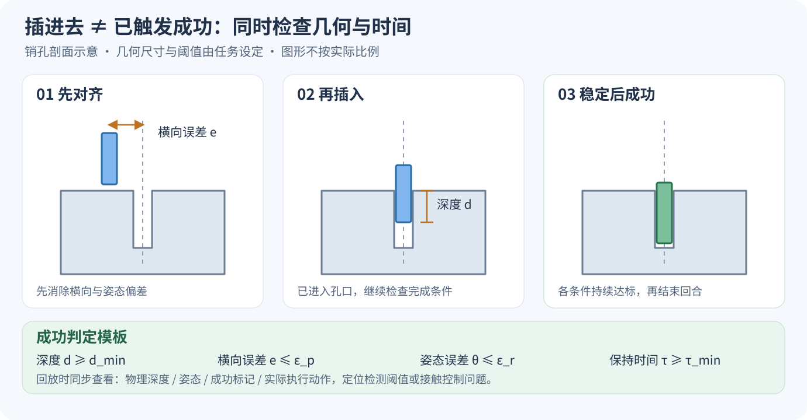

# HIL-SERL：人机协同强化学习与 MuJoCo 插孔入门

**少量示范负责提供起点，在线强化学习负责继续改进，人类在策略卡住时接管并示范恢复动作。** 本章解释 HIL-SERL 如何把纠偏数据用于策略更新，并通过官方 MuJoCo 仿真学习采集、训练及插孔任务移植。适合已经接触过 MuJoCo、Gymnasium 和 SAC，希望从模仿学习进入在线机器人强化学习的读者。

## 1. 学习目标：从完整示范走向在线纠偏

插孔需要策略在接触过程中持续调整：先对齐销与孔，再沿插入方向推进，遇到偏差时能够退回并重新对齐。少量成功示范能提供基本路径；在线交互则会暴露偏离路径后的状态，人类接管可以补充这些状态下的恢复动作。

本章围绕以下学习过程展开：

| 阶段 | 读者完成的工作 | 关注点 |
| --- | --- | --- |
| 环境交互 | 在官方 Panda 抓块环境检查图像、状态与遥操作 | 动作是否按预期执行 |
| 示范采集 | 记录完整成功轨迹 | 数据与相机、动作维度是否对应 |
| 在线训练 | 启动 actor/learner，并在需要时接管 | 实际执行的人类动作是否进入回放 |
| 插孔移植 | 配置接触场景、位置变化和成功判定 | 插入深度、姿态与终止标记是否一致 |
| 自主评估 | 固定策略并关闭人工干预 | 成功率、完成时间与恢复能力 |

完成本章后，应能沿着“示范采集 → 在线尝试 → 人类纠偏 → 自主评估”的流程开展练习。章节提供方法说明与官方实践入口，实验结果由读者运行后记录。

## 2. HIL-SERL 的关键：干预动作怎样进入学习

HIL-SERL 对应 Berkeley 的论文 *Precise and Dexterous Robotic Manipulation via Human-in-the-Loop Reinforcement Learning*。它把人类纠偏接入基于 RLPD 的在线学习过程：策略自主探索时积累经验，人类接管时提供当前状态下更有用的动作。[论文 §3](https://arxiv.org/html/2410.21845v1#S3)


图 1：左侧 actor 与环境交互并接收人类纠偏；右侧 learner 混合示范与在线数据更新策略。来源：Jianlan Luo、Charles Xu、Jeffrey Wu、Sergey Levine，[HIL-SERL 论文 v1 图 2](https://arxiv.org/html/2410.21845v1#S3.F2)，原图保留，[CC BY 4.0](https://creativecommons.org/licenses/by/4.0/)。

### 2.1 两个缓冲区，以及实际执行动作

原版实现使用两个回放缓冲区。`demo buffer` 保存初始示范及在线干预数据，`RL buffer` 保存在线交互，包括自主动作和干预动作；学习器从两者各取半个 batch。人工接管时，写入 transition 的动作必须是**真正作用于环境的人类动作**。

可以对照下面这段教学伪代码理解数据流；它省略了通信、批处理和控制细节，不是上游接口：

```python
proposed = policy(observation)
executed = human_action if takeover else proposed
next_observation, reward, terminated, truncated, info = env.step(executed)
transition = (observation, executed, reward, next_observation,
              terminated, truncated)
rl_buffer.add(transition)
if takeover:
    demo_buffer.add(transition)
batch = mix(demo_buffer.sample(batch_size // 2),
            rl_buffer.sample(batch_size // 2))
learner.update(batch)
```

Berkeley 的 [`examples/train_rlpd.py`](https://github.com/rail-berkeley/hil-serl/blob/main/examples/train_rlpd.py)中，actor 从环境返回的 `intervene_action` 取出实际动作，干预 transition 同时送往两类数据存储；learner 再进行 50/50 采样。这里的人类信号直接改变了训练数据中的动作及状态转移，而非只在界面上临时接管。[原版训练代码](https://github.com/rail-berkeley/hil-serl/blob/main/examples/train_rlpd.py)

### 2.2 奖励、动作空间与控制器

原论文通过成功/失败样本训练二分类奖励模型，完成任务时产生稀疏正奖励；连续末端运动与离散夹爪决策分别处理，夹爪使用额外的 DQN critic。接触操作还依赖底层阻抗控制与参考限幅，状态和动作的相对坐标表示则服务于位置变化下的控制。[论文 §3.3–3.5](https://arxiv.org/html/2410.21845v1#S3.S3)

这些设计给插孔练习带来三个具体问题：相机和机器人状态能否区分“接近孔口”和“已经插入”？成功奖励是否与插入深度一致？策略的小步末端动作能否在接触后继续稳定执行？移植时应根据自己的环境逐项明确奖励和控制器配置。

### 2.3 Actor 与 learner 分开运行

Actor 与仿真交互并接收人工干预；learner 消费回放数据、更新网络，再向 actor 发送参数。两者异步通信，环境采样与梯度更新可以各自推进。[Berkeley 代码结构](https://github.com/rail-berkeley/hil-serl#overview-and-code-structure)

```text
初始示范 ──────────────→ demo buffer ─┐
                                    ├→ learner → 新参数 → actor
actor → MuJoCo → 在线交互 → RL buffer ┘                 │
                   └─ 人类干预数据 → demo buffer        │
                         ↑                              │
                         └──── 人类接管 / 自主执行 ←────┘
```

## 3. 实践入口：先跑官方 MuJoCo 抓块，再改插孔

| 路线 | 用途 | 上游入口 |
| --- | --- | --- |
| Berkeley HIL-SERL | 学习原版 JAX、RLPD、奖励分类器及 Franka 真机流程 | [代码与安装](https://github.com/rail-berkeley/hil-serl) |
| LeRobot + gym-hil | 使用 PyTorch 与 MuJoCo 学习示范采集、干预和 actor/learner 流程 | [官方仿真指南](https://huggingface.co/docs/lerobot/hilserl_sim) |

本章推荐从 **LeRobot + gym-hil 的 Panda 抓块环境**入门。它已有基础、手柄与键盘环境，可以先验证交互链路，再接入接触更敏感的插孔任务；官方默认任务是抓块，插孔需要另外实现。[gym-hil 环境说明](https://github.com/huggingface/gym-hil)

### 3.1 安装与版本

在与已跑通实验分开的学习环境中操作。先按 [LeRobot 安装文档](https://huggingface.co/docs/lerobot/installation)准备对应版本的 Python 与 PyTorch，再在 LeRobot 源码目录安装 HIL-SERL 扩展：

```bash
python -m pip install -e ".[hilserl]"
git rev-parse HEAD
python -m pip show lerobot gym-hil torch mujoco
```

把版本输出保存到自己的实验记录。下载依赖、数据和权重时使用所在机器既定的下载入口；训练和评估单独启动。

**不要混用两套安装环境。** Berkeley README 使用 Python 3.10 和 JAX；本章核对时 LeRobot `main` 的 `pyproject.toml` 要求 Python ≥3.12。gym-hil README 中的 Python 3.10 示例是独立环境说明，不能直接代替新版 LeRobot 的要求。[Berkeley 安装](https://github.com/rail-berkeley/hil-serl#installation)、[LeRobot 依赖定义](https://github.com/huggingface/lerobot/blob/main/pyproject.toml)

### 3.2 先检查环境，再采集示范

按 [gym-hil Quick Start](https://github.com/huggingface/gym-hil#franka-environment-quick-start)检查 Panda 场景、前视/腕部图像和末端控制。示例里的随机动作只用于检查环境响应。需要键盘或手柄遥操作时，使用其 `PandaPickCubeKeyboard-v0` 或 `PandaPickCubeGamepad-v0` 环境。

接着按照 [LeRobot 仿真指南](https://huggingface.co/docs/lerobot/hilserl_sim)配置并执行以下流程。下列路径代表读者自行保存、并与所用 LeRobot 版本匹配的配置：

```bash
# mode=null：检查环境；mode="record"：采集示范。
python -m lerobot.rl.gym_manipulator --config_path path/to/env_config.json

# 终端 A：先启动 learner。
python -m lerobot.rl.learner --config_path path/to/train_config.json

# 终端 B：再启动 actor，使用同一份训练配置。
python -m lerobot.rl.actor --config_path path/to/train_config.json
```

仿真文档链接了[环境配置示例](https://huggingface.co/datasets/lerobot/config_examples/blob/main/rl/gym_hil/env_config.json)和[训练配置示例](https://huggingface.co/datasets/lerobot/config_examples/blob/main/rl/gym_hil/train_config.json)。运行前先核对数据集路径、相机键、状态/动作维度和 checkpoint 保存频率：环境示例默认开启 `push_to_hub`，本地练习应改为 `false`；训练示例包含作者的数据集 ID，应替换为自己的数据。示例也有 `wandb.enable` 开关，本地练习可关闭。

这些示例与源码可能独立更新，字段以所固定代码版本的配置类为准。启动顺序采用 [actor 源码说明](https://github.com/huggingface/lerobot/blob/main/src/lerobot/rl/actor.py)：learner 就绪后，actor 再连接。

### 3.3 把纠偏录成可学习的数据

先录若干完整成功示范，再开始在线尝试。人类接管时，重点演示“怎样从当前偏差恢复并完成任务”，随后交还策略。按当前环境的遥操作映射测试接管与释放，并核对日志里实际执行动作及干预标记。不同实现的字段名并不统一：Berkeley 使用 `intervene_action`，gym-hil README 描述了 `is_intervention` 和 `teleop_action`。[gym-hil 数据说明](https://github.com/huggingface/gym-hil#franka-environment-quick-start)

## 4. 从抓块扩展到插孔，要改哪些接口

下面是本教程建议的移植方案，任务参数由读者自己的插孔场景确定。

| 接口 | 插孔练习需要明确的内容 |
| --- | --- |
| 场景与接触 | 销、孔、碰撞几何、间隙、摩擦及夹持方式；先用遥操作确认确实能够插入 |
| Reset | 固定位置跑通后再增加位置变化；记录变化的是销、孔座还是二者，以及采样形状和坐标系 |
| 观测与动作 | 前视/腕部图像、末端位姿与夹爪状态；末端平移/旋转增量、单位、坐标系和限幅 |
| 奖励与终止 | 区分插入深度、横向误差、姿态误差和稳定保持时间；时间耗尽通过 `truncated` 表达 |
| 干预数据 | 将实际执行的人类动作与下一观测配对，并保存接管标记；确认这些数据进入学习器 |
| 自主评估 | 固定 checkpoint，关闭人工干预，记录成功回合数、总回合数和完成时间 |



图 2：本教程绘制的几何示意。对齐、插入与成功是不同状态；绿色条件是任务设计模板，各阈值需按销孔尺寸和控制精度设定。

奖励可先采用仿真状态判定，把插入深度和接触过程调清楚；之后再换成图像成功分类器，检查视觉奖励与物理状态是否一致。这是本章建议的分阶段练习。

**位置变化要写成明确的 reset 规则。** 例如，半径 0.02 m 的圆盘，与 x/y 分别在 ±0.02 m 内均匀采样的方形，覆盖范围不同。练习报告应记录采样形状、坐标系，以及变化的是销还是孔座；这里的数值是任务配置示例。

出现“看起来已经插入，末端还在摆动”时，先同时回放物理深度、成功标记和动作幅度。若插入确实完成但成功标记迟迟不触发，就定位几何阈值或奖励检测；若深度和姿态持续变化，再检查动作尺度与接触控制。同步记录这些量，可以区分成功检测与接触控制的问题。

## 5. 建议记录的结果

| 记录项 | 目的 |
| --- | --- |
| 示范条数、环境步数、梯度更新次数 | 明确数据量以及 `step` 的计数对象 |
| 总训练时长、人工接管时长与比例 | 分别衡量计算/交互耗时与人的投入 |
| 自主成功数 / 总评估回合数、完成时间 | 衡量交还控制后策略的表现 |
| Reset 分布、成功阈值、随机种子 | 解释位置变化下的结果 |
| 同步图像、动作、奖励和终止标记 | 复盘卡住、恢复和完成的过程 |

可以先完成固定位置抓块，再做固定位置插孔，最后加入位置变化。每一步都保存一段包含失败、人工纠偏及后续自主尝试的连续记录，便于理解策略实际学到了什么。

## 6. 延伸阅读

- [HIL-SERL 官方项目页](https://hil-serl.github.io/)与[论文 v1](https://arxiv.org/html/2410.21845v1)：理解原版方法和真实机器人任务。
- [Berkeley HIL-SERL 源码](https://github.com/rail-berkeley/hil-serl)：跟读 `examples/train_rlpd.py` 中的干预动作、双缓冲区与参数同步。
- [LeRobot 真机流程](https://huggingface.co/docs/lerobot/hilserl)：继续学习示范采集、奖励分类器和在线干预。
- [本教程 MuJoCo 机械臂与 ACT / Pi0 / SmolVLA 实践](../../06-策略抓取或抓取VLA/大模型控制、VLA、VLM/04mujoco复现ACT、Pi0、SmolVLA/README.md)：衔接已有的模仿学习路线。
- [Robots That Know What to Ask 奖励对齐导读](../04-Robots-That-Know-What-to-Ask奖励对齐导读/README.md)：继续理解人类纠正与奖励定义之间的关系。
