# Gemini 4 Argon 机器人案例：从提示词到可验证的执行闭环

> 来源：[Google Developers Blog，Gemini 4 Argon for Robotics](https://developers.googleblog.com/gemini-4-argon-for-robotics/)，Kanishka Rao，2026-10-13。本文为中文整理与教学分析，案例表现和数字均为原文报告，并非本教程实测。文中视频和图片来自原文，已获得收录授权。

Google 将 Argon 描述为用于物理推理和代码生成的通用模型，展示机器人控制、Real2Sim、物理理解与自我改进四类应用。其示例的共同结构是：**给模型提供任务与可观测状态，限定工具和动作，再用实际或仿真反馈检查结果并更新下一步**。模型能力以外，相机、标定、动作接口、仿真器和验证方式共同决定了实验能否运行。

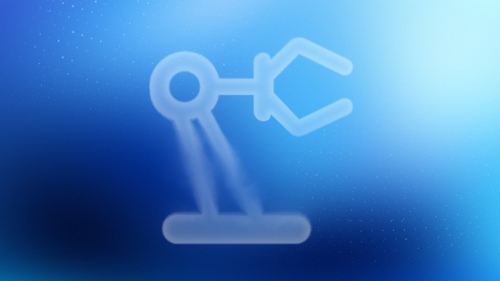

*图片来源：Google Developers Blog；经授权收录。*

原文 Prompt 完整保留在每个案例末尾，可直接复制；上方中文段落解释任务与关键约束。Prompt 中的文件、工具、接口和硬件是 Google 演示使用的上下文，使用其他系统时需要按实际接口适配。每段动态画面是原视频前 6 秒预览，完整视频可通过下方链接查看。

## 1. 机器人控制

### 1.1 Spot 移动操作：先仿真，再踩踏板

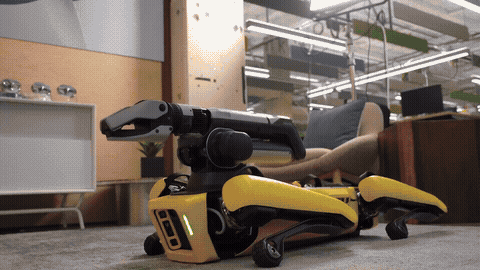

*图 2 Google 原始演示的前 6 秒预览。*

[观看完整视频](./assets/Spot-can-long-voiceover-preview.mp4)

任务是让 Spot 寻找饮料罐、踩开脚踏垃圾桶并投放。原文描述系统先构建带关节的 MuJoCo 垃圾桶模型，在仿真中练习；执行前检查前右脚是否对准踏板，并分别验证踩踏和机械手在桶内的位置。

**上下文要点**：区分移动底盘、机械臂和脚踏板的状态；提供前视和腕部视角；在释放物体前设置明确的视觉检查。双重验证是系统流程中的设计，不代表两个验证器天然独立可靠。

**原文 Prompt（英文，保留原始接口与参数）**

```text
There's a Diet Coke can behind you and another on the black table on your left.
Use the spot-mobile-manipulation skill to pick them up and trash them in the black foot-pedal bin.
Before stepping down on the pedal, verify in the front cameras that your front-right foot target is centered on the pedal, and use a 2-agent verification swarm (foot-verifier and hand-verifier) to verify both the foot-pedal step and the 3D hand-in-bin alignment before releasing.
```

### 1.2 零样本机械臂：图像标尺与动作原语

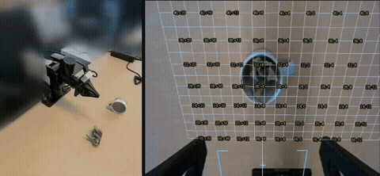

*图 3 Google 原始演示的前 6 秒预览。*

[观看完整视频](./assets/yam_control.mp4)

任务是扶正倒下的杯子，再把纸巾放入杯中。模型接收腕部相机图像和状态文件：图上叠加世界坐标网格、夹爪中心、开合方向与物体朝向；状态包含末端位置、是否持物、执行状态和工作空间。

可用动作包括观察、像素反投影、抓取、放置、移动和接触停止。原文要求每轮执行后观察更新后的图像，抓取失败时重新观察。它还提供粗粒度、抓取前悬停检查和细粒度视觉伺服三种调用频率。

**上下文要点**：标注必须解释坐标轴、单位、高度平面和夹爪朝向；状态必须是最新的；动作返回值和图像共同决定下一轮。原文接口与参数属于该演示环境，不能直接当成通用机器人 API。

**原文 Prompt（英文，保留原始接口与参数）**

```text
[Attached: wrist_cam.png, obs.json]

Task: Get the robot arm to reorient the mug upright and put the napkin inside the mug.

## Execution Discipline
- Simply output 1 sentence observation followed immediately by your `curl` command (with `# Plan:` on Turn 1 and `# Thought:` on every turn). Everything needed is in `obs.json` and the calibrated reticle/grid drawn on `wrist_cam.png`.

## Visual Coordinate Reference (Annotated on wrist_cam.png)
- `+X` (UP in image): Away from robot base | `-X` (DOWN): Towards robot base
- `+Y` (LEFT in image): World left         | `-Y` (RIGHT): World right
- `+Z`: Height above table                | `Yellow numbers`: World (X, Y) in centimetres (2 cm grid at `grid_z`)
- `Cyan + crosshair`: Current 3D pinch center
- `Cyan [ + ] brackets`: Current jaw opening and closing line
- `Green line`: Current object long-axis orientation (`yaw_deg`: 0° = vertical along +X, 90° = horizontal along +Y)
- `pitch_deg = 90°`: Straight down (-Z) top-down grasp/place; `pitch_deg < 60°`: Tilted coaxial approach along finger axis

## Closed-Loop Turn Workflow
1. Inspect current state & view `wrist_cam.png`:
   `curl -s http://127.0.0.1:8081/obs` (returns `ee_pos`, `holding`, `status`, `workspace`, `wrist_cam_path`).
2. Select VLM call granularity upfront on Turn 1:
   - Coarse (2–4 calls): `look_at` -> `grasp` -> `place` -> `done`
   - Pre-Grasp Hover Verify (4–7 calls): `look_at` -> `goto(z=0.04)` (verify cyan `[ + ]` brackets straddle target) -> `grasp` -> `place_until_contact` -> `done`
   - Fine Visual Servoing (8–20 calls): `look_at` -> `grasp` -> pre-pose `goto` -> closed-loop `move_by` / `move_until_contact` -> `done`
3. Send motion primitives (`POST /plan`) and verify visually after every turn in the updated `wrist_cam.png`. If `status == "grasp_failed"`, call `robot.look_at(...)` to re-observe and recover closed-loop.

## Code-as-Policies Primitives (`POST http://127.0.0.1:8081/plan`)
robot.look_at(x=0.35, y=0.13, z=0.14, grid_z=0.015)
x, y = robot.deproject(u=0.52, v=0.48, z_plane=0.015)
robot.grasp(x=x, y=y, z=0.015, yaw_deg=-35, pitch_deg=90)
robot.place(x=0.24, y=0.06, z=0.075)
robot.place_until_contact(x=0.24, y=0.06, z=0.015, max_lag=0.012, relief=0.002)
robot.goto(x=0.28, y=0.05, z=0.04, arc_z=0.14, pitch_deg=25, azimuth_deg=90, roll_deg=0, speed=0.10)
robot.move_by(forward=0.025, dz=-0.002, dpitch_deg=-3, droll_deg=5, speed=0.04)
robot.move_until_contact(dz=-0.06, speed=0.03, max_lag=0.012, relief=0.002)
robot.open_gripper() / robot.close_gripper() / robot.home() / robot.done()
```

### 1.3 视频世界模型的闭环引导

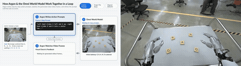

*图 4 Google 原始演示的前 6 秒预览。*

[观看完整视频](./assets/omni_control_final_2.mp4)

模型根据中间生成帧，逐轮编写带时间戳的动作描述，让视频中的双手排列字母。原文要求一次描述一个简单方向的动作、让不活动的手避开视线，并说明物体移走后哪些区域变空。

这里的动作指令控制的是**视频世界模型的生成**；中间帧用于下一轮修订，不能直接视为真机完成了相同任务。

**原文 Prompt（英文，保留原始接口与参数）**

```text
Goal: {task_goal}

You are steering a video world model (Gemini Omni) in an iterative visual feedback loop. Inspect the attached frames from the latest rollout and write the next timestamped action prompt for the video world model:
- Break complex motions into one simple, single-direction action at a time.
- Keep inactive hands retracted and avoid blocking the camera's view of objects in the workspace.
- Explicitly state which areas of the workspace become empty after an object moves.
- Use [MM:SS.mmm] timestamps for each action beat and wrap your output in <omni_prompt> tags.

Example format (sample timestamps only, not the full prompt):
<omni_prompt>
[00:00.000] Character A's left hand rests at the side while the right hand reaches toward the target object.
[00:02.500] Character A's right fingertips push the object smoothly into the center of the table, leaving its starting area empty.
[00:05.000] Character A's right hand opens and retracts to the side so all placed objects remain in clear view of the camera.
</omni_prompt>
```

## 2. Real2Sim：把真实观察转为可检验的仿真

### 2.1 机器人视角重建

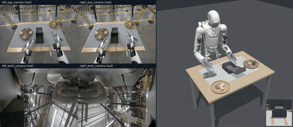

*图 5 Google 原始演示的前 6 秒预览。*

[观看完整视频](./assets/real2sim_final.mp4)

输入为真实遥操作轨迹和同步相机、触觉数据。目标是构建 MuJoCo 场景，逐帧回放并对照多相机图像和指尖接触力的时间、大小、方向。可调整物体几何、质量、摩擦和初始位置，以及原文指定范围内的局部控制命令。原文禁止通过外力、瞬移物体或复制真实触觉值伪造接触。

**上下文要点**：同时定义视觉匹配、物理匹配、允许调整的变量和禁止的捷径；只看画面相似不足以证明接触动力学一致。

**原文 Prompt（英文，保留原始接口与参数）**

```text
[Attached: robot_rollout_episode]

Build a MuJoCo scene of the robot and reconstructed task objects. When each episode is replayed frame by frame, by driving the robot joints toward the logged observation.state with joint-space PD.

Iterate using two verification objectives:
(1) Visual match: MuJoCo renders from the head_left, left_wrist, and right_wrist cameras line up with, and look like, those real observations.
(2) Physical match: the simulated contact force/torque on each Sharpa fingertip, in the sensor frame, matches the logged tactile_force in timing, magnitude and direction.

What you can tune happens before simulation starts:
(1) Static object assets: realistic geometry, collision shapes, mass, inertia, friction and joints, with appearance close to the real objects, plus the initial object poses at t = 0.
(2) Offline-planned robot commands, changed only in frames where the real fingertips are near an object. Each command must stay within 0.55 rad (arm joints) and 0.65 rad (hand joints) of the logged teleop trajectory. Everywhere else, replay the logged trajectory unchanged.

No sim cheating: task objects may move only through real MuJoCo contact with the robot hands and the environment (mj_step).
Not allowed after t = 0: changing MjModel parameters; applying external forces or torques to objects; welds or equality constraints; feedforward torques beyond joint-space PD; setting or rolling back object qpos/qvel; disabling or excluding collisions; reporting contact forces that don't come from the MuJoCo solver (for example, copying the logged tactile readings).

Immediately present the reconstructed scene and rollout results as an interactive HTML session viewer with one page per episode, showing:
- At the bottom: A synced timeline (play, scrub, speed control) that drives every panel.
- On the left panel: An interactive 3D Blender scene showing the simulated robot and objects, showing contact points and force arrows as replay progresses.
- On the right panel: Real vs. sim camera views side by side for all 3 cameras. Real vs. sim finger force visualizations.
```

### 2.2 第一人称人类视频到仿真

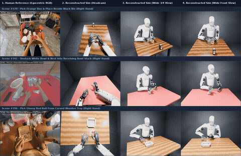

*图 6 Google 原始演示的前 6 秒预览。*

[观看完整视频](./assets/human_real2sim_2.mp4)

输入第一人称操作视频、候选视角和手部三维关键点。原文要求识别任务相关物体、处理容器的凹形碰撞几何，将人手轨迹重定向到双臂灵巧手，并在 500 Hz 仿真中检查夹持、抬升和最终放置。

**上下文要点**：图像、相机参数、关键点和机器人关节定义是不同的信息源；“看起来抓住”与物理接触稳定是不同的验证目标。

**原文 Prompt（英文，保留原始接口与参数）**

```text
[Attached: egocentric_human_video.mp4, candidate_sim_views.png, hand_3d_keypoints.json]

You are building a physically solvable 500 Hz MuJoCo manipulation environment (`scene.xml`) and studio Blender render that faithfully reproduces the tabletop task shown in `egocentric_human_video.mp4` on a bimanual humanoid robot with 22-DoF dexterous five-fingered hands:

1. Scene Reconstruction & Camera Calibration:
   - Identify only the manipulation-relevant objects (the grasped target object and the receiving container or landmark) and triangulate their 3D tabletop coordinates from the egocentric camera intrinsics/extrinsics.
   - Replace crude bounding boxes with compound convex-decomposed 3D meshes so concave containers (nested bowls, recessed wooden trays, open bins) support physical interior placement.

2. 500 Hz Dexterous Motion-Fitting Stress Test:
   - Retarget the 3D human wrist and finger keypoints to the humanoid's 7-DoF arm and 22-DoF hand joints, and step the trajectory in MuJoCo at 500 Hz (dt = 0.002s) with zero kinematic weld constraints.
   - Verify opposing thumb-and-finger force closure, clean object lift (> 2 cm), and stable final placement inside or beside the target landmark.
```

### 2.3 草图到仿真

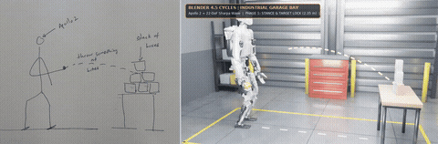

*图 7 Google 原始演示的前 6 秒预览。*

[观看完整视频](./assets/sketch_to_sim_final.mp4)

输入一张人形机器人投球击倒箱子的手绘草图；示例要求构造场景、生成全身投掷轨迹，并在物理仿真中检查平衡和目标倒下情况。草图提供的是任务意图和相对布局，机器人尺寸、动力学参数、控制频率和成功判据还需另行指定。

**原文 Prompt（英文，保留原始接口与参数）**

```text
[Attached: hand_drawn_throw_sketch.jpg]

Translate this hand-drawn sketch into a physically verified humanoid simulation in `mujoco_warp` and a raytraced Blender Cycles video:

1. Scene & Kinematic Setup from Sketch:
   - Parse the spatial layout from `hand_drawn_throw_sketch.jpg`: place the 76-DoF humanoid (32-DoF body equipped with two 22-DoF five-finger dexterous hands) at the origin facing a table holding a 3-2-1 pyramid of 6 rigid target boxes, with a projectile sphere grasped in the right five-finger hand.

2. Whole-Body Balance & Dexterous Throw Synthesis:
   - Synthesize a 50 Hz whole-body throwing trajectory (140 steps, 2.80 s) across four phases: (1) stable stance & 5-finger power grasp closure, (2) torso/shoulder wind-up with ankle-hip Center-of-Mass compensation, (3) forward whipping acceleration, and (4) synchronized 22-DoF five-finger opening at peak hand velocity so the ball launches on a ballistic arc into the pyramid's second-tier center of mass.
   - Verify in `mujoco_warp` contact physics that the humanoid maintains upright balance (< 3 cm pelvis drift) and knocks down all 6 target boxes.
```

## 3. 物理理解：从轨迹中提取可用信息

### 3.1 事后标注与质量判断

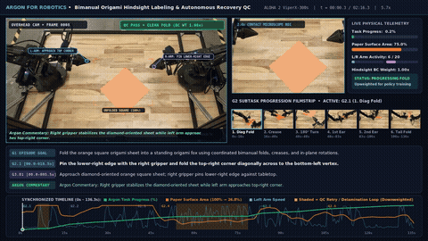

*图 8 Google 原始演示的前 6 秒预览。*

[观看完整视频](./assets/aloha2_origami_hindsight_1.mp4)

针对双臂折纸视频，原文按任务目标、连续子任务、接触级动作和质量控制四层生成带时间的标注；对滑动、重试等没有推进任务的片段，保持进度不变并降低行为克隆样本权重。标注可用于构造数据，但需要核验边界、接触事件与权重是否合理。

**原文 Prompt（英文，保留原始接口与参数）**

```text
[Attached: Aloha2_Origami_20250309.mp4]

Produce a time-aligned multi-granularity hindsight annotation JSON with four levels:
1. G1_episode_instruction: Concise imperative sentence describing the overall manipulation goal.
2. G2_subtasks: Contiguous semantic subtask phases specifying which arm(s) anchor vs. fold/rotate the object.
3. G3_atomic_primitives: Fine-grained contact-level primitives (3–15s) aligned with grasp closure, crease sweeps, release, or retry attempts.
4. quality_control_and_reweighting: Hold task_progress_pct flat during non-progressing slip/delamination retry loops and downweight them (0.15x–0.25x) for Behavior Cloning.
```

### 3.2 天平找异球

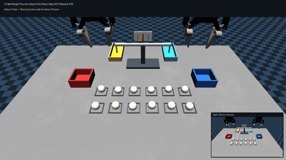

*图 9 Google 原始演示的前 6 秒预览。*

[观看完整视频](./assets/weight_puzzle_2.mp4)

示例构建双臂机械臂和十二个外观相同的球，通过双目图像定位并读取天平倾斜，在三次称量内识别偏重或偏轻的球。上下文需要维护每次称量的候选集合与结果；原文将环境构建与只使用视觉和机器人本体状态的求解器分开，避免读取隐藏答案。

**原文 Prompt（英文，保留原始接口与参数）**

```text
# Prompt 1 — Physics-Accurate MuJoCo Environment & Benchmark Generation
Make a MuJoCo environment where a dual-arm robot (two 7-DoF Franka FR3 arms with parallel-jaw grippers on a shared tabletop) is tasked to solve the classic 12-ball balance scale weight puzzle from https://www.mathsisfun.com/pool_balls_solution.html.
1. Create 12 visually indistinguishable pool balls in a 2x6 starting rack (11 standard 150 g, 1 odd ball either 270 g or 30 g).
2. Build a functional two-pan Roberval balance scale at the center of the table with parallelogram equality constraints (`mjEQ_JOINT`) so the Left (Gold) and Right (Teal) pans stay horizontal, plus Red (Heavy) and Blue (Light) submission trays.
3. Track distinct settled weighings (`weighing_count`) and reward `1.00` for isolating the true odd ball in the correct Heavy/Light tray within <= 3 weighings.

# Prompt 2 — Closed-Loop Vision-Only Solver
Implement an independent closed-loop policy relying strictly on stereo RGB camera inputs (`head_camera_left_rgb_image`, `head_camera_right_rgb_image`) and robot proprioception (`add_privileged_task_observations=False`):
1. Segment the 12 balls, Gold/Teal pans, and Red/Blue trays in both stereo views and triangulate their 3D coordinates.
2. Visually read the balance scale tilt after each weighing from stereo vertical pixel disparity (+1 = left heavier, -1 = right heavier, 0 = balanced).
3. Rotate the gripper wrist yaw by 90 degrees when grasping/placing inside the narrow scale pans to clear the raised rims, and isolate the odd ball into the Red or Blue tray within <= 3 weighings.
```

### 3.3 任务进度与价值估计

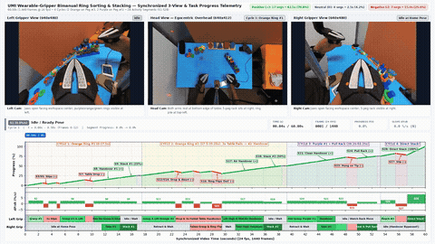

*图 10 Google 原始演示的前 6 秒预览。*

[观看完整视频](./assets/umi_progress_labeling_final_1.mp4)

模型查看头部与左右夹爪的同步视频，标记接触变化、任务片段与进度上升、停滞或下降。进度曲线是从视频推断的估计，需要与标注规则和实际任务结果对照，不能仅凭曲线证明模型已经学到可迁移的价值函数。

**原文 Prompt（英文，保留原始接口与参数）**

```text
[Attached: umi_head.mp4, umi_left_gripper.mp4, umi_right_gripper.mp4]

Look at 3 videos of human wearing a gripper performing activities from head, left, right gripper views. Look at the videos thoroughly and give a detailed plot of progress at the task (with positive, neutral, negative slope), identifying important segments in the video and labeling the activities. Look at individual frames or subsegments of the video if necessary to get a better understanding.
```

## 4. 研究与自我改进

### 4.1 仿真数据改善 VLA

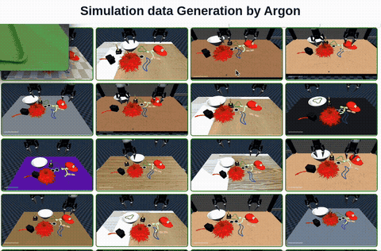

*图 11 Google 原始演示的前 6 秒预览。*

[观看完整视频](./assets/action_improvement_final.mp4)

原文描述从真实桌面照片构建仿真场景，设计任务和随机化数据，生成 4,500 多条轨迹用于 VLA 微调。Google 在所述实验中报告真机成功率从 **56% 提升至 75%**，完成时间从 **35 秒降至 24 秒**。这是该案例的报告值；文章未给出足以在此完整复现实验的全部训练和评测细节。

**原文 Prompt（英文，保留原始接口与参数）**

```text
[Attached: real_tabletop_photo.jpg]

You are given a single overhead RGB camera photo (`real_tabletop_photo.jpg`) of a bimanual robot workspace (two 7-DoF Franka FR3 arms with parallel-jaw grippers and 4 RGB cameras) facing a table arranged with photobooth party props.
1. Reconstruct procedural 3D meshes and compound MuJoCo collision primitives for all 9 party props matching their real-world dimensions, colors, and resting poses, including spring-hinged deformable crown panels for the soft plush cap.
2. Define a 77-task single-arm and bimanual curriculum (pick-and-place, uprighting, directional pushing, mid-air handovers, bimanual scoop-and-push, and pipelined table clearing).
3. Synthesize a closed-loop IK trajectory generator across ±10 cm pose randomization, verify `reward == 1.0` in MuJoCo physics, and export 4,500+ episodes for VLA fine-tuning.
```

### 4.2 真机抓取的多轮改进

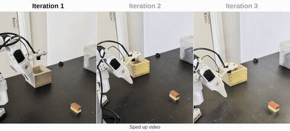

*图 12 Google 原始演示的前 6 秒预览。*

[观看完整视频](./assets/so101_final.mp4)

示例先定位物体并生成不移动硬件的试运行计划，再悬停观察，最后执行抓放并利用日志和视频诊断失败、调整和重试。原文展示三轮分别为 58.9、22.9、17.4 秒，第二轮触碰箱沿。这里体现的是任务执行和参数的迭代改进；它本身不说明系统已实现递归自我改进（RSI）。

**原文 Prompt（英文，保留原始接口与参数）**

```text
# Stage 1 — Measure Objects & Dry-Run Plan (No Hardware Motion)
Stage 1: measure objects — find the objects and plan the whole motion. The arm does not move in this stage.

A. I put a LEGO brick and a box on the table in front of the arm, and the wooden box to one side. Find the brick and the wooden box in the image. And also in the real world. Show this in an annotated image.

B. A dry-run plan (no hardware). Write the planner to pick and place the lego block. Print the plan table, draw all poses onto the overhead image, and stop. Do not move the robot.
Report with evidence.

# Stage 2 — Pre-Pick Hover & Wrist-Camera Verification
Stage 2: Put the gripper above the brick without touching it, and verify with the wrist camera that the arm and the vision agree. Please record executions with both cameras (compressed video is OK).

# Stage 3 (Autonomous Pick-and-Place → Self-Improvement → Optimization):
1. Execute autonomously: Turn the Stage 1 dry run into a real grasp, lift, and place into the wooden box. Run it yourself subject to safety rules from AGENTS.md.

2. Self-improve: When an attempt fails, diagnose it yourself. Review your own logs and wrist/overhead footage, find the root cause, check the fix in a dry run, and retry.

3. Optimize on feedback: Once it succeeds, make it at least 2× faster within safety limits (rule R5) unless I authorize more, or give feedback.
```

### 4.3 机器人论文的浏览器复现

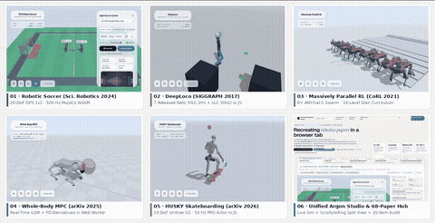

*图 13 Google 原始演示的前 6 秒预览。*

[观看完整视频](./assets/recreating_robotics_papers_1.mp4)

输入论文和可选权重或机器人资产，要求构建 MuJoCo WebAssembly 环境、运行控制器并做浏览器检查。原文展示了多篇运动控制工作。无报错和非零进度只能验证示例基本运行；是否复现论文结论仍需对齐模型、控制频率、任务协议及指标。

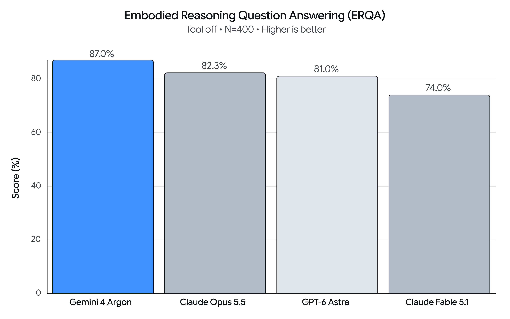

*Google 原文中的 ERQA 测试图；测试结果与条件以原文为准。*

**原文 Prompt（英文，保留原始接口与参数）**

```text
[Attached: paper.pdf, optional author_checkpoints/ or urdf_assets/]

Reproduce the paper "<Paper Title & arXiv ID>" from scratch in MuJoCo WebAssembly and deploy a self-contained browser lab + visual essay:
1. Match the paper's exact physics timestep, actuator gains (kp/kv), torque limits, and kinematic constraints in MuJoCo XML, and run real neural inference or Web Worker iLQR in JavaScript at the paper's exact control rates.
2. Build `index.html` (Spatial UI simulator with camera presets, live telemetry plots, and disturbance injection) and `scrollytelling.html` (interactive visual essay).
3. Run a headless Chromium (Playwright) verification loop asserting 0 console errors and non-zero task progress over 300+ frames.
```

## 5. 从案例提炼的设计方法

| 模块 | 需要提供或记录 | 例子 |
| --- | --- | --- |
| 目标与阶段 | 最终目标、当前子任务、完成判据 | 杯子扶正后再放入纸巾 |
| 实时观测 | 相机、状态、时间戳、失效标记 | 腕部画面、末端位置、夹爪状态 |
| 空间约定 | 坐标系、单位、标定和误差 | 世界坐标网格、像素反投影 |
| 工具与限制 | 允许调用的动作、参数范围、停止条件 | 抓取、移动、接触后停止 |
| 验证与记忆 | 执行结果、历史尝试、失败原因 | 每轮图像验证，失败后重新观察 |
| 数据与评价 | 数据来源、切分、指标和资源 | 同一任务设置下比较成功率与耗时 |

这些案例表明，上下文不限于一段自然语言提示：可视化标尺、结构化状态、历史记录、工具返回和任务判据都是决策输入。下一步可使用[实践模板](./02-机器人上下文设计与实践模板.md)为自己的系统填写信息。

## 原文观看入口与引用

[原文页面及 12 个演示视频、图表](https://developers.googleblog.com/gemini-4-argon-for-robotics/)。原文还报告 ERQA 得分 87%；这一数字是 Google 对其所述测试设置的报告，不能直接推出任意真机任务的成功率。
