# RoboAPI：云端动作模型与 RoboLab 仿真实践

本节从一次云端模型调用出发，讲清如何把任务指令、腕部图像和机器人状态接入 Poke-Aurora，再在 RoboLab 中运行包含干扰物的桌面操作任务，记录动作、视频、延迟和调用额度。

<p align="center"><a href="./assets/local-mugs-dual.mp4">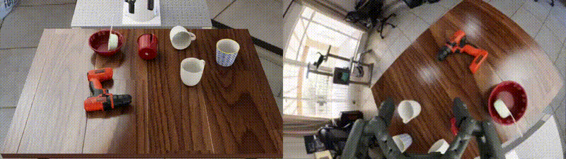</a></p>
<p align="center"><strong>本机白杯扶正成功</strong> · 24 次推理 · 单次请求往返中位数 0.92 秒 · 点击播放双视角视频</p>


| 资料 | 用途 |
| :--- | :--- |
| [破壳机器人官方介绍](https://pokebot.com/zh-cn/ai) | 模型设计、示例和使用范围 |
| [RoboAPI 中文开发文档](https://developers.pokebot.com/zh/docs/roboapi/latest) | 注册、观测格式、连续任务与硬件接入 |
| [第一次云端调用](https://developers.pokebot.com/zh/docs/roboapi/latest/cloud-quickstart) | 用一张图像和状态获取第一段动作 |
| [连续任务与会话](https://developers.pokebot.com/zh/docs/roboapi/latest/model-contract) | 多轮观测、动作和执行回执 |
| [常见问题与排错](https://developers.pokebot.com/zh/docs/roboapi/latest/troubleshooting) | 相机、坐标、连接与动作问题 |
| [开发者控制台](https://platform.pokebot.com/) | 创建密钥、查看模型、余额和使用记录 |
| [社区仿真项目](https://github.com/huashanjian/roboapi-playground) | 相机、夹爪、动作接口与 RoboLab 任务适配 |
| [社区仿真安装指南](https://github.com/huashanjian/roboapi-playground/blob/main/docs/roboapi/setup.md) | 标定组件、依赖和无调用预检 |
| [社区任务目录](https://github.com/huashanjian/roboapi-playground/blob/main/robolab/tasks/README.md) | 按场景选择机器人操作任务 |
| [社区评估与协议](https://github.com/huashanjian/roboapi-playground/blob/main/docs/roboapi/evaluation.md) | 运行条件、动作格式和结果记录 |
| [RoboLab 官方仓库](https://github.com/NVlabs/RoboLab) | 机器人操作任务、场景和成功判定 |
| [相机与硬件配置](https://developers.pokebot.com/docs/roboapi/latest/hardware) | 参考视场、夹爪位置、鱼眼投影和安装要求 |
| [非标准硬件接入](https://developers.pokebot.com/docs/roboapi/latest/add-hardware) | 自定义机械臂、夹爪和相机适配 |

## 1. 先看效果

下面的动图来自社区仿真项目作者的公开演示，展示要完成的任务与场景。作者说明推理请求等待期间会暂停仿真时间，其中魔方堆叠以三倍速度回放；这几段不是本节的本机实验记录。

| 桌面物品整理 | 多个杯子中扶正目标 | 魔方堆叠 |
| :---: | :---: | :---: |
| 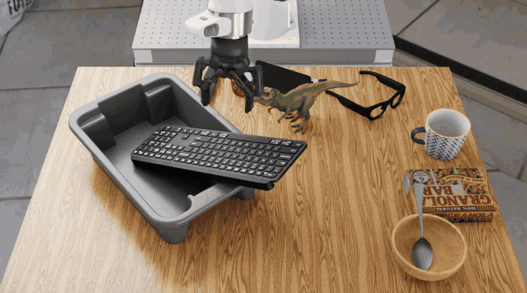 |  | 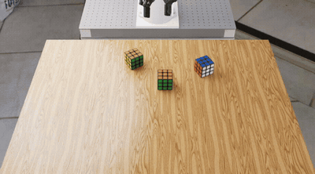 |
| 识别并整理电子设备 | 扶正横放的白色杯子 | 调整抓取后堆叠 |

图片来源：[roboapi-playground 演示](https://github.com/huashanjian/roboapi-playground#-demos)。该项目代码采用 Apache-2.0［开源许可证］；素材与场景的具体许可参见其 [第三方说明](https://github.com/huashanjian/roboapi-playground/blob/main/THIRD_PARTY_NOTICES.md)。

## 2. 一次任务怎样执行

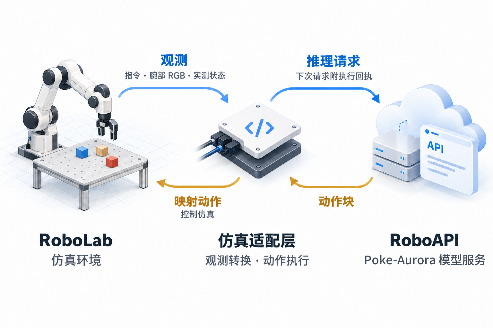

图：社区项目的中文接入流程；来源：[roboapi-playground](https://github.com/huashanjian/roboapi-playground)。

1. 环境给出自然语言任务、腕部相机的 RGB［红绿蓝彩色图像］、机械臂法兰位姿和夹爪开合状态。
2. 客户端把当前观测发送至云端 Poke-Aurora，模型返回一段末端目标动作。
3. 控制器逐步执行该动作，记录实际执行情况，并使用新画面和新状态发起下一轮推理。
4. 任务成功、达到运行上限或发生错误后，保存状态、视频、请求记录与会话信息。

模型使用的是法兰中心位置、姿态与夹爪开合量；坐标系、单位和四元数顺序均须与接口约定一致。仿真项目使用每秒 30 次动作控制、每秒 240 次物理模拟；每轮等待云端推理时仿真时钟暂停。详细约定见[观测与动作](https://developers.pokebot.com/docs/roboapi/latest/inputs)与[社区项目的控制说明](https://github.com/huashanjian/roboapi-playground/blob/main/docs/roboapi/control.md)。

### 2.1 Poke-Aurora 的模型思路

官方将 Poke-Aurora 描述为世界动作模型：训练时共同学习未来视频与机器人动作，希望让模型同时理解环境变化和操作结果。其“调制残差耦合”在视频预测与动作预测模块之间加入可学习交互，同时保留各模块原有计算路径；官方报告这一设计改善了两种预测目标的梯度对齐。后训练则围绕腕部鱼眼画面和末端位姿控制进行配置对齐，便于将同一接口适配到不同机械臂。方法与官方结果见[模型介绍](https://pokebot.com/zh-cn/ai)。

### 2.2 观测与动作的字段

每次推理提交一张图像和与其同时刻采集的机器人状态。模型接口的状态和动作均由八个数构成：前三个是以米计的位置，接下来四个是按 `xyzw` 顺序排列的姿态四元数，最后一个是夹爪开合比例。动作中的每一行代表一个末端绝对目标，控制程序按约定频率执行。机器人驱动内部若使用其他顺序，需要在接口处明确转换。[字段约定](https://developers.pokebot.com/zh/docs/roboapi/latest/model-contract)

## 3. 注册、密钥与额度

在[开发者控制台](https://platform.pokebot.com/)注册并登录，在“API 密钥”［应用程序接口密钥］页创建密钥，在“数据看板”查看剩余次数和历史消耗。技术预览期间官方说明免费，当前限非商业用途，参见[官方介绍](https://pokebot.com/zh-cn/ai)。

密钥应放在仅本人可读的文件，运行程序通过文件路径读取；不要把密钥写入代码仓库、截图或日志。实机使用时，腕部图像、任务指令与机器人状态会发送给云端服务，部署前应确认场景内容适合上传。一个任务通常需要多轮模型推理，因此应观察单次任务的请求记录和前后额度差，再估算所需额度。是否刷新及具体扣减规则以控制台和官方说明为准。

## 4. 环境与资源准备

社区项目推荐 Python［编程语言］3.11、Isaac Sim［机器人仿真器］5.1 和 Isaac Lab［机器人仿真框架］2.3.2.post1。本机复用了已有环境的解释器，无需在其中重新安装依赖：

```text
/data/Data14TB/envs/robolab-0.2.1-isaac51-py311/bin/python
```

组装机械臂模型时，本机还借用已有的 `/data/Data14TB/envs/tabero-fullcopy-isaaclab23-isaacsim51/bin/python`，用于提供 USD［通用场景描述格式］文件处理能力；这两套环境均未安装新依赖。

本次使用的社区项目提交为 `9638b5879fdb17c643cf2deba2e80b9455010607`，独立工作目录与大型输出位于 `/data/Data14TB2/roboapi-every-embodied/`。为配合该机下载规则，所需场景、贴图、腕部组件和机械臂模型事先下载到本地；对场景中外部材质地址做本地路径映射，并保留原始文件备份及文件校验记录。原始机械臂组件来自 NVIDIA［英伟达］公开资产，腕部组件来自社区项目的[标定组件发布页](https://github.com/huashanjian/roboapi-playground/releases/tag/roboapi-rig-v1.0.0)。

在自己的电脑复现时，先按[安装与标定组件说明](https://github.com/huashanjian/roboapi-playground/blob/main/docs/roboapi/setup.md)准备环境、项目资源和机械臂模型，再用下面的方式验证。实际路径由自己的环境决定。

```bash
# 在社区项目根目录，将配置中的路径改成自己的本机路径。
cp -n .env.example .env.local
# 根据 docs/roboapi/setup.md 配置组件目录、Panda 模型、解释器和密钥文件。
set -a
source .env.local
set +a

# 构建机械臂组件；USD_PYTHON 指向能导入 pxr 的 Python。
"${USD_PYTHON:-$ROBOAPI_PYTHON}" -m policies.roboapi.build_asset

# 先完成不消耗模型额度的相机、机械臂和夹爪预检。
policies/roboapi/run.sh --task ReorientWhiteMugsTask --num-runs 1 \
  --preflight-only --video-mode all --output-folder-name preflight
```

预检会记录相机画面、机械臂小范围运动和夹爪验证。先检查 `preflight.json`、`wrist_initial.png`、`runtime_camera.json` 和对应视频，再开始云端推理。预检不调用模型。

下图为本机预检拍摄的画面，左侧是送入模型的腕部鱼眼图像，右侧是用于观察任务的外部视角。图中的桌面包含横放的白杯、其他杯子、量杯和电钻。

| 模型的腕部视角 | 外部场景视角 |
| :---: | :---: |
| 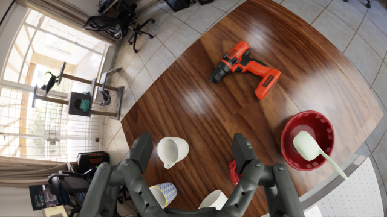 | 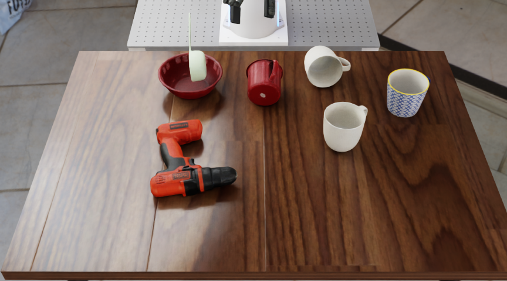 |

本机预检的五项位姿运动检查位置误差约为 0.032～0.075 毫米，夹爪检查通过；这一步消耗模型调用额度 0 次。

### 4.1 腕部鱼眼相机怎样适配

仿真相机固定在夹爪腕部，随末端运动；社区项目通过已标定组件设置相机内参、安装位姿和鱼眼投影，图像直接用于模型推理。预检实际检测到 `OmniLensDistortionFthetaAPI` 鱼眼镜头模型，图像为 640×360，安装位置和旋转误差均在预检阈值内，镜头参数及光学设置检查通过。可查看[相机预检记录](./assets/runtime-camera.json)和[社区组件的相机参数](./assets/rig-camera.json)。

社区组件的内参按 1280×720 记录：`fx=417.01`、`fy=417.47`、`cx=641.19`、`cy=355.12`，用于渲染的分辨率为 640×360。相机标定文件中的 `D_effective` 与仿真原生鱼眼镜头参数并非同一个参数化表达。上述检查说明仿真与该社区组件一致；该组件的具体镜头与官方推荐实物镜头的等效程度仍需对照标定。

[官方相机与安装说明](https://developers.pokebot.com/docs/roboapi/latest/hardware)推荐 Insta360 Ace Pro 2 配 Ultra Wide Lens，也列出 DJI Osmo Action 6 配 FOV Boost Lens；官方[腕部参考图](https://developers.pokebot.com/docs/roboapi/latest/inputs)可用于比较夹爪在画面中的位置和大小、桌沿弯曲与可见范围。硬件页面所述实物视频模式是 1280×720、每秒 30 帧；本次仿真推理帧为 640×360。社区组件未标明等同于哪一款官方实物镜头，因此具体光学匹配不能仅凭相机名称判断。

下面是本机三次运行中实际送入模型的 640×360 腕部鱼眼推理帧；视频中则显示同一腕部传感器随动作连续更新的画面。

| 玩具整理 | 电子设备整理首次 | 电子设备整理补跑 |
| :---: | :---: | :---: |
| 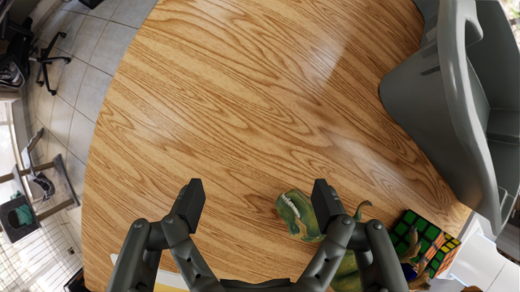 | 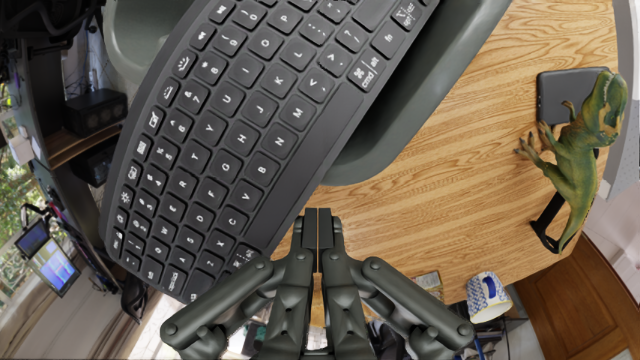 | 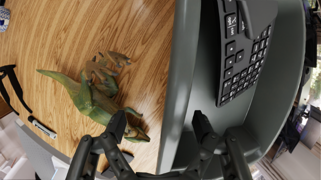 |

下方四个视频均为左侧外部画面、右侧腕部鱼眼画面。模型原始输入为 640×360；本次运行保存腕部视频时下采样为 320×180，拼接时放大显示，推理帧原图保存在上表。视频按仿真时间播放，等待云端响应的时间不会显示在画面里。

## 5. 选择场景并运行

```bash
# 明确指定一个任务和一次运行，避免误启动完整评测。
policies/roboapi/run.sh --task ElectronicsInBinTask --num-runs 1 \
  --video-mode all --output-folder-name electronics_trial

policies/roboapi/run.sh --task ReorientWhiteMugsTask --num-runs 1 \
  --video-mode all --output-folder-name mugs_trial

policies/roboapi/run.sh --task CleanUpToysTask --num-runs 1 \
  --video-mode all --output-folder-name toys_trial
```

项目有 120 个任务定义，未指定任务与次数时可能启动完整评测。每次更改模型或标定，应使用新的输出目录，避免与已完成运行混淆。项目默认每次运行最多 90 个动作块，任务成功后提前结束。

## 6. 实验结果与调用消耗

本次测试覆盖三个场景，分别记录每次运行；每次使用种子 0、同一台机器和同一套标定相机与夹爪。所请求模型为 `poke-aurora-preview`，服务端实际解析到 `poke-aurora-gauss-1030`。本机为 AMD Ryzen 9 9950X［中央处理器］与 NVIDIA RTX PRO 6000 Blackwell［图形处理器］，物理仿真使用中央处理器，图像由图形处理器渲染；运行期间图形处理器与其他任务共享，任务总耗时反映本次共享条件。

| 场景 | 结果 | 成功推理 / 推理请求 | 实际扣额 | 仿真时间 | 本次运行墙钟时间 |
| :--- | :--- | ---: | ---: | ---: | ---: |
| 白杯扶正 | 成功 1/1 | 24 / 24 | 24 次 | 30.83 秒 | 105.84 秒 |
| 电子设备整理，首次 | 服务中断，未评分 | 45 / 46 | 45 次 | 60.00 秒 | 210.19 秒 |
| 玩具整理 | 达到上限，未完成 0/1 | 90 / 90 | 90 次 | 120.00 秒 | 337.17 秒 |
| 电子设备整理，补跑 | 达到上限，未完成 0/1；子任务得分 0.5 | 90 / 90 | 90 次 | 120.00 秒 | 366.99 秒 |

电子设备首次运行的第 46 次推理返回 503［服务暂时不可用］，客户端按原项目设计停止，不自动重放动作；这一次失败请求没有产生观察到的额度扣减。玩具整理是按 120 秒仿真时间、90 个动作块上限完成的一次评测，结果为未完成；从视频可以看到夹爪多次尝试接近玩具。

### 6.1 本机视频：白杯扶正

[](./assets/local-mugs-dual.mp4)

教程源码中的动图预览为两倍速；[双视角完整视频](./assets/local-mugs-dual.mp4)左侧为外部画面，右侧为腕部画面，按仿真时间原速播放。机器人的画面等待云端推理时仿真时钟暂停；30.8 秒视频对应本次约 105.84 秒运行时间。下图为视频末尾画面：

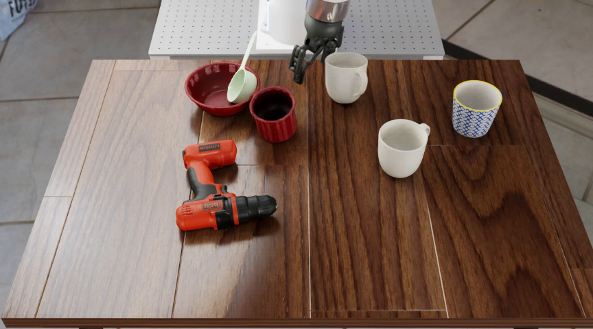

### 6.2 本机视频：多玩具整理

[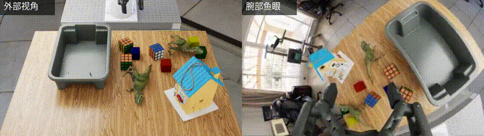](./assets/local-toys-dual.mp4)

教程源码中的动图预览为四倍速；[双视角完整视频](./assets/local-toys-dual.mp4)按仿真时间原速播放。本次桌面上同时有魔方、彩色积木、玩具动物、鸟屋和收纳盒，任务要求整理小玩具并保留鸟屋；本次未满足任务完成条件。

### 6.3 本机视频：电子设备整理首次运行

[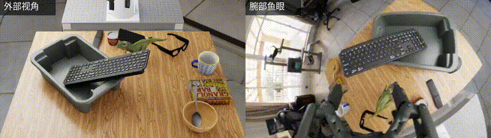](./assets/local-electronics-interrupted-dual.mp4)

教程源码中的动图预览为两倍速；[双视角完整中断记录](./assets/local-electronics-interrupted-dual.mp4)按仿真时间原速播放，60 秒处因云端服务错误停止，任务未评分。桌面包含键盘、手机、玩具、眼镜、餐具和零食等物品。

### 6.4 本机视频：电子设备整理补跑

[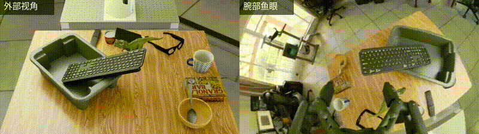](./assets/local-electronics-retry-dual.mp4)

教程源码中的动图预览为四倍速；[补跑双视角完整视频](./assets/local-electronics-retry-dual.mp4)按仿真时间原速播放。该次运行 90 次模型推理全部收到成功响应，环境给出 0.5 的子任务得分；遥控器和鼠标的抓取条件仍未完成，最终整体任务未成功。


### 6.5 推理延迟

下表的统计范围为收到成功响应的模型推理请求，百分位采用线性插值；失败请求单独记录。服务端处理时间来自返回的 `inference_usage.timings_ms.total_ms` 字段，请求往返时间由本机客户端测量。

| 场景 | 成功请求数 | 请求往返平均 / 中位 / 第 95 百分位 | 服务端处理平均 / 中位 / 第 95 百分位 |
| :--- | ---: | :--- | :--- |
| 白杯扶正 | 24 | 1.218 / 0.919 / 2.905 秒 | 0.843 / 0.580 / 2.565 秒 |
| 电子设备整理，首次 | 45 | 1.029 / 0.998 / 1.355 秒 | 0.567 / 0.559 / 0.656 秒 |
| 玩具整理 | 90 | 0.958 / 0.952 / 1.196 秒 | 0.569 / 0.570 / 0.672 秒 |
| 电子设备整理，补跑 | 90 | 0.953 / 0.944 / 1.179 秒 | 0.562 / 0.554 / 0.691 秒 |

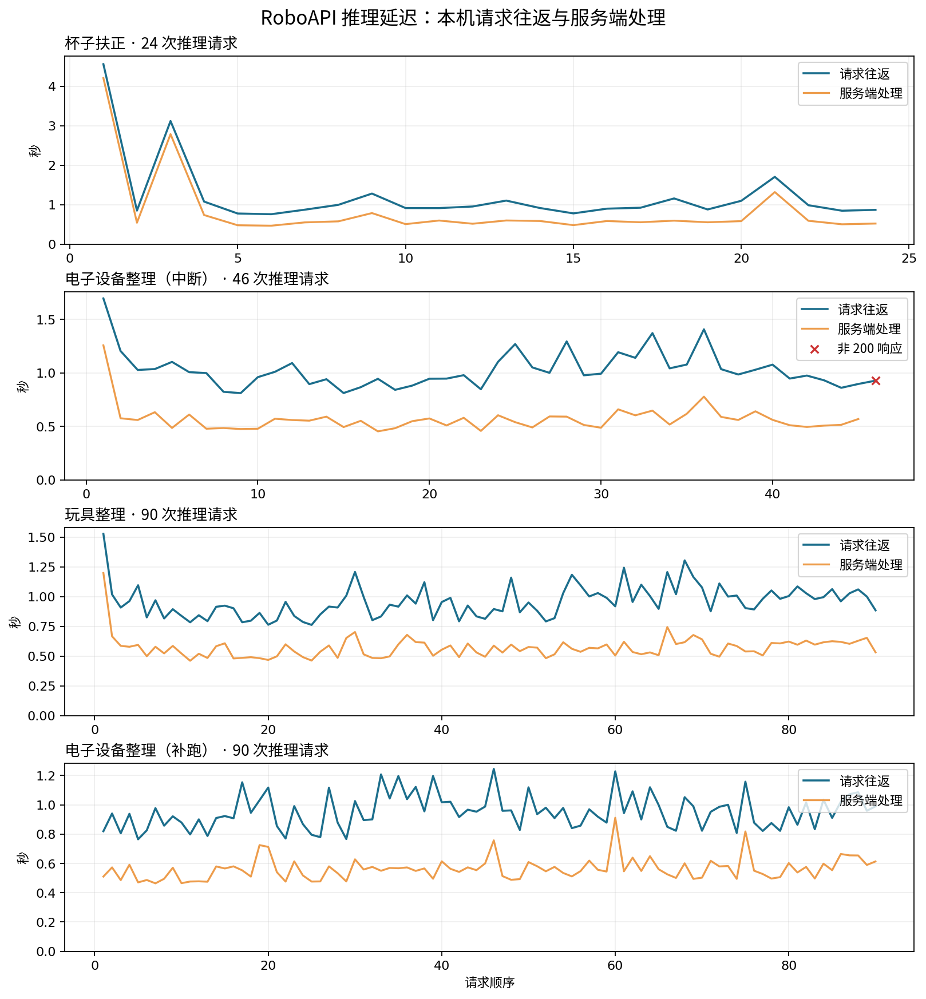

四次运行一共发起 250 次推理请求，其中 249 次成功、1 次返回 503；账户余额从 1,000 变为 751，实际消耗 249 次。249 次成功请求的往返时间平均 0.994 秒、中位数 0.954 秒，服务端处理时间平均 0.593 秒、中位数 0.559 秒。图中红叉表示一次 503 响应。原始、去除密钥和会话标识的逐次数据：[白杯扶正](./assets/mugs-latency.csv) · [电子设备首次运行](./assets/electronics-interrupted-latency.csv) · [玩具整理](./assets/toys-latency.csv) · [电子设备补跑](./assets/electronics-retry-latency.csv)。

请求往返时间与服务端处理时间的差包含网络、网关与其他客户端或服务开销，不能直接当作单向网络延迟。视频时间、仿真时间与实际运行时间的统计口径不同；每个场景的有效样本数见上表，统计用于展示本次接入与延迟现象。


### 6.6 共享设备的资源观察

每 5 秒采样整张图形处理器的资源情况；采样从各运行中途开始，数值包含机器上同时运行的其他进程。电子设备首次运行记录 32 个样本，利用率平均 59.4%，已用显存平均 57.5 GiB［吉比字节］；玩具整理记录 61 个样本，利用率平均 17.1%，已用显存平均 57.5 GiB［吉比字节］。逐次采样见[电子设备任务](./assets/electronics-shared-gpu.csv)和[玩具任务](./assets/toys-shared-gpu.csv)。

## 7. 如何读运行记录

本机原始运行记录位于 `/data/Data14TB2/roboapi-every-embodied/roboapi-playground/output/`，其中 `mugs_trial_20261111`、`electronics_trial_20261111`、`toys_trial_20261111` 和 `electronics_retry_20261111` 分别对应上表四次运行。

每次任务目录中，`run_0_api/summary.json` 记录模型、请求数、动作执行步数、错误以及延迟数组；`observation_*.png` 与 `observation_*.json` 保存每轮模型收到的图像、指令和状态；`chunk_*.json` 保存动作输出；`events.jsonl` 保存执行事件。项目提供的外部视角视频可用于复核真实的动作过程。本节附有 [统计脚本](./tools/summarize_run.py) 和 [逐次延迟导出脚本](./tools/export_latency_csv.py)，可以对自己的运行目录执行同样的整理。

`api_http_latency_s` 是从发出请求到读取响应体的客户端网络往返时间；`api_latency_s` 还包含图像编码与请求、响应归档开销。云端处理耗时需要从服务端返回的计时字段单独读取。一次或少量运行适合检查接口与现象，成功率应同时报告实际运行次数。

## 8. 用自己的相机和机械臂

官方提供腕部鱼眼相机参考配置，也说明非标准相机可通过匹配相机安装位置、姿态、鱼眼投影和夹爪在画面中的尺寸与位置进行适配。普通相机的较窄视角无法通过图像变换找回画面外的内容，因此建议先比对参考图与实际图，再测量任务效果。[官方硬件配置](https://developers.pokebot.com/docs/roboapi/latest/hardware)

更换机械臂时，还要适配状态读取、末端位姿控制、夹爪驱动和坐标标定。真机动作执行前，应先验证相机方向、坐标轴、位姿单位、夹爪开合和急停；接口说明见[非标准硬件接入](https://developers.pokebot.com/docs/roboapi/latest/add-hardware)。
