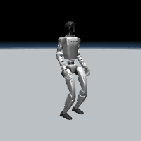
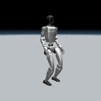
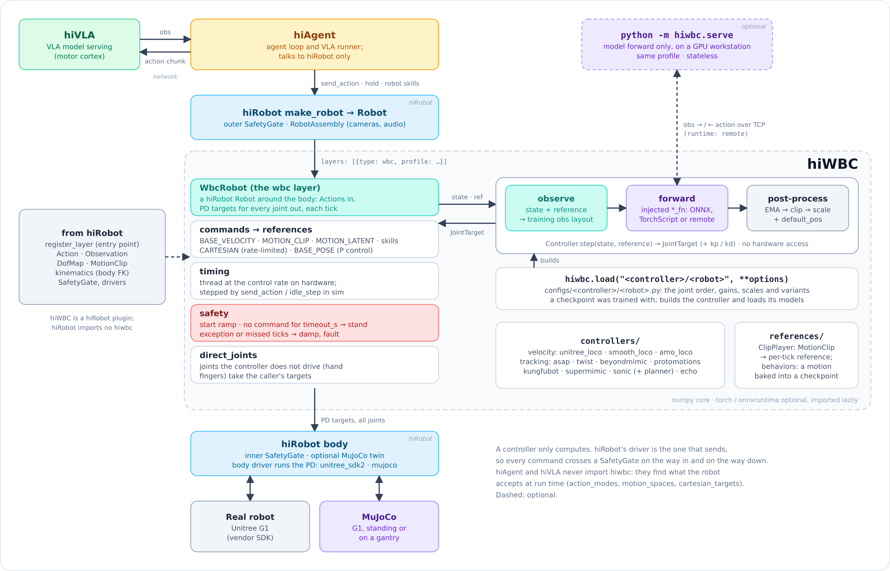

# hiRobot 与 hiWBC：机器人接口与全身控制部署

> 代码状态核对：2026-11-13。本文检查的版本为 hiRobot [`0070ce7`](https://github.com/humanoidintelligence/hiRobot/tree/0070ce7f199910f935ed35509bc08171868a5d93) 和 hiWBC [`1b66910`](https://github.com/humanoidintelligence/hiWBC/tree/1b66910238cbeeabfbb913a8cf74d3ffeb15b50a)。两个项目处于早期开发阶段，后续接口可能变化。

hiRobot 把不同机器人的观测、动作、驱动和安全检查组织成统一接口；hiWBC 把已有的行走和全身动作跟踪控制器接进同一套接口。学习时可以先运行无需硬件和权重的接口示例，再配置 G1 仿真与实际策略。本文放在**机器人操作与运动控制**下，因为它同时涉及机械臂、人形机器人和硬件接口；相关训练方法可接着看 [SuperMimic 专题](../Locomotion/08-UniSuperMimic世界模型全身动作跟踪/README.md)。

<table><tr>
<td align="center"><br>SONIC 行走 · 官方仿真演示</td>
<td align="center"><br>SuperMimic 动作跟踪 · 官方仿真演示</td>
<td align="center"><br>BeyondMimic · 官方仿真演示</td>
</tr></table>

图源：[hiWBC 官方仓库](https://github.com/humanoidintelligence/hiWBC/tree/1b66910238cbeeabfbb913a8cf74d3ffeb15b50a/assets/controllers)；这些是项目方的演示，本文本机验证范围见第 8 节。

## 1. 四个项目怎么分工

| 项目 | 职责 | 本次核对的公开状态 |
| --- | --- | --- |
| [hiRobot](https://github.com/humanoidintelligence/hiRobot) | 设备组装、观测和动作接口、驱动、安全检查、仿真接口 | 已有代码、配置、测试和文档，Apache-2.0 |
| [hiWBC](https://github.com/humanoidintelligence/hiWBC) | 包装已有全身运动控制器，将参考命令和机器人状态转换为关节目标 | 已有代码、测试和文档，Apache-2.0；具体预训练模型通常需另行获取 |
| [hiVLA](https://github.com/humanoidintelligence/hiVLA) | 计划中的视觉语言动作模型部署 | GitHub 仓库为空，暂不能从此仓库安装运行 |
| [hiAgent](https://github.com/humanoidintelligence/hiAgent) | 计划中的任务规划和工具调用 | GitHub 仓库为空，暂不能从此仓库安装运行 |

```text
上层应用 / 人工命令（hiAgent、hiVLA 是计划中的可选来源）
                     │ 高层命令
                     ▼
hiRobot Robot 接口 ── hiWBC 可选控制层：状态 + 参考 → 关节目标
                     │
                     ▼
        hiRobot 安全检查 → 仿真驱动或厂家驱动 → 机器人
                     ▲                        │
                     └──────── 状态与图像 ─────┘
```

hiWBC 的控制器也可独立在用户自己的循环中运行，不直接连接硬件；`WbcRobot` 则把它作为 hiRobot 的一层。接口集成使策略可以复用，完成某项具体任务还需要匹配的策略、观测、动作格式与机器人配置。[上游架构说明](https://github.com/humanoidintelligence/hiWBC/blob/1b66910238cbeeabfbb913a8cf74d3ffeb15b50a/docs/guides/robot.zh-CN.md)。



## 2. 现在可以做哪些事

| 能力 / 任务 | 实现入口与条件 | 现有证据 |
| --- | --- | --- |
| 关节状态读取、关节位置命令 | hiRobot `get_observation()`、`send_action()`；可先用 `toy` 驱动 | 本文玩具驱动本机已运行；上游列出多种真机验证 |
| 机械臂、夹爪、相机 | 对应机器人和末端执行器驱动、厂家软件包、相机驱动和配置 | 上游标记 Franka FR3、UR5e、AgileX PiPER 等做过真机验证；具体程度见其设备文档 |
| 速度命令行走 | hiWBC `unitree_loco`、`smooth_loco`、`amo_loco` 或 SONIC；需要对应的模型和 G1 仿真资源 | 上游做过仿真逐周期对齐；本教程未运行这些真实权重 |
| 动作模仿 / 跟踪 | `asap_tracker`、`twist_tracker`、`beyondmimic_tracker`、`protomotions_tracker`、`kungfubot_tracker`、`supermimic`；需要匹配的动作和模型 | 上游提供仿真与对齐测试；SuperMimic 接口适配的是社区部署实现 |
| 手部位姿、动作片段和运动潜变量 | SONIC 配置支持手部目标、64 维动作潜变量、动作片段；具体命令取决于控制器 | 上游 SONIC 仿真演示及控制器实现 |
| 高层到关节目标的接口联调 | hiRobot 的 `toy` 驱动加 hiWBC 的 `EchoController`；无需权重和硬件 | 本文示例本机通过；它保持固定姿态，不产生行走能力 |
| 语言理解、自主抓取、任务规划 | 需另外接入可用的上层系统、相机和目标策略 | hiAgent / hiVLA 仓库当前为空，不能仅靠本项目直接完成 |

上游说明：部分 RoboJuDo 里的原始策略曾在真机运行，**本次发布的 hiWBC 版本，包括 SONIC、SuperMimic 和 `wbc` 控制层，作者声明只在仿真运行过**。[上游声明](https://github.com/humanoidintelligence/hiWBC/blob/1b66910238cbeeabfbb913a8cf74d3ffeb15b50a/README.zh-CN.md)。

### 支持哪些硬件？

上游硬件表中标记做过真机运行的本体包括 Unitree G1 / H1、AgiBot G1、Franka FR3、UR5e、AgileX PiPER；还有 Dex3、Inspire、Robotiq 2F-85 等末端设备。其他机型有的有配置、有的尚在计划，**配置存在和已经真机验证是两回事**。完整清单及每台机器的设置步骤见 [hiRobot 支持列表](https://github.com/humanoidintelligence/hiRobot/blob/0070ce7f199910f935ed35509bc08171868a5d93/docs/supported_robots.zh-CN.md)。

RealSense D435i 有本地 USB 相机驱动；现有 D435 可检查分辨率、彩色与深度流能否通过 `pyrealsense2` 适配，不能直接把 D435i 的验证结果算成 D435 验证。当前源码没有发现 ROKAE xMate ER3 Pro 对应的现成驱动：使用该机械臂需要实现并测试厂家 SDK 到 hiRobot 的适配层、关节顺序、坐标系和安全约束。参见 [驱动扩展接口](https://github.com/humanoidintelligence/hiRobot/blob/0070ce7f199910f935ed35509bc08171868a5d93/docs/api.zh-CN.md#扩展点相机末端执行器与音频)和 [RealSense 设置](https://github.com/humanoidintelligence/hiRobot/blob/0070ce7f199910f935ed35509bc08171868a5d93/docs/setup/ur.zh-CN.md)。

## 3. 下载和安装

下述命令使用 Python 3.10 或 3.11 的独立环境，固定到本文核对的代码。`HI_WORK` 和 `HI_ENV` 可设置到有足够空间的磁盘；环境不安装到已有项目中。Ubuntu 本机可将 `HI_ENV` 指向 `/data/Data14TB/envs/hi-infra`，磁盘空间不足时选择其他数据盘。

```bash
export HI_WORK="$HOME/robotics/hi-infra"
export HI_ENV="$HOME/.virtualenvs/hi-infra"
mkdir -p "$HI_WORK" "$(dirname "$HI_ENV")"
python3 -m venv "$HI_ENV"
source "$HI_ENV/bin/activate"
python -m pip install --upgrade pip

git clone https://github.com/humanoidintelligence/hiRobot.git "$HI_WORK/hiRobot"
git -C "$HI_WORK/hiRobot" checkout --detach 0070ce7f199910f935ed35509bc08171868a5d93
git clone https://github.com/humanoidintelligence/hiWBC.git "$HI_WORK/hiWBC"
git -C "$HI_WORK/hiWBC" checkout --detach 1b66910238cbeeabfbb913a8cf74d3ffeb15b50a
python -m pip install -e "$HI_WORK/hiRobot"
python -m pip install -e "$HI_WORK/hiWBC"
```

hiRobot 核心依赖 NumPy、Pydantic 和 PyYAML；hiWBC 核心依赖 hiRobot 和 NumPy。后续按需求安装仿真或模型推理依赖：

```bash
python -m pip install -e "$HI_WORK/hiRobot[sim]"     # MuJoCo
python -m pip install -e "$HI_WORK/hiWBC[onnx]"     # SONIC 等 ONNX 模型
python -m pip install -e "$HI_WORK/hiWBC[torch]"    # TorchScript 模型
python -m pip install -e "$HI_WORK/hiWBC[dev]"      # 测试工具
```

以上安装会改动当前激活的 Python 环境，因此先确认提示符和 `which python`。`-e` 可让源码修改立即生效；它还会注册 `wbc` 插件。官方安装文档：[hiRobot](https://github.com/humanoidintelligence/hiRobot/blob/0070ce7f199910f935ed35509bc08171868a5d93/README.zh-CN.md)、[hiWBC](https://github.com/humanoidintelligence/hiWBC/blob/1b66910238cbeeabfbb913a8cf74d3ffeb15b50a/docs/guides/getting_started.zh-CN.md)。

## 4. 第一步：不连硬件跑通接口

在本教程目录运行：

```bash
python 01-toy-and-wbc.py
```

示例用 4 个虚拟关节构建 `toy` 机器人，将 `EchoController` 包在 `WbcRobot` 中，发送 10 次速度命令，并输出关节与控制状态。预期输出中的 `simulated` 为 `True`，关节保持在 `[0.1, -0.1, 0.2, -0.2]`，控制器状态里 `mode` 为 `command`。`echo` 只返回设定的默认姿态，不会根据速度指令让机器人行走；`toy` 是进程内的运动学测试替身，不是带接触动力学的物理仿真。

脚本的数据流：配置四个关节 → `make_robot(config)` → `EchoController` → `WbcRobot` → `connect()` → `send_action(BASE_VELOCITY)` → `get_observation()` / `get_status()` → `disconnect()`。真实模型的控制器实现相同的输入输出约定，但还要加载其权重与正确的机器人状态。

也可以运行上游的无权重控制器测试：

```bash
cd "$HI_WORK/hiWBC"
python -m pytest -q tests/test_controllers.py
```

只有直接用 `PYTHONPATH` 临时引用两个源码目录、没有安装插件时，配置中的 `type: wbc` 才可能报 `Unknown robot layer 'wbc'`；按第 3 节安装 hiWBC，或在源码调试时显式 `import hiwbc.plugin` 注册。上面的教程脚本直接构造 `WbcRobot`，不依赖插件自动发现。

## 5. 第二步：在 MuJoCo 中运行 G1

### 5.1 检查 G1 模型

hiRobot 自带机器人配置，但不附带 Unitree G1 的 MuJoCo 模型。按[官方设置](https://github.com/humanoidintelligence/hiRobot/blob/0070ce7f199910f935ed35509bc08171868a5d93/docs/setup/unitree.zh-CN.md#5-mujocog1可选)获取，并先用固定底座检查：

```bash
python -m pip install -e "$HI_WORK/hiRobot[sim]"
git clone --depth 1 --filter=blob:none --sparse \
  https://github.com/unitreerobotics/unitree_ros.git "$HOME/.cache/hirobot/unitree_ros"
git -C "$HOME/.cache/hirobot/unitree_ros" sparse-checkout set robots/g1_description
hirobot sim unitree_g1_mujoco --viewer
```

这是保持姿态与模型加载检查，固定底座不会测试真实行走。需要图形显示；无显示器可参考官方文档配置 `MUJOCO_GL=egl`。读取仿真头部图像需要可用的渲染上下文。

### 5.2 SONIC 行走示例

[SONIC 指南](https://github.com/humanoidintelligence/hiWBC/blob/1b66910238cbeeabfbb913a8cf74d3ffeb15b50a/docs/guides/sonic.zh-CN.md)要求单独获取 NVIDIA 的 [GEAR-SONIC 权重](https://huggingface.co/nvidia/GEAR-SONIC)，须遵循其模型许可。行走还需同一发布包中的 `planner_sonic.onnx`，官方文档标注约 740 MB。以下按官方默认缓存目录准备：

```bash
python -m pip install -e "$HI_WORK/hiWBC[onnx]" huggingface_hub
huggingface-cli download nvidia/GEAR-SONIC --local-dir "$HOME/.cache/hiwbc/sonic"
# 在本教程目录运行，默认使用相邻的 g1_sonic.yaml
python 02-sonic-g1-sim.py
```

如果权重放在其他位置，在 [g1_sonic.yaml](g1_sonic.yaml) 的 `wbc` 控制层下设置 `checkpoint_dir: /你的/权重目录`。该配置引用自由站立的 `unitree_g1_mujoco_standing`，按官方示例将初始关节姿态设为 SONIC 的默认值，并设 `start_seconds: 0`，使控制器从第一个周期接管。脚本发送 250 次 `[0.4, 0, 0]` 速度命令，在 50 Hz 下对应 5 秒仿真，再保持站立。仿真通过 `send_action` 逐步推进；该脚本默认输出状态，不自动录制视频。教程保留的配置和流程来自官方示例，本次没有下载 SONIC 权重或运行该仿真。

### 5.3 其他控制器及权重

| 类型 | 控制器与来源 | 输入和资源说明 |
| --- | --- | --- |
| 行走 | `unitree_loco`、`smooth_loco`、`amo_loco` | G1 策略资源可参见 [RoboJuDo](https://github.com/HansZ8/RoboJuDo)，按具体控制器准备模型；AMO 观测 23 关节、驱动 15 关节 |
| 动作跟踪 | `asap_tracker`、`twist_tracker`、`beyondmimic_tracker`、`protomotions_tracker`、`kungfubot_tracker` | 使用对应动作、权重和观测格式；部分动作固化在模型中 |
| SuperMimic | `supermimic` | 上游适配 [supermimic_deploy](https://github.com/KyrieYoung926/supermimic_deploy) 的 G1 模型包，包含 `config.json`、`policy.onnx` 和参考动作，见[官方动作跟踪指南](https://github.com/humanoidintelligence/hiWBC/blob/1b66910238cbeeabfbb913a8cf74d3ffeb15b50a/docs/guides/motion_tracking.zh-CN.md) |
| SONIC | `sonic` | 使用 NVIDIA 发布的编码器、解码器及可选行走规划器；动作片段、手部目标和速度命令需与配置匹配 |
| 接口调试 | `echo` | 不需要模型，返回默认姿态 |

例如，已有 RoboJuDo 的 G1 模型目录后，官方提供如下加载方法，具体权重的下载与使用条件以各自项目为准：

```python
import hiwbc
ctrl = hiwbc.load("unitree_loco/unitree_g1", checkpoint_dir="/path/to/RoboJuDo/assets/models/g1")
```

这段只加载控制器；真正行走还需要每个周期读取机器人状态、调用 `step` 并通过仿真驱动执行关节目标。详见[行走指南](https://github.com/humanoidintelligence/hiWBC/blob/1b66910238cbeeabfbb913a8cf74d3ffeb15b50a/docs/guides/locomotion.zh-CN.md)与 [hiRobot 集成指南](https://github.com/humanoidintelligence/hiWBC/blob/1b66910238cbeeabfbb913a8cf74d3ffeb15b50a/docs/guides/robot.zh-CN.md)。

## 6. 读源码时看什么

| 问题 | 源码入口 | 重点 |
| --- | --- | --- |
| 机器人从配置如何生成？ | [hiRobot 的 `make_robot`](https://github.com/humanoidintelligence/hiRobot/blob/0070ce7f199910f935ed35509bc08171868a5d93/src/hirobot/__init__.py)、[配置解析](https://github.com/humanoidintelligence/hiRobot/blob/0070ce7f199910f935ed35509bc08171868a5d93/src/hirobot/loading/build.py) | 本体、相机和夹爪配置被组装，按名字选择驱动 |
| 观测和动作包含什么？ | [hiRobot 类型定义](https://github.com/humanoidintelligence/hiRobot/blob/0070ce7f199910f935ed35509bc08171868a5d93/src/hirobot/core/types.py) | 关节、相机、夹爪、基座状态和不同控制模式 |
| 安全和命令冲突如何处理？ | [安全检查](https://github.com/humanoidintelligence/hiRobot/blob/0070ce7f199910f935ed35509bc08171868a5d93/src/hirobot/control/safety.py)、[命令仲裁](https://github.com/humanoidintelligence/hiRobot/blob/0070ce7f199910f935ed35509bc08171868a5d93/src/hirobot/control/arbiter.py)、[超时监测](https://github.com/humanoidintelligence/hiRobot/blob/0070ce7f199910f935ed35509bc08171868a5d93/src/hirobot/control/watchdog.py) | 关节限位、步长和目标偏差等检查；资源仲裁和速度命令超时适用范围以配置及驱动为准 |
| 全身控制层如何工作？ | [hiWBC `robot.py`](https://github.com/humanoidintelligence/hiWBC/blob/1b66910238cbeeabfbb913a8cf74d3ffeb15b50a/src/hiwbc/robot.py)、[控制器基类](https://github.com/humanoidintelligence/hiWBC/blob/1b66910238cbeeabfbb913a8cf74d3ffeb15b50a/src/hiwbc/controller.py) | 参考命令和状态 → 构造观测 → 模型前向 → 裁剪 / 平滑 / 缩放 → 关节位置目标 |
| 各策略参数和模型从哪来？ | [控制器](https://github.com/humanoidintelligence/hiWBC/tree/1b66910238cbeeabfbb913a8cf74d3ffeb15b50a/src/hiwbc/controllers)、[模型配置](https://github.com/humanoidintelligence/hiWBC/tree/1b66910238cbeeabfbb913a8cf74d3ffeb15b50a/src/hiwbc/configs) | 不同策略需要不同关节顺序、观测布局、权重、增益与控制周期 |

接真机前先完成仿真及只读检查，核对每个关节的名称、方向、限位、控制增益、控制频率及传感器坐标系。hiWBC 状态四元数为 `[x, y, z, w]`，而 Unitree SDK 与 MuJoCo 常见输入为 `[w, x, y, z]`，需按项目文档重排；真机首次动作应使用支撑、低增益和可触及的急停。[上游首次上电与常见问题](https://github.com/humanoidintelligence/hiWBC/blob/1b66910238cbeeabfbb913a8cf74d3ffeb15b50a/docs/guides/getting_started.zh-CN.md)。

## 7. 和 FRoM-W1、SuperMimic 的关系

[FRoM-W1 论文](https://arxiv.org/abs/2601.12799)、[项目主页](https://openmoss.ai/FRoM-W1/)和[研究代码](https://github.com/OpenMOSS/FRoM-W1)是同一研究团队的相关成果，不是 hiRobot / hiWBC 的使用手册。其论文路线是 H-GPT 从语言生成全身人体动作，经动作重定向后由 H-ACT 的强化学习跟踪策略驱动人形机器人。可用于理解语言到动作生成和执行的研究背景，不能据此认为这四个基础设施项目已经开源了同样的端到端语言控制。

[SuperMimic、InstantTrack 与 BlinkMimic 专题](../Locomotion/08-UniSuperMimic世界模型全身动作跟踪/04-SuperMimic与InstantTrack-BlinkMimic训练加速.md)侧重动作跟踪策略及训练加速；本节侧重通过 hiWBC 接入**已有**的 SuperMimic 部署模型，二者分别对应策略训练与控制部署。

## 8. 本机核验与来源

2026-11-13 在现有 Python 环境中通过 `PYTHONPATH` 只读引用固定版本源码，运行 [01-toy-and-wbc.py](01-toy-and-wbc.py)：虚拟机器人的四个关节保持在预设位置，10 次高层速度命令处理后状态为 `command`。上游 `tests/test_controllers.py` 的 **9 项测试全部通过**；另外选择 echo、构造控制层、命令超时相关测试，显式导入插件后结果为 **5 通过、1 跳过、40 项未选**。没有连接真机，也没有在本次验证中运行 G1、SONIC 或其他真实模型权重；上方演示动画来自项目方。

- [hiRobot 项目及中文文档](https://github.com/humanoidintelligence/hiRobot/tree/0070ce7f199910f935ed35509bc08171868a5d93)
- [hiWBC 项目及中文指南](https://github.com/humanoidintelligence/hiWBC/tree/1b66910238cbeeabfbb913a8cf74d3ffeb15b50a)
- [hiAgent](https://github.com/humanoidintelligence/hiAgent) · [hiVLA](https://github.com/humanoidintelligence/hiVLA)
- [FRoM-W1 论文](https://arxiv.org/abs/2601.12799) · [FRoM-W1 代码](https://github.com/OpenMOSS/FRoM-W1)
- 上游项目采用 Apache-2.0；不同的机器人模型、策略权重和数据集有各自许可，获取时请查看对应页面。
