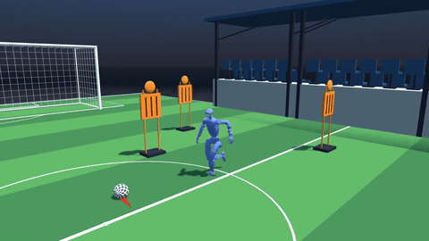
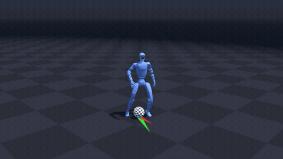
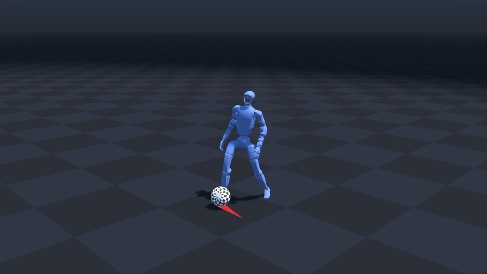
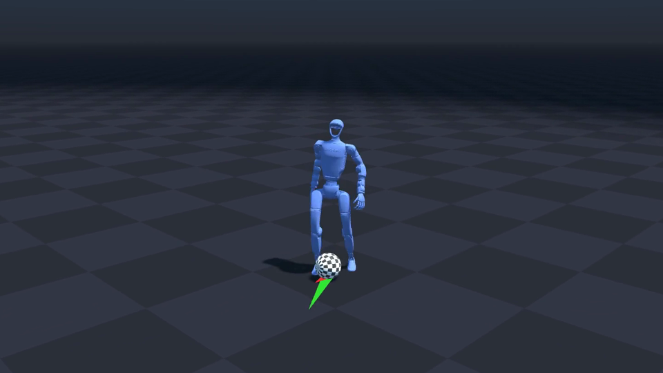

# DribbleAMP：人形机器人足球带球与动作先验

如何让人形机器人既保持相对自然的双足动作，又能追球、触球并调整球的运动方向？本章以开源项目 [DribbleAMP](https://github.com/ErykHalicki/DribbleAMP) 为例，介绍 Unitree G1 的足球带球仿真、动作先验和两阶段强化学习训练。

项目提供 G1 两阶段预训练模型、足球任务代码和动作参考数据。其现有任务是在平地上追球、控制球的速度和方向；六杆绕行需要在此基础上增加障碍与路线规划。本章按 2026-11-05 核对的代码版本编写。

## 1. 项目入口与学习路线

| 资源 | 内容 |
| --- | --- |
| [DribbleAMP 源码与说明](https://github.com/ErykHalicki/DribbleAMP/tree/f25a4bcf0362c60730faf07b0604b5213aa40dd1) | G1 带球任务、训练配置、动作数据与预训练模型 |
| [追球演示](https://youtu.be/f0HXS8HKP3Q) | 上游 G1 第一阶段：接近球和触球 |
| [带球演示](https://youtu.be/H7UHbeMz4UI) | 上游 G1 第二阶段：跟随目标球速带球 |
| [项目报告](https://github.com/ErykHalicki/DribbleAMP/tree/f25a4bcf0362c60730faf07b0604b5213aa40dd1/report) | 奖励、训练及消融实验 |
| [MimicKit](https://github.com/xbpeng/MimicKit) | 上游使用的动作模仿与强化学习框架 |
| [DribbleMaster](https://zhuoheng0910.github.io/DribbleMaster/) | 上游任务奖励设计参考 |

建议先看两个上游演示，再运行预训练模型，最后阅读训练代码。带球演示中的红色箭头表示目标球速，绿色箭头表示实际球速。

### 1.1 本机带球演示

球场场景中，机器人跟随足球运动，周围摆放了球门、看台和训练假人：

[](assets/g1-stadium.mp4)

**球场场景视频：** [观看 16 秒片段](assets/g1-stadium.mp4)。本机使用第二阶段预训练模型、单环境与随机种子 42 录制，完整回合 600 步，回报约 442.54。场地、球门、看台和假人来自公开资产，仅用于渲染；机器人和球仍按原任务进行物理仿真，假人没有碰撞或避障行为。场地模型的水平尺寸缩放至原来的四分之一，便于展示。

以下保留原始平地场景，便于观察动作和速度箭头：

点击画面可打开视频：机器人接近足球、调整脚步触球，并跟随足球运动。红色箭头表示目标球速，绿色箭头表示实际球速；两个箭头越接近，球的实际运动越接近目标。

[](assets/g1-dribble.mp4)

**视频 1：G1 足球带球仿真。** 本机使用上游第二阶段预训练模型、单环境和随机种子 42 录制；视频为 20 秒回合中第 2–18 秒的裁剪画面。播放完整版片段：[G1 足球带球视频](assets/g1-dribble.mp4)。

| 接近足球 | 足球处于脚前 |
| --- | --- |
|  |  |

**图 1：本机回放画面。** 左图展示机器人接近足球，右图展示足球、机器人和速度箭头的相对位置；两张图均截取自同一次本机仿真录制。

## 2. 从参考动作到带球策略

训练时，仿真器提供机器人关节与身体状态、足球状态以及期望的球速方向。策略输出控制动作；足球与机器人在物理仿真中接触，奖励同时评价带球效果和动作风格。

```text
参考动作 ──> 动作判别器 ──> 风格奖励 ──┐
                                       ├──> 强化学习 ──> G1 控制策略
机器人和足球状态、目标球速 ──> 任务奖励 ──┘
```

| 组成 | 作用 | 代码入口 |
| --- | --- | --- |
| 足球任务观测 | 将球相对机器人位置、球速和目标方向转换到机器人朝向相关坐标系，并与身体观测拼接 | [`task_soccer_env.py`](https://github.com/ErykHalicki/DribbleAMP/blob/f25a4bcf0362c60730faf07b0604b5213aa40dd1/MimicKit/mimickit/envs/task_soccer_env.py) |
| 任务奖励 | 奖励球速接近目标、球运动方向对准目标、机器人靠近球 | 同一文件中的 `compute_soccer_reward` |
| 对抗式动作先验（AMP） | 判别器使用参考动作提供风格奖励，鼓励策略产生类似参考数据的身体运动 | [`amp_task_g1_agent_phase2.yaml`](https://github.com/ErykHalicki/DribbleAMP/blob/f25a4bcf0362c60730faf07b0604b5213aa40dd1/MimicKit/data/agents/amp_task_g1_agent_phase2.yaml) |
| 物理仿真 | 以 Newton、MuJoCo Warp 和 G1 模型计算运动与接触 | `MimicKit/mimickit/engines/newton_engine.py` |

第二阶段配置中，任务奖励与风格奖励的权重分别为 0.8 和 0.2；任务内球速、方向和距离权重分别为 0.3、0.5、0.2。G1 参考动作清单实际包含 `g1_walk.pkl`、`g1_run.pkl` 和 `g1_kick_combo.pkl`，权重依次为 1、2、1，见 [G1 动作清单](https://github.com/ErykHalicki/DribbleAMP/blob/f25a4bcf0362c60730faf07b0604b5213aa40dd1/MimicKit/data/datasets/dataset_g1_locomotion.yaml)。该清单没有标明这些动作来源于梅西。

上游报告还比较了去掉风格奖励的策略：任务误差降低，但步态更蹲伏。这个取舍有助于理解为什么“球控制得好”和“动作风格自然”需要分别观察。

### 2.1 机器人看到什么

每个控制周期，足球任务把以下信息加入机器人自身的运动观测：

1. **球相对身体的位置**：用球的位置减去机器人根部位置，再转换到机器人当前朝向对应的坐标系。
2. **球的速度**：将仿真中的球速旋转到机器人朝向坐标系，用于判断球正在朝哪里运动。
3. **目标方向与速度**：方向同样转换到机器人朝向坐标系，再与目标速度数值拼接。
4. **身体状态**：由基础运动环境提供，并与上述足球观测拼接后送入策略。

这组观测直接来自仿真状态；要部署到真实机器人，需要另外提供球检测、相对位置和速度估计。上游第二阶段配置每 4–7 秒重新采样一次目标，目标速度范围为 0–4 米/秒。

### 2.2 奖励怎样引导带球

设球的水平速度大小为 `v`，目标速度大小为 `v_target`，机器人与球的水平距离为 `d`，则第二阶段任务奖励由三部分组成：

| 奖励项 | 计算方式 | 作用 |
| --- | --- | --- |
| 速度 | `exp(-0.2 * (v_target - v)^2)` | 鼓励球速接近目标 |
| 方向 | `max(球速单位方向 · 目标单位方向, 0)` | 鼓励球沿目标方向运动 |
| 距离 | `exp(-0.1 * d^2)` | 鼓励机器人留在球附近 |

第二阶段将这三项分别乘以 0.3、0.5、0.2，再将任务奖励与动作风格奖励分别按 0.8、0.2 组合。球速接近零时，代码对方向归一化的分母设有下限，避免除零。具体实现参见 [`compute_soccer_reward`](https://github.com/ErykHalicki/DribbleAMP/blob/f25a4bcf0362c60730faf07b0604b5213aa40dd1/MimicKit/mimickit/envs/task_soccer_env.py)。

代码中 `control_freq: 30` 表示每秒 30 个控制周期，`sim_freq: 240` 表示每秒 240 个物理仿真步；一个控制周期对应 8 个物理步。20 秒最长回合因而对应 600 个控制步。

## 3. 准备环境与源码

以下为 Linux 路线。上游说明其开发环境为 Python 3.11 和 CUDA 13；完整训练需要 NVIDIA 显卡。交互回放需要可用的图形会话；首次安装依赖和获取源码需要联网。下列目录可以按机器情况调整，源码、环境和训练输出均放在教程仓库之外。

```bash
export WORK_ROOT="$HOME/robotics/dribbleamp"
export ENV_DIR="$WORK_ROOT/env"
mkdir -p "$WORK_ROOT"
git clone https://github.com/ErykHalicki/DribbleAMP.git "$WORK_ROOT/DribbleAMP"
cd "$WORK_ROOT/DribbleAMP"
git checkout f25a4bcf0362c60730faf07b0604b5213aa40dd1
python3.11 -m venv "$ENV_DIR"
source "$ENV_DIR/bin/activate"
python -m pip install --upgrade pip
python -m pip install -r requirements.txt -r MimicKit/requirements.txt 'warp-lang==1.12.0' trimesh scipy
```

上游根目录的依赖文件固定了 `mujoco==3.6.0`、`mujoco-warp==3.6.0` 和 `newton==1.0.0`；MimicKit 的依赖文件包含 PyTorch 等包。本机检查发现自动安装的 `warp-lang==1.19.0` 会因缺少 `warp.config.verbose` 导致 Newton 初始化失败，因此命令额外固定 `warp-lang==1.12.0`，并补充机器人网格读取需要的 `trimesh` 与 `scipy`。具体 GPU 驱动、CUDA 和 PyTorch 的适配请按机器环境安装。要运行本文的 Newton 路线，不需要运行上游仓库中面向其他仿真后端的训练脚本。

确认配置、动作和两阶段权重存在：

```bash
cd "$WORK_ROOT/DribbleAMP"
ls -lh models/g1_stage1.pt models/g1_stage2.pt
ls MimicKit/data/motions/g1/g1_{walk,run,kick_combo}.pkl
python -c 'import torch, mujoco, warp, newton; print("torch", torch.__version__, "CUDA", torch.version.cuda); print("mujoco", mujoco.__version__, "newton", newton.__version__)'
```

上游 `scripts/soccer_test.sh` 把 Python 解释器写死为仓库内 `.venv/bin/python`。为了使用上面指定的独立环境，下面直接调用同一个程序入口，并显式指定配置和权重。

## 4. 回放 G1 预训练带球策略

从 `MimicKit` 目录运行。以下启动一份环境、使用 NVIDIA GPU，并在图形窗口中运行第二阶段策略：

```bash
cd "$WORK_ROOT/DribbleAMP/MimicKit"
python mimickit/run.py \
  --mode test --devices cuda:0 --num_envs 1 --visualize true \
  --engine_config data/engines/newton_engine.yaml \
  --env_config data/envs/amp_soccer_g1_env_phase2.yaml \
  --agent_config data/agents/amp_task_g1_agent_phase2.yaml \
  --model_file "$WORK_ROOT/DribbleAMP/models/g1_stage2.pt" \
  --test_episodes 2
```

成功时应看到机器人、足球和速度方向标记；程序结束时输出 `Mean Return`、`Mean Episode Length` 和 `Episodes`。第二阶段配置每回合最长 20 秒，目标方向和速度会周期性变化；球可能因随机初始状态或摔倒而提前结束回合。比较时可加入 `--rand_seed 42` 固定随机种子。

本机在有 CUDA 设备时使用 CPU 图形回放，速度箭头绘制出现 CPU / CUDA 设备不一致错误；因此图形回放命令使用 `cuda:0`。Newton 在 CPU 上还会提示跳过网格与网格之间的碰撞；需要完整网格接触时使用 CUDA 设备，并检查对应场景和碰撞几何体。

**本机检查**：2026-11-05 在 Linux、Python 3.11、PyTorch 2.15.0、MuJoCo 3.6.0、Newton 1.0.0 和 Warp 1.12.0 环境中，以 CPU、单环境、无窗口、随机种子 42 加载上游 `g1_stage2.pt`，完成 1 个回合；输出回合长度 600 步、回报 372.97。同一环境使用 RTX PRO 6000、CUDA 图形回放也完成 1 个 600 步回合，回报 464.48。两次运行的计算设备与渲染设置不同；带球动作的可视效果可结合上游演示和图形回放观察。

想看第一阶段，只需将上面三个带 `phase2` 的环境配置、智能体配置和 `g1_stage2.pt` 分别改为 `phase1`、`phase1` 和 `g1_stage1.pt`。无图形环境可把 `--visualize true` 改为 `--visualize false`，观察终端指标；这一步不会生成视频。CPU 无窗口检查还可将 `--devices cuda:0` 改为 `--devices cpu`。

### 4.1 录制自己的回合

上游程序支持离屏录制。以下命令使用第二阶段模型、单个环境和固定种子；`--video true` 启用录制，`--visualize false` 避免同时启动交互窗口。录制仍需要可用的图形渲染环境。

```bash
cd "$WORK_ROOT/DribbleAMP/MimicKit"
export VIDEO_OUT="$WORK_ROOT/recordings/g1-seed42"
python -u mimickit/run.py \
  --mode test --devices cuda:0 --num_envs 1 --visualize false --video true \
  --engine_config data/engines/newton_engine.yaml \
  --env_config data/envs/amp_soccer_g1_env_phase2.yaml \
  --agent_config data/agents/amp_task_g1_agent_phase2.yaml \
  --model_file "$WORK_ROOT/DribbleAMP/models/g1_stage2.pt" \
  --test_episodes 1 --rand_seed 42 --out_dir "$VIDEO_OUT"
```

运行结束时，终端输出回报、回合长度及 `Video saved to .../test_video.mp4`。原始录制为 1920 × 1080、30 帧/秒；单个 20 秒回合约 600 帧。录制器会在保存前缓存画面，因此长回合会占用较多内存。

本章视频来自上述命令的本机运行，原始回合长度为 600 步、回报约 451.43。视频中展示的 16 秒片段通过裁剪原始画面和缩放得到，适合网页查看：

```bash
ffmpeg -ss 2 -i "$VIDEO_OUT/test_video.mp4" -t 16 \
  -vf 'crop=1440:810:240:200,scale=960:540' \
  -c:v libx264 -crf 21 -pix_fmt yuv420p -movflags +faststart \
  "$VIDEO_OUT/g1-dribble.mp4"
```

查看结果时，先观察球是否出现在镜头中，再看机器人与球之间的距离、触球后的球速方向，以及目标改变后的调整。回报和回合长度用于辅助观察，实际运动仍应结合视频逐帧检查。

### 4.2 录制球场视觉场景

球场、球门与看台来自 [Football Soccer Stadium and Club Grounds](https://3dassets.dev/packs/football-soccer-club-grounds)；训练假人来自同一套资产中的 [Free kick training mannequin](https://3dassets.dev/assets/football-soccer-club-grounds-free-kick-mannequin-1412ba74)。资产发布方标注为 [CC0 1.0](https://creativecommons.org/publicdomain/zero/1.0/)；本仓库存放经 Blender 转换的文件，以便当前 `trimesh` 版本正确读取模型。模型为低多边形风格，场景脚本调整了缩放与摆放位置。

完成第 3 节环境配置后，设置本仓库的实际位置，再运行场景脚本：

```bash
export EVERY_EMBODIED=/path/to/every-embodied
export DRIBBLEAMP_MIMICKIT="$WORK_ROOT/DribbleAMP/MimicKit"
export STADIUM_DEMO="$EVERY_EMBODIED/07-机器人操作、运动控制/Locomotion/09-DribbleAMP人形机器人足球带球/stadium_demo"
cd "$DRIBBLEAMP_MIMICKIT"
python -u "$STADIUM_DEMO/stadium_run.py" \
  --mode test --devices cuda:0 --num_envs 1 --visualize false --video true \
  --engine_config data/engines/newton_engine.yaml \
  --env_config data/envs/amp_soccer_g1_env_phase2.yaml \
  --agent_config data/agents/amp_task_g1_agent_phase2.yaml \
  --model_file "$WORK_ROOT/DribbleAMP/models/g1_stage2.pt" \
  --test_episodes 1 --rand_seed 42 --out_dir "$WORK_ROOT/recordings/g1-stadium"
```

输出为 `test_video.mp4`。脚本只扩展录制器的视觉网格，没有改变策略输入、物理场景或奖励；要研究真实绕障，需要另外添加碰撞体、障碍观测和对应策略训练或规划。

## 5. 两阶段训练

上游训练采用两阶段课程：

| 阶段 | 目标 | 球初始距离 | 任务奖励权重：速度 / 方向 / 距离 |
| --- | --- | --- | --- |
| 第一阶段 | 保持平衡、接近球并触球 | 0–5 米 | 0.6 / 0.0 / 0.4 |
| 第二阶段 | 控制球速和方向 | 1–3 米 | 0.3 / 0.5 / 0.2 |

上游脚本使用 2048 个并行环境，路径、集群账号和 CUDA 模块写死在脚本中。以下直接调用其程序入口，用较小环境数检查训练是否启动；将 `--num_envs`、训练样本量和输出目录调整到自己的机器后，再进行完整训练。两段命令从 `MimicKit` 目录执行，输出目录需要有可用空间。

```bash
export TRAIN_ROOT="$WORK_ROOT/runs"
cd "$WORK_ROOT/DribbleAMP/MimicKit"
python -u mimickit/run.py \
  --mode train --devices cuda:0 --num_envs 64 --visualize false \
  --engine_config data/engines/newton_engine.yaml \
  --env_config data/envs/amp_soccer_g1_env_phase1.yaml \
  --agent_config data/agents/amp_task_g1_agent_phase1.yaml \
  --out_dir "$TRAIN_ROOT/g1_phase1" --logger tb \
  --save_int_models true --max_samples 1000000
```

第一阶段训练产生 `model.pt` 后，可将其作为第二阶段的初始模型。短检查主要确认环境、显卡和训练流程可用；想得到可靠动作，应增加训练量并观察回报、回合长度与实际回放。

```bash
python -u mimickit/run.py \
  --mode train --devices cuda:0 --num_envs 64 --visualize false \
  --engine_config data/engines/newton_engine.yaml \
  --env_config data/envs/amp_soccer_g1_env_phase2.yaml \
  --agent_config data/agents/amp_task_g1_agent_phase2.yaml \
  --model_file "$TRAIN_ROOT/g1_phase1/model.pt" \
  --out_dir "$TRAIN_ROOT/g1_phase2" --logger tb \
  --save_int_models true --max_samples 1000000
```

具体超参数可查看两个 `data/agents/amp_task_g1_agent_phase*.yaml`。上游还报告了从零训练第二阶段的消融；若研究课程学习是否带来收益，需固定训练预算并对照不同随机种子，不应只比较单条演示。

## 6. 如何扩展到六杆绕行

现有策略接受目标球速与方向，但项目没有提供六杆赛道、自动绕杆导航或六杆成功率评测。可以按以下顺序扩展：

1. **建立场景**：在仿真中加入六个有碰撞几何体的杆，固定杆间距、球与机器人的初始位置，并定义碰杆和越界条件。
2. **给出路线**：设置杆间交替的航点，根据球位置和下一个航点生成目标球速与方向，先用现有低层带球策略执行。保留当前策略输入的坐标系约定。
3. **定义判定**：按顺序检查球是否穿过各段目标区域，记录完成率、耗时、触杆次数、跌倒次数和球脱离控制的次数；比较时固定场地、初始分布和随机种子。
4. **逐步训练**：先测试单个转弯，再增加杆数；必要时将杆的相对位置、碰撞代价和航点进度加入观测与奖励，并重新训练或微调。

如果想研究从球员视频学习动作，还需要取得具有合法使用条件的动作数据，完成三维人体运动估计、机器人重定向与物理跟踪训练，再与足球接触任务结合。动作模仿和带球控制之间还需要通过仿真验证。

## 7. 相关开源路线

- [G1 Dribble Newton](https://github.com/NMadhub/g1-dribble-newton)：使用 Isaac Lab 和 Newton 训练 G1 带球，仓库提供策略模型；项目说明不使用动作捕捉数据。
- [G1 Motion Imitation](https://github.com/GaganBhusal/unitree-g1-motion-imitation)：提供名为 `messi.npz` 的动作文件及踢球动作模仿流程，适合研究参考动作跟踪；其项目说明没有把该动作描述为六杆足球带球策略。
- [Joga](https://joga.csail.mit.edu/)：研究带主动视觉的 G1 带球、传接球和射门，项目页提供真机演示和论文，适合了解从仿真到真机的系统设计。

## 8. 常见问题

- **找不到权重或动作文件**：确认检出的是本章固定提交，且在 `MimicKit` 目录执行程序。相对路径由当前工作目录解析。
- **没有图形窗口**：先用 `--visualize false` 确认模型与仿真初始化；图形回放需要可用的桌面显示与 OpenGL 环境。
- **CUDA 不可用或显存不足**：确认 PyTorch 能识别显卡，检查驱动与依赖版本；训练先减小 `--num_envs`，也可使用 `--devices cpu --visualize false` 检查模型和仿真是否运行。
- **球很快脱离机器人或机器人跌倒**：先固定种子并回看多次回合；预训练模型的效果受初始状态和目标方向影响。
- **训练没有进入第二阶段**：检查第一阶段输出的 `model.pt` 是否存在，并将 `--model_file` 指向该实际文件；上游集群脚本中的路径不能直接用于本机。
