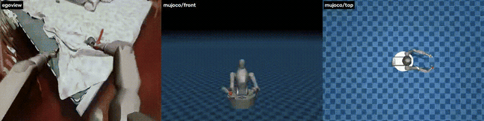
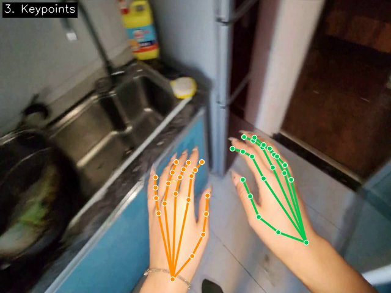
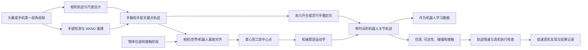

# 从第一视角视频到机器人动作：MANO、重定向与真机复现

人戴着相机完成一次拿取，怎样把视频中的手部动作变成机械臂能够执行的轨迹？本章把这条路径拆成四段：**视频与手部重建 → 坐标和尺度对齐 → 机器人动作重定向 → 仿真检查与真机执行**。重点是还原物体交互，而不仅仅让机械手的姿势看起来像人手。

本章整理公开代码和项目资料，截至 2026-11-05 核对；文中命令来自相应项目的公开说明，本章没有执行训练、仿真或真机复现。原始短视频作者表示其代码尚未开源，下面介绍的是能够完成相关环节的开源工具，不将它们认作该视频的原始实现。

## 1. 先看开源项目能做到什么

| 项目 | 输入与输出 | 适合解决的问题 |
| --- | --- | --- |
| [Open-AoE / Retarget Galbot](https://github.com/ant-research/Open-AoE/tree/a99354633af12c1ef152d12289d36493db6c04e7/aoe-reconstruct-retarget/retarget_galbot) | 已重建的第一视角手部数据 → 机械臂/手部关节轨迹和仿真画面 | 从手掌轨迹到机械臂末端，最贴近本章主线 |
| [Open-AoE / Phantom](https://github.com/ant-research/Open-AoE/tree/a99354633af12c1ef152d12289d36493db6c04e7/aoe-reconstruct-retarget/phantom) | MANO 双手数据 → Unitree G1 双臂与 Dex3 / Inspire 灵巧手轨迹 | 研究双臂逆运动学与不同灵巧手映射 |
| [HaWoR](https://github.com/ThunderVVV/HaWoR) | 第一视角视频 → 相机轨迹和世界坐标下的手部运动重建 | 从原始视频估计手部运动；对遮挡和出画面做时序处理 |
| [WiLoR](https://github.com/rolpotamias/WiLoR) | 单帧图像 / 视频 → 手部检测与三维姿态重建 | 先获取相机视角中的手部姿态；世界轨迹需要额外处理 |
| [SPIDER](https://github.com/facebookresearch/spider) | 人手与物体运动 → 多种机器人手的物理约束轨迹 | 关注接触、物体运动和动力学可行性 |
| [Wuji Ego MINT](https://github.com/wuji-technology/wuji-ego-mint) | 第一视角视频 / 片段 → 手部与相机运动；另提供灵巧手映射资产 | 研究手部与相机重建以及 Wuji 手的映射 |
| [Ego-Pi](https://egopipaper.github.io/) | 人类和机器人示范 → 联合微调视觉语言动作模型 | 利用人类数据学习任务语义和技能组合 |

**视频 1：上游 Open-AoE 的 Galbot 映射演示。** 画面展示第一视角合成、仿真正视图和俯视图。来源：[Retarget Galbot 项目说明](https://github.com/ant-research/Open-AoE/tree/a99354633af12c1ef152d12289d36493db6c04e7/aoe-reconstruct-retarget/retarget_galbot)。



[观看完整演示视频](assets/galbot-demo.mp4)。上方为前 8 秒的压缩预览，完整视频由上游 16 秒动图转码得到。

**图 2：上游 Phantom 的手部关键点叠加。** 第一视角图像上的骨架用于检查检测、左右手和投影位置。来源：[Phantom 项目说明](https://github.com/ant-research/Open-AoE/tree/a99354633af12c1ef152d12289d36493db6c04e7/aoe-reconstruct-retarget/phantom)。



上面素材由 Open-AoE 项目发布；视频是上游生成的仿真 / 合成展示，不是本仓录制的真机视频。预览经过缩放、降帧和截取，视频由动图转码；图片保持上游原样。上游项目许可见[随附文件](assets/LICENSE-OPEN-AOE.txt)，其他依赖与数据的条件见[上游许可说明](https://github.com/ant-research/Open-AoE/blob/a99354633af12c1ef152d12289d36493db6c04e7/LEGAL.md)。

## 2. 完整数据流



**图 3：从人类视频到机器人动作的数据流。** 真实系统的相机、世界和机器人坐标关系由具体采集设备决定；物体位姿、机械臂模型和执行检查需要与目标机器人配套。

| 阶段 | 主要输入 | 主要输出 | 应检查什么 |
| --- | --- | --- | --- |
| 视频与手部重建 | 视频、相机内参、模型权重 | 每帧手部姿态、手腕位置、有效性和相机运动 | 是否识别到正确的手，遮挡与出画面是否有标记 |
| 坐标与场景对齐 | 相机轨迹、外参、机器人基座和物体位姿 | 机器人坐标系下的手/物轨迹 | 单位、尺度、旋转方向、时间戳和外参 |
| 动作重定向 | 人手关键点、机器人运动学模型、末端定义 | 机械臂关节位置与夹爪 / 手指动作 | 可达性、手型差异、夹爪开合和关节范围 |
| 仿真与执行 | 关节轨迹、碰撞几何、控制频率和约束 | 可回放轨迹、检查结果及必要时的真机动作 | 全段碰撞、速度、加速度、急动度和任务成败 |

## 3. 从视频得到可用的手部数据

### 3.1 MANO 输出是什么

[MANO](https://mano.is.tue.mpg.de/) 是参数化的人手模型：手腕位置与朝向决定手在空间中的整体姿态，手指姿态和形状参数决定手的关节与表面。它可以用于重建网格和关键点；要得到机器人命令，还需要结合相机运动、机器人结构和场景标定。

HaWoR 的方法是先从视频估计相机坐标系下的手部，再估计相机轨迹，把手部运动恢复到世界坐标系；对手离开视野的片段使用时序补全。可查看[上游方法和演示](https://hawor-project.github.io/)与[代码安装说明](https://github.com/ThunderVVV/HaWoR/blob/66c7d4108d58a716deccd192cb7645170cdc7bd7/README.md)。

准备 HaWoR 时，上游要求分别取得模型权重、DROID-SLAM / Metric3D 资源以及 MANO 模型。其演示入口如下，命令以官方仓库和依赖已准备完毕为前提：

```bash
export HAWOR_ROOT=/path/to/your/HaWoR
cd "$HAWOR_ROOT"
python demo.py --video_path ./example/video_0.mp4 --vis_mode world
python demo.py --video_path ./example/video_0.mp4 --vis_mode cam
```

两个模式分别用于检查世界视角和相机视角。MANO 模型需从[官方网站](https://mano.is.tue.mpg.de/)注册并按许可获取；HaWoR 模型及其他依赖也有各自的许可和使用条件。

### 3.2 先检查一条 Open-AoE 数据

[Open-AoE 数据说明](https://github.com/ant-research/Open-AoE/blob/a99354633af12c1ef152d12289d36493db6c04e7/open-aoe-2000h/README.md)提供视频、手部重建、相机轨迹和动作标注。一个片段中的核心文件通常为：

```text
<segment>/
├── raw_video.mp4
├── video_info.json
└── ego_process/
    ├── ego_hands_reconstruction/
    │   ├── hands.npz
    │   ├── hands_keypoints.npz    # 部分流程生成的关键点文件
    │   └── camera_traj.npz
    └── ego_undistorted_video/
        ├── raw_video_undistorted.mp4
        └── undistorted_video_info.json
```

`hands.npz` 的左右手维度为 2：`0` 是左手、`1` 是右手；`pred_valid` 是逐帧有效性掩码，`pred_trans` 是世界坐标系下的手腕平移，`pred_rot` 是轴角形式的手腕旋转，`pred_hand_pose` 是手指关节姿态。`camera_traj.npz` 中的 `cam_c2w` 表示逐帧相机到世界变换。坐标单位和字段形状以[上游数据规范](https://github.com/ant-research/Open-AoE/blob/a99354633af12c1ef152d12289d36493db6c04e7/open-aoe-2000h/README.md)为准。

拿到一条实际片段后，可先用以下命令查看帧数与左右手有效帧。它只读取数据，不运行重建或控制机器人：

```bash
export AOE_EPISODE=/path/to/your/aoe_segment
export HANDS_FILE="$AOE_EPISODE/ego_process/ego_hands_reconstruction/hands.npz"
python - <<'PY'
import os
import numpy as np

with np.load(os.environ["HANDS_FILE"]) as data:
    valid = data["pred_valid"] > 0
    print("fields:", data.files)
    print("hand validity shape:", valid.shape)
    print("left/right valid frames:", valid.sum(axis=1).tolist())
    print("wrist translation shape:", data["pred_trans"].shape)
PY
```

检查重建手部与去畸变视频是否逐帧对齐、左右手是否正确、手被遮挡时是否标为无效。使用去畸变图像时，采用配套的去畸变内参；无效帧不要直接当作可靠位姿。换用 HaWoR 或其他重建器时，先编写和验证格式转换，不能假定它们直接输出 Open-AoE 的目录与字段。

## 4. 坐标、尺度和物体关系

### 4.1 明确每个坐标系

记 `C` 为逐帧相机坐标系，`W` 为该段重建使用的世界坐标系，`B` 为机器人基座坐标系，`H` 为人手参考坐标系，`TCP` 为机器人工具中心点。用 `T_A_B` 表示将 B 坐标中的点转换到 A 坐标的变换：

```text
T_B_TCP(t) = T_B_W × T_W_H(t) × T_H_TCP
```

其中 `T_W_H(t)` 来自手部和相机重建，`T_B_W` 通过场景或标定建立，`T_H_TCP` 描述人手参考点和机器人末端工具之间的对应关系。实际实现要先统一各系统的轴方向、左右手、旋转表示、长度单位和时间戳。

对于固定在环境中的相机，可标定相机与机器人基座之间的固定变换；对于装在末端上的相机，先做手眼标定，再结合每帧机械臂位姿计算相机到基座的变换。头戴相机随人移动，不能将每一帧的相机坐标直接当作固定世界坐标。已有入门材料见[手眼协调与标定](../../../02-机器人基础和控制、手眼协调/补充01手眼协调.md)。

单目视频的重建尺度、相机漂移、画面遮挡都会影响目标位置。即使某个方法输出以米为单位的结果，也应使用已知尺寸或可测场景做尺度与位置核对；例如 Wuji Ego MINT 当前公开数据说明其中部分相机轨迹存在尺度放大，使用前应查看[项目发布状态](https://github.com/wuji-technology/wuji-ego-mint)。

### 4.2 以物体为参照更容易保持任务含义

如果演示中的瓶子与实际机器人桌面上的瓶子不在同一位置，直接播放世界坐标轨迹容易抓空。可以先估计演示中物体位姿 `T_W_O_demo`，把接近、抓取和抬起时的人手变成物体相对轨迹；执行时再用实测的 `T_B_O_robot` 将目标放回机器人工作空间。需要注意物体外形、对称性、遮挡和夹爪方向，并逐帧验证变换与接触点。

更换演示者不必然要求重做机械臂与固定外部相机的手眼标定；新的拍摄片段仍需确认它自己的相机轨迹、尺度与场景对齐。若相机、机器人、工具或安装位置改变，则应重新检查相应标定。人手大小、抓取习惯及机器人手结构变化也会影响动作映射。

## 5. 两条具体重定向路线

### 5.1 机械臂与夹爪：Retarget Galbot

Open-AoE 的 [Retarget Galbot](https://github.com/ant-research/Open-AoE/blob/a99354633af12c1ef152d12289d36493db6c04e7/aoe-reconstruct-retarget/retarget_galbot/README.md) 从数据片段读取手部信息；必要时先用 MANO 正向运动学生成关键点。其文档说明，掌心由手腕和 5、9、13、17 号掌指关节点的均值构造，并结合片段的臂长尺度；机械臂采用 Pinocchio 阻尼最小二乘工具中心点逆运动学，生成 `(T, 33)` 的 Galbot 关节位置数组。

**输入与输出**：输入是一段符合 Open-AoE 结构的数据；输出包括 `<segment>_actions.npy` 和可选逐帧文件。上游还提供合成第一视角、正面、俯视画面以及 LeRobot 数据导出。合成图像用于对照观察；是否抓到物体，需要检查仿真接触或真实执行结果。

下面是基于上游固定版本的路线。`AOE_EPISODE` 指向用户自行取得的一个片段，不能直接指向普通视频文件；环境及模型需按[上游依赖说明](https://github.com/ant-research/Open-AoE/blob/a99354633af12c1ef152d12289d36493db6c04e7/aoe-reconstruct-retarget/retarget_galbot/README.md#requirements)准备。

```bash
export WORK_ROOT="$HOME/robotics/ego-retarget"
export AOE_ROOT="$WORK_ROOT/Open-AoE"
export ENV_DIR="$WORK_ROOT/env-galbot"
export AOE_EPISODE=/path/to/your/aoe_segment
mkdir -p "$WORK_ROOT"
git clone https://github.com/ant-research/Open-AoE.git "$AOE_ROOT"
git -C "$AOE_ROOT" checkout a99354633af12c1ef152d12289d36493db6c04e7
conda create -p "$ENV_DIR" python=3.11 -y
conda activate "$ENV_DIR"
cd "$AOE_ROOT/aoe-reconstruct-retarget/retarget_galbot"
python -m pip install -e .
export MUJOCO_GL=egl
python scripts/retarget.py \
  --episode_dir "$AOE_EPISODE" \
  --output_dir "$WORK_ROOT/output/galbot" \
  --max_frames 100 --write_pickle
```

完成后检查输出中的 `<segment>_actions.npy`、长度、单位与机器人关节顺序，再按上游说明生成多视角仿真或导出数据。若没有 `hands_keypoints.npz`，上游可能需要另行准备 MANO 模型以生成关键点。完整第一视角合成还需要 SAM 2、ProPainter 等额外依赖；仅查看轨迹不必默认执行视频修复步骤。

### 5.2 人形双臂与灵巧手：Phantom

[Phantom](https://github.com/ant-research/Open-AoE/blob/a99354633af12c1ef152d12289d36493db6c04e7/aoe-reconstruct-retarget/phantom/README.md) 使用手部关键点、机械臂逆运动学和 `dex-retargeting`，将数据映射到 G1 双臂及不同灵巧手。其文档列出 G1 + Inspire 的 26 维动作和 G1 + Dex3 的 28 维动作，关节布局不同，不能互换。

在已准备上游依赖与 MANO 资源后，可从对应子目录运行单片段：

```bash
cd "$AOE_ROOT/aoe-reconstruct-retarget/phantom"
MUJOCO_GL=egl python scripts/retarget.py \
  --episode_dir "$AOE_EPISODE" \
  --robot g1_inspire \
  --output_dir "$WORK_ROOT/output/g1-inspire" \
  --visualize
```

将 `--robot g1_inspire` 改为 `--robot g1_dex3` 可选择另一套手。检查机器人关节轨迹与仿真画面时，应分别核对双臂、手指、物体和碰撞模型。上游还提供人手分割、画面修复和机器人叠加；它们服务于可视化与数据生成，需要按[上游说明](https://github.com/ant-research/Open-AoE/blob/a99354633af12c1ef152d12289d36493db6c04e7/aoe-reconstruct-retarget/phantom/README.md)单独配置。

### 5.3 手型、接触与不同实现

- **平行夹爪**：通常把手腕 / 掌心轨迹映射成末端位姿，再用拇指与食指间距等特征估计开合；真实夹爪开口、接触力和目标物体尺寸需要单独标定。
- **灵巧手**：人手与机器人手的关节数、长度和活动范围不同，可用指尖 / 掌心几何目标做优化映射，并检查关节限位与自碰撞。
- **物理约束**：若目标是拾取、旋转等接触任务，可参考 [SPIDER 项目](https://github.com/facebookresearch/spider)：在运动学结果基础上引入物理采样，优化机器人和物体的可执行交互；其[项目页](https://jc-bao.github.io/spider-project/)有仿真与真实机器人演示。

## 6. 从仿真轨迹到真机

把重建轨迹交给真机前，按目标设备建立一份明确的检查和停止条件：

1. **对齐检查**：确认机器人基座、工具中心点、相机和物体使用同一约定；用几个实测位置检查方向、尺度、时间同步和末端朝向。
2. **逐帧求解**：对每个目标位姿求逆运动学，使用连续初值并记录失败帧、位置 / 姿态残差与关节跳变。检查整段后再决定是否执行；不可达帧需要修正目标、路径或机器人姿态。
3. **路径检查**：检查关节软限位、自碰撞、环境碰撞及机器人接近奇异位形时的行为。对插值后的轨迹重新检查，而不是只看离散关键帧。
4. **时间参数化**：结合设备额定约束，为关节轨迹设置速度、加速度与急动度上限；调整速度后重新检查轨迹及碰撞。
5. **分阶段执行**：先空载、低速、留出安全空间，确保急停与人工监看可用；再逐步接触物体，记录末端误差、抓取是否稳定、碰撞与失败原因。

上面的项目提供了重建和仿真工具；具体真机控制接口、标定结果和停止阈值必须根据机器人型号、夹具及工作空间配置。`IK` 全部成功只是其中一项检查，还需结合轨迹和任务结果评估。

## 7. 何时直接复现，何时用于学习

如果目标是**复现同一个拿取动作**，重点是物体相对轨迹、标定、夹爪控制、全段运动学与接触检查。要比较“看起来像”和“真的完成任务”，可记录有效重建比例、逆运动学成功帧比例、末端位置 / 姿态误差、碰撞数、抓取成功次数和重复次数。

如果目标是**利用大量人类视频训练机器人策略**，重定向后的轨迹可以成为候选监督数据，也可以与机器人数据一起训练；必须保留数据来源、坐标系、动作语义与有效性标记。[Ego-Pi](https://egopipaper.github.io/)研究的是人类与机器人数据联合微调：机器人已有基础操作能力，人类数据用于学习排序规则和技能组合。它是相关学习路线，并非上述直接轨迹回放工具。

第一视角视频既可以用于离线数据处理，也可以在系统支持时用于在线控制。与使用 Pico 等头显和控制器的实时遥操作相比，离线视频路线更关注采集规模、重建质量和数据可用性；实时遥操作还需要持续的人机同步、低延迟反馈与跟踪。两种路线的精度取决于设备、标定、遮挡和实现，不能只凭采集形式判定谁一定更准。

## 8. 常见问题与资料

- **人手覆盖图对得上，但机械臂抓偏**：先查相机到基座外参、重建尺度、物体位姿和手到工具中心点偏移；再查末端运动学与控制误差。
- **手在视频中暂时消失**：查看有效性掩码和重建方法的补全结果；长遮挡段应复核，避免把补全轨迹直接用于接触执行。
- **手腕位置平滑，手指仍穿物体**：分别检查手型映射、物体几何、接触阶段和仿真碰撞；考虑物理约束方法。
- **同一动作换一个人之后抓取失败**：检查新片段的相机轨迹、手部尺度、目标物位置和接触点，不要默认新片段与原来共享重建世界坐标。

**项目和数据来源**：[Open-AoE 总览及数据集](https://github.com/ant-research/Open-AoE)、[Retarget Galbot](https://github.com/ant-research/Open-AoE/tree/a99354633af12c1ef152d12289d36493db6c04e7/aoe-reconstruct-retarget/retarget_galbot)、[Phantom](https://github.com/ant-research/Open-AoE/tree/a99354633af12c1ef152d12289d36493db6c04e7/aoe-reconstruct-retarget/phantom)、[HaWoR](https://hawor-project.github.io/)、[SPIDER](https://github.com/facebookresearch/spider)、[MANO](https://mano.is.tue.mpg.de/)。项目代码、数据、机器人模型和 MANO 权重可能采用不同许可，使用时分别查看各自说明。
