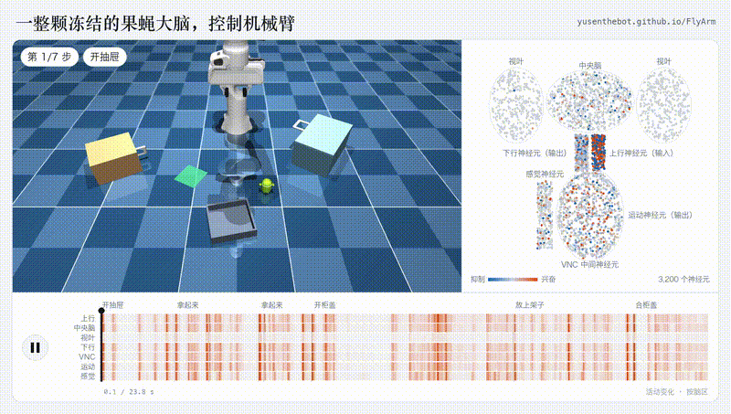
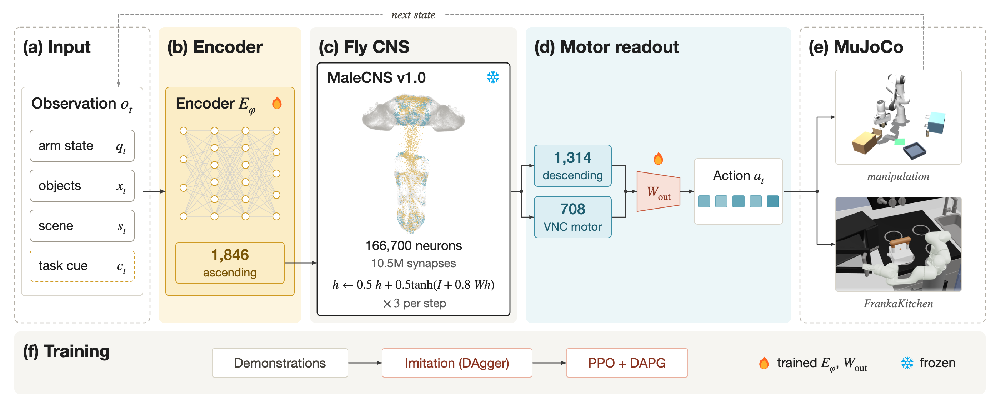

# 果蝇神经连接组：从数字果蝇到机械臂控制

这篇把果蝇神经图谱、脑网络仿真与机器人身体控制放在一条学习线上：先理解 **FlyWire 的神经连接数据**，再看 Eon 如何将脑模型与虚拟果蝇身体连接，最后对照本机已有源码的 **FlyArm 机械臂仿真实验**。这些项目使用不同连接组和神经元模型，适合并列学习。

[](./assets/flyarm-robot-brain.mp4)

*视频：FlyArm 作者提供的仿真回放，左侧为机械臂执行任务，右侧为选取的 3,200 个神经元活动；点击播放[完整视频](./assets/flyarm-robot-brain.mp4)。来源：[FlyArm 项目](https://github.com/yusenthebot/FlyArm)，此视频是作者演示，不是本教程新增实验。*

## 1. 图片中的说法对应什么

截图提到 **FlyWire**、约 **13.9 万神经元**和 **5,000 万个突触**。FlyWire 论文确实报告：对一只成年雌性果蝇大脑的重建包含 **139,255 个神经元和约 5,450 万个化学突触**。这是通过图像重建得到的神经元及其连接资料；神经活动如何随时间演化，还需要建立计算模型。[FlyWire 原论文](https://www.nature.com/articles/s41586-024-07558-y)

截图未标出机甲视频的作者、项目名称或代码地址，因此暂时无法确认画面的具体出处。下面列出的是与其描述**相关且有来源的开源项目**，并单独标明各自的演示和模型。

| 资料或项目 | 使用什么 | 输出或展示 | 来源 |
| --- | --- | --- | --- |
| FlyWire | 成年雌性果蝇脑连接图及神经元标注 | 连接、细胞类别等数据 | [论文](https://www.nature.com/articles/s41586-024-07558-y) · [标注代码](https://github.com/flyconnectome/flywire_annotations) |
| Eon fly-brain | 基于 FlyWire 的简化脉冲神经元模型 | 受刺激或抑制后的神经活动模拟；仓库提供多个计算后端 | [代码仓库](https://github.com/eonsystemspbc/fly-brain) · [身体连接说明](https://eon.systems/updates/embodied-brain-emulation) |
| NeuroMechFly / FlyGym | 果蝇身体、关节、接触和感官的物理仿真 | 可供控制器使用的虚拟果蝇身体 | [FlyGym 代码](https://github.com/NeLy-EPFL/flygym) · [项目文档](https://neuromechfly.org/) |
| FlyArm | 雄性果蝇全中枢神经系统连接组 MaleCNS，外加训练过的输入和输出接口 | 控制 MuJoCo［物理仿真引擎］中的 Franka 机械臂 | [项目与结果](https://github.com/yusenthebot/FlyArm) · [交互演示](https://yusenthebot.github.io/FlyArm/) |

**数量口径：**FlyWire 论文的 5,450 万是重建出的化学突触数量；程序经筛选、聚合同一对神经元之间的多个突触后，会得到不同数量的神经元连接或边。Eon 仓库简介写约 500 万个“synapses”；比较这一数字与论文突触总数前，需要核对数据版本、筛选和统计单位。[Eon 代码说明](https://github.com/eonsystemspbc/fly-brain)

### 原始论文和作者资料

| 来源 | 回答什么问题 | 阅读入口 |
| --- | --- | --- |
| Dorkenwald 等，2024 年《自然》 | 13.9 万神经元的大脑连接图从何而来 | [论文全文](https://pmc.ncbi.nlm.nih.gov/articles/PMC11446842/) · [连接数据](https://doi.org/10.5281/zenodo.10676866) |
| Shiu 等，2024 年《自然》 | 如何根据连接图构建脉冲神经元模型，以及模型预测与生物实验如何比较 | [论文全文](https://pmc.ncbi.nlm.nih.gov/articles/PMC11446845/) · [论文作者代码](https://github.com/philshiu/Drosophila_brain_model) |
| Wang-Chen 等，2024 年《自然·方法》 | 虚拟果蝇的身体、感官和物理交互如何建立 | [论文](https://www.nature.com/articles/s41592-024-02497-y) · [论文代码快照](https://zenodo.org/records/12973000) |
| Eon 团队，2026 年技术说明 | 脑模型怎样与虚拟果蝇身体连接 | [作者方法说明](https://eon.systems/updates/embodied-brain-emulation) · [原始演示说明](https://eon.systems/updates/first-multi-behavior-brain-upload) · [开源脑模型](https://github.com/eonsystemspbc/fly-brain) |

Shiu 等人的论文报告，在 **164 项可以用实验核对的模型预测中，91% 与实验一致**；这是论文所述的神经回路预测检验。Eon 后续把相关脑模型与身体仿真及控制接口结合，不能把这个百分比直接当作机械臂任务成功率。[论文结果](https://pmc.ncbi.nlm.nih.gov/articles/PMC11446845/)

## 2. 从神经图谱到可行动的身体

```text
环境刺激 / 机器人状态
       ↓  设计或学习输入映射
感觉通路 → 神经元模型与连接组 → 选取的下行神经元活动
                                      ↓  设计或学习输出映射
                             控制器 → 仿真身体 / 机械臂
                                      ↓
                            身体运动产生新的观测
```

连接图描述的是神经元之间的线路。要让它参与控制，还要确定神经元更新规则、外界刺激如何输入、哪些神经活动被读出，以及读出结果如何转换为身体动作。

Eon 的[技术说明](https://eon.systems/updates/embodied-brain-emulation)描述了虚拟果蝇的闭环：将刺激映射到相关神经通路，更新脑网络，读取部分下行信号，再由身体控制器转换为动作并反馈感官变化。身体使用 NeuroMechFly，物理演化使用 MuJoCo［物理仿真引擎］。其说明同时指出，输入和脑到身体的映射有人工设计，展示中采用既有身体控制器；该说明所述的视觉活动当时尚未显著影响行为输出。

Eon 的 [`fly-brain` 仓库](https://github.com/eonsystemspbc/fly-brain)目前主要提供脑网络仿真与后端比较入口；[FlyGym](https://github.com/NeLy-EPFL/flygym)另行提供果蝇身体仿真。阅读时应分别检查代码、数据及身体接口，按各上游项目说明准备环境。

## 3. FlyArm：把连接组接到机械臂

FlyArm 适合作为本专题的机器人操作案例。本机已有一份项目工作副本：`/data/Data14TB/01Proj/FlyArm-20261018`；可公开查阅[作者仓库](https://github.com/yusenthebot/FlyArm)和[交互展示](https://yusenthebot.github.io/FlyArm/)。仓库中的代码与实验记录保留在原项目中。



*图：FlyArm 作者的流程图。来源：[流程图及说明](https://github.com/yusenthebot/FlyArm/blob/main/docs/figures/pipeline-caption.md)。*

1. **输入**：仿真器提供机械臂、物体、场景状态以及当前任务提示；输入编码器将这些信息写入上行神经元。
2. **连接组**：使用 MaleCNS v1.0 雄性果蝇中枢神经系统资料；作者报告网络有 166,700 个神经元，图中约 1,050 万条连接经过所述突触阈值筛选。连接权重在策略学习中固定。
3. **输出**：从下行及运动神经元读出活动，经训练的线性解码器映射成机械臂动作，仿真器执行并产生下一次状态。
4. **训练**：项目先用示教和 DAgger［数据集聚合模仿学习］，再用带示教项的 PPO［近端策略优化］训练接口；机械臂实验中还会通过固定的连接组更新输入编码器。

这个实验使用的是**神经元活动率模型**，输入是仿真器状态，任务顺序由任务计划提供；项目当前展示的是机械臂仿真。它与截图中的 FlyWire 雌性脑图谱、脉冲神经元模型及未知机甲视频不是同一个已确认的实现。[作者方法和范围](https://github.com/yusenthebot/FlyArm#scope-and-limits)

### 作者报告的结果

FlyArm 对多步操作任务报告了以下完整任务成功率，分别比较训练与测试条件；这是作者报告的**单个训练种子**结果：

| 测试条件 | 模仿学习 | 加入强化学习后 |
| --- | ---: | ---: |
| 同分布 | 63.4% | 76.3% |
| 未见物体 | 64.7% | 82.6% |
| 未见家具 | 28.1% | 36.6% |
| 未见任务组合 | 17.2% | 26.6% |

作者也在 FrankaKitchen 仿真中展示多任务结果，并给出神经元消融和连接打乱对照的研究记录；连接组布线相对其他网络的优势仍在研究中。更详细的任务、分母和检查点见[项目结果](https://github.com/yusenthebot/FlyArm#results)和[实验记录](https://github.com/yusenthebot/FlyArm/blob/main/docs/RESEARCH_LOG.md)。

## 4. 还有哪些可以一起看

- [FlyDrones](https://github.com/SpikeCalls/FlyDrones)：探索将摄像头和手势信息映射到神经模型，再转为无人机高层指令。作者明确标注网页演示使用 850 个手工搭建的神经元；完整 MaleCNS 数据需要另行准备，浏览器演示不能当成全连接组实测。
- [FlyGM 论文与项目页](https://lnsgroup.cc/research/FlyGM/)：把果蝇连接图作为图模型结构，用强化学习控制仿真果蝇行走与飞行；项目页当前将代码标为待发布。
- [FlyWire 标注与数据入口](https://github.com/flyconnectome/flywire_annotations)：查找细胞类别和连接图数据；数据、模型与代码应分别查看对应许可。

## 5. 从哪里开始

1. 先看 [Eon 的身体连接说明](https://eon.systems/updates/embodied-brain-emulation)，理解感觉输入、神经活动和身体控制如何接起来。
2. 打开 [FlyArm 交互展示](https://yusenthebot.github.io/FlyArm/)，观察机械臂动作、部分神经元活动和消融结果。
3. 按研究目标选择 [脑网络代码](https://github.com/eonsystemspbc/fly-brain)、[果蝇身体仿真](https://github.com/NeLy-EPFL/flygym)或 [机械臂实验代码](https://github.com/yusenthebot/FlyArm)。本专题尚未在当前机器启动新的训练或复现。

本机 FlyArm 工作副本的上游说明以 Apple Silicon［苹果芯片］和 MLX［苹果机器学习框架］为主要运行配置；本机 NVIDIA［英伟达显卡］环境需先核对对应后端与依赖，不能直接套用苹果平台耗时。代码许可证及连接组、机器人模型等数据许可分别见各项目说明；例如 FlyArm 代码为 Apache-2.0，而上游数据保留各自许可。
