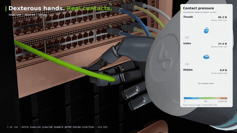
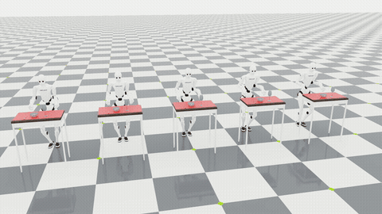
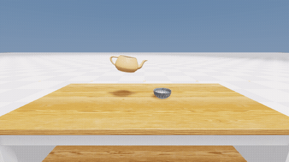
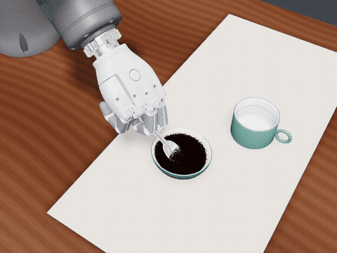

# Isaac Lab 3.0：多后端仿真与柔体操作示例

Isaac Lab 3.0 将机器人学习任务、物理求解、渲染和训练框架的接口进一步解耦。对于具身操作研究，它提供了从轻量仿真验证到大规模训练的共同工作流；网线插拔和抽桌布则让我们直观看到灵巧手、接触与柔性物体如何放进同一场景。

> 本文是官方资料导读和示例运行指南，资料核对日期为 2026-11-08；视频来自官方演示。茶壶和咖啡视频在本机按下文所列配置录制，运行命令及硬件需求以对应版本的官方文档为准。

## 1. 为什么值得学习？

[Isaac Lab 3.0 正式版](https://github.com/isaac-sim/IsaacLab/releases/tag/v3.0.0)于 2026-10-20 发布，面向机器人学习提供多种物理、渲染和可视化后端。关键变化是**仿真与训练基础设施**：任务可以在支持的配置之间切换，同时沿用统一的任务接口和训练入口。

| 组成 | 作用 | 本教程中的例子 |
| --- | --- | --- |
| Isaac Lab | 组织机器人、场景、观测、动作和任务，连接训练与评估 | 创建可交互机器人操作环境 |
| Newton | 可独立于完整 Isaac Sim 运行的物理后端，提供多种求解器 | 线缆和桌布中的 VBD［基于顶点的动力学］ |
| PhysX［物理引擎］ | 刚体等物理仿真后端，提供独立运行库和 Isaac Sim 两种路径 | 使用现有 PhysX［物理引擎］任务与传感器 |
| 渲染与可视化 | 生成相机图像或展示仿真状态，可按任务选择 | Newton GL［图形查看器］、Kit［图形运行环境］ |
| 强化学习接口 | 将环境连接到 RSL-RL、RLinf 等训练库 | 定义观测、动作、奖励和终止条件后训练策略 |

Newton 还包括 MuJoCo-Warp［加速物理求解器］、MPM［物质点法］等求解路径，可用于不同的刚体、柔体和颗粒场景。物理、渲染和可视化是不同的选择；**具体能否组合由任务和版本决定**。详见[官方后端和预设说明](https://isaac-sim.github.io/IsaacLab/main/source/concepts/backends_and_presets.html)及[正式版说明](https://github.com/isaac-sim/IsaacLab/releases/tag/v3.0.0)。

## 2. 官方示例：网线、桌布、倒水与咖啡

| 插入与拔出网线 | 五工位抽桌布对比 |
| --- | --- |
| [](assets/rj45-official.mp4) | [](assets/tablecloth-official.mp4) |
| [观看官方完整视频](assets/rj45-official.mp4) | [观看官方五速度对比视频](assets/tablecloth-official.mp4) · [另一视角](https://github.com/user-attachments/assets/27ac0365-e862-4d60-bd85-51f585a580d5) |

视频来源：NVIDIA [Isaac Lab 生态页面](https://isaac-sim.github.io/IsaacLab/develop/source/isaaclab/ecosystem.html)和[官方示例页面](https://isaac-sim.github.io/IsaacLab/develop/source/isaaclab/demos.html)。网线完整视频为官方原片的压缩版本，预览从官方视频抽取；两段均为官方演示。

### 2.1 Sharpa RJ45：灵巧手与接触

Rizon 4s 机械臂配合 SHARPA 灵巧手，在一次连续仿真中完成插入、松手、重新抓取、按压卡扣和拔出。其主要结构如下：

1. 脚本状态机读取仿真状态，依次给出手掌和手指目标；Newton IK［逆运动学］及动作管理器驱动机器人。
2. 手部与接头外壳及卡扣之间使用 hydroelastic［静水弹性］接触；接头带有弹簧卡扣，线缆使用 VBD［基于顶点的动力学］。
3. 线缆一端固定，另一端跟随测得的插头位置；官方说明该线缆不会将力反馈给插头。官方给出的物理步进为 480 Hz［赫兹］、每步四次 VBD［基于顶点的动力学］迭代。

这是脚本控制示例：官方说明没有奖励、训练预设、策略检查点或自动回合重置。如果希望训练插拔策略，可以在理解场景、接触和动作接口后，另行定义观测、动作、奖励、成功条件、重置与随机化，再选择强化学习库。训练结果需要单独评估。

[示例环境与资产源码（固定版本）](https://github.com/isaac-sim/IsaacLab/tree/e3a79743e3119b82ebb72e8e3e2410c9275cc168/source/isaaclab_tasks/isaaclab_tasks/contrib/gb300_sharpa_insertion) · [官方资产和录制说明（固定版本）](https://github.com/isaac-sim/IsaacLab/blob/e3a79743e3119b82ebb72e8e3e2410c9275cc168/source/isaaclab_tasks/isaaclab_tasks/contrib/gb300_sharpa_insertion/README.md)

### 2.2 Tablecloth Trick：柔性布料与多机器人

三个固定基座的 H2 Plus 机器人使用 SHARPA 灵巧手，以不同速度抽拉桌布；Newton VBD［基于顶点的动力学］处理布料、餐具和接触驱动的抓握，机器人通过脚本化 IK［逆运动学］控制。官方将该例标为实验性，并优先设置接触精度。官方展示图为三个工位，本文视频展示五个速度工位；网线插拔是另一示例。

[官方示例与命令](https://isaac-sim.github.io/IsaacLab/develop/source/isaaclab/demos.html#focused-examples)

### 2.3 Teapot Fill：茶壶倒水与液体仿真

[](assets/teapot-local.mp4)

[观看本机录制视频](assets/teapot-local.mp4)：官方茶壶脚本、3 毫米粒子间距、25 帧每秒。画面中部分水流入碗中，部分洒在桌面。

[Teapot Fill 官方源码（固定版本）](https://github.com/isaac-sim/IsaacLab/blob/e3a79743e3119b82ebb72e8e3e2410c9275cc168/examples/demos/teapot_fill.py)使用 Newton MPM［物质点法］模拟壶内水流、容器与接水碗的相互作用。默认场景没有机械臂：程序直接按预设的时间曲线更新茶壶的位姿与速度，观察水从壶嘴流出。

在第 4.2 节准备好固定版本后，从 `IsaacLab` 目录运行：

```bash
# 物理流体与默认的 Newton GL 可视化
uv run isaaclab demo teapot-fill --device cuda:0 --visualizer newton_gl

# 同时显示流体粒子与重建表面
uv run isaaclab demo teapot-fill --device cuda:0 --visualizer newton_gl --fluid_render_mode both

# 可选：加入 Rizon 与 SHARPA，执行固定抓取和倒水动作
uv run isaaclab example rizon-sharpa-teapot
```

第三条是[官方机械臂扩展示例](https://github.com/isaac-sim/IsaacLab/blob/e3a79743e3119b82ebb72e8e3e2410c9275cc168/examples/rizon_sharpa_teapot.py)，使用固定抓取与预设动作，首次运行还需要机器人资产；它和截图中的无机械臂茶壶场景属于不同配置。茶壶、碗和台面资源也需要可访问对应的官方资产地址。默认无机械臂示例没有配套的策略训练或示教数据采集入口；如用于机器人学习，需先加入机器人、动作接口和任务数据记录。

### 2.4 Rizon–Sharpa Coffee：舀取、倒入和搅拌

[](assets/coffee-local.mp4)

[观看本机录制视频](assets/coffee-local.mp4)：2026-11-08 使用固定版本 `e3a79743`、`--water --physics_hz 120 --grains_per_particle 1`、Newton GL 查看器录制，视频 25.1 秒。脚本依次执行舀取、搬运、倒入、搅拌和收回，运行结束并通过其内置送达检查。画面为脚本控制的仿真，勺子以运动学方式跟随手掌。

官方[咖啡示例说明（固定版本）](https://github.com/isaac-sim/IsaacLab/blob/e3a79743e3119b82ebb72e8e3e2410c9275cc168/source/isaaclab_tasks/isaaclab_tasks/contrib/rizon_sharpa_coffee/README.md)展示 Rizon 4s 和 SHARPA 灵巧手舀咖啡粉、倒入杯中；开启水后还会模拟粉末进入液体、颜色扩散和搅拌。控制器根据测得的勺子位置切换预设动作阶段，再通过 IK［逆运动学］驱动机械臂及手指。勺子通过运动学方式跟随手掌，抓取勺子的过程需要单独构建。

```bash
# 默认：舀取并倒入干咖啡粉
uv run isaaclab demo rizon-sharpa-coffee --device cuda:0 --visualizer newton_gl

# 杯中有水，执行粉末入水与搅拌
uv run isaaclab demo rizon-sharpa-coffee --device cuda:0 --water --visualizer newton_gl

# 用 Newton GL 录制完整画面；输出到数据盘
uv run --extra video isaaclab demo rizon-sharpa-coffee \
  --device cuda:0 --water --video --visualizer newton_gl \
  --output_dir /data/Data14TB/01Proj/isaaclab-coffee/videos
```

录制文件名为 `coffee_0000.mp4` 等；视频是画面记录，训练用的观测—动作数据需要另外配置。咖啡示例需要支持 CUDA［并行计算平台］的 NVIDIA GPU［图形处理器］，并从官方资产库加载碗、杯、勺和授权机器人资源。若使用完整本地资产包，可设置 `ISAACLAB_COFFEE_ASSET_ROOT`；咖啡场景的资产根目录与网线场景的覆盖变量不同，详见官方说明。资产版权和使用条件按提供方规定执行。

## 3. 咖啡场景能采数据和训练吗？

**可以作为基础改造，但现成命令运行的是脚本演示。** 官方咖啡环境继承非学习型环境，没有注册训练任务、策略观测、奖励或 PPO［近端策略优化］配置。官方已给出[改造成强化学习任务的具体方向](https://github.com/isaac-sim/IsaacLab/blob/e3a79743e3119b82ebb72e8e3e2410c9275cc168/source/isaaclab_tasks/isaaclab_tasks/contrib/rizon_sharpa_coffee/README.md#reusing-the-simulation)。

| 目标 | 需要做的事 | 得到什么 |
| --- | --- | --- |
| 先看效果 | 运行上面的干粉或 `--water` 命令 | 单次脚本控制的仿真；可另录视频 |
| 采集示教 | 给环境增加观测和数据记录：每步对齐关节状态、手掌位姿、动作、目标物状态、时间和成功标记；视觉策略还需要同步相机图像 | 供回放和模仿学习使用的多回合轨迹数据 |
| 模仿学习 | 先验证记录和回放，再连接所选训练框架；收集不同初始条件下的成功示教 | 根据观测预测动作的策略 |
| 强化学习 | 使用 `ManagerBasedRLEnv` 及其配置，补齐观测、动作、奖励、终止、重置、任务注册及训练配置；根据实际资源调试并行环境 | 与环境交互并更新的策略 |

官方的机械臂动作是手掌位置、四元数及 22 个手指关节目标组成的 29 维指令。采集时应同时记录动作定义、坐标系、控制频率和版本；从单个固定脚本反复保存的轨迹开始，可先验证数据链路，再通过有效的初始条件变化或人工示教增加多样性。

奖励可从咖啡进入杯中的质量、洒落量和动作平稳度构造；成功条件可参考官方现有的送达比例和最低质量检查，再按任务目标调整。需要把勺子抓取也纳入学习时，应替换当前固定随手掌运动的安装方式，建立接触抓取和相应的重置、成功判定。

Isaac Lab 的[官方示教采集与模仿学习教程](https://isaac-sim.github.io/IsaacLab/main/source/overview/imitation-learning/teleop_imitation.html)提供堆积方块的录制、回放及数据生成示例，可参考其数据流程；它对应的是已注册的方块任务，不能直接把任务名换成咖啡示例就运行。

## 4. 如何体验

### 4.1 先在浏览器体验

访问[官方交互示例](https://isaac-sim.github.io/IsaacLab/develop/source/isaaclab/interactive_demos.html)，可先体验材料变化、刚体接触或预训练策略回放。浏览器示例使用简化场景在本地 CPU［中央处理器］中运行，适合熟悉物理现象；网线和桌布的原生示例见下一节。

### 4.2 从源码运行官方示例

**版本区别：** `v3.0.0` 是正式版基线。网线示例目录在该标签中不存在，在核对时的 `main` 分支提交 `e3a79743e3119b82ebb72e8e3e2410c9275cc168` 中存在。下面固定该提交，避免后续分支变化影响命令；示例及依赖以对应源码为准。需要兼容的 NVIDIA GPU［图形处理器］、驱动和网络，先阅读[官方安装指南](https://isaac-sim.github.io/IsaacLab/main/source/isaaclab/installation.html)。

```bash
git clone https://github.com/isaac-sim/IsaacLab.git
cd IsaacLab
git checkout e3a79743e3119b82ebb72e8e3e2410c9275cc168

# 本机环境与缓存保存在数据盘
export UV_PROJECT_ENVIRONMENT=/data/Data14TB/envs/isaaclab3-main
export UV_CACHE_DIR=/data/Data14TB/cache/uv
export HF_HOME=/data/Data14TB/cache/huggingface

# 查看当前版本的示例列表
uv run isaaclab example list

# 网线插拔：默认 Newton GL 查看器
uv run isaaclab example sharpa-rj45

# 抽桌布：使用第一块 CUDA 设备
uv run isaaclab example tablecloth --device cuda:0
```

`uv run` 会按项目配置准备依赖。网线场景还需要外部机器人与视觉资产，官方说明列出了资产服务器、本地资产目录覆盖选项及接头资源；机器人资产的许可条件以资产提供方为准。首次运行资源准备时间取决于网络和环境。指定项目环境和缓存位置时，请依照本机环境管理约定，避免将大型环境与资源写入系统盘。

如需官方的 Kit［图形运行环境］录制路线，参照[网线示例说明](https://github.com/isaac-sim/IsaacLab/blob/e3a79743e3119b82ebb72e8e3e2410c9275cc168/source/isaaclab_tasks/isaaclab_tasks/contrib/gb300_sharpa_insertion/README.md)和[桌布示例文档](https://isaac-sim.github.io/IsaacLab/develop/source/isaaclab/demos.html#focused-examples)。运行成功后，先观察模型与资产是否加载、抓取及插拔是否连续，再调整场景；遇到资产缺失或显卡兼容问题，先检查终端输出和官方说明。

### 4.3 正式版强化学习入门

如果目标是了解训练而非播放脚本，官方正式版提供倒立摆入门：

```bash
git clone --branch v3.0.0 --depth 1 https://github.com/isaac-sim/IsaacLab.git
cd IsaacLab
export UV_PROJECT_ENVIRONMENT=/data/Data14TB/envs/isaaclab3-v300
export UV_CACHE_DIR=/data/Data14TB/cache/uv
export HF_HOME=/data/Data14TB/cache/huggingface
uv run isaaclab train --rl_library rsl_rl --task Isaac-Cartpole --viz newton_gl physics=newton_mjwarp
```

该命令训练倒立摆策略，不会训练网线示例。正式版的 Python［编程语言］、PyTorch［深度学习框架］、CUDA［并行计算平台］和驱动要求请以[正式版发布说明](https://github.com/isaac-sim/IsaacLab/releases/tag/v3.0.0)及[安装指南](https://isaac-sim.github.io/IsaacLab/main/source/isaaclab/installation.html)为准。

## 5. 学习路径与资料

建议先浏览视频理解任务，再运行网线或桌布示例，阅读环境、接触和控制代码；有训练需求时转到倒立摆，之后再为自己的操作任务设计环境。已有教程中的 [Isaac 部署导览](../01Isaac部署与GR00T实践/00Isaac部署导览.md)介绍工作站与云端部署，[UniLab 与 MotrixSim 训练](../11UniLab-MotrixSim异构RL训练/README.md)提供另一条强化学习基础设施学习路线。

- [Isaac Lab 3.0 正式版发布说明](https://github.com/isaac-sim/IsaacLab/releases/tag/v3.0.0)
- [官方示例库和命令](https://isaac-sim.github.io/IsaacLab/develop/source/isaaclab/demos.html)
- [Sharpa RJ45 环境与资源说明](https://github.com/isaac-sim/IsaacLab/blob/e3a79743e3119b82ebb72e8e3e2410c9275cc168/source/isaaclab_tasks/isaaclab_tasks/contrib/gb300_sharpa_insertion/README.md)
- [交互式浏览器示例](https://isaac-sim.github.io/IsaacLab/develop/source/isaaclab/interactive_demos.html)
