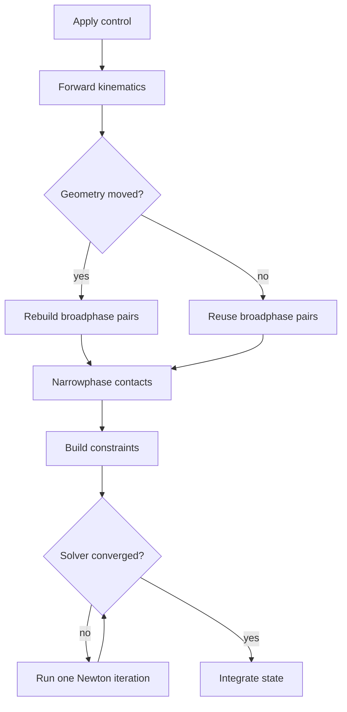

# How Conditional Graphs Accelerate MuJoCo-Warp

## One physics step

An eager step launches these kernels from the host. A static graph records a
fixed sequence once and replays it with one host launch. A conditional graph
also records the control flow: a device predicate selects a branch or repeats
a body graph without copying the decision back to the host.

The graph does not make an individual kernel faster. It can improve total step
time in two ways:

1. reduce host launch and synchronization overhead;
2. omit graph regions that are unnecessary for the current state.

## Two prioritized nodes

| Priority | Node | Device predicate | Work that may be omitted | Coverage |
| --- | --- | --- | --- | --- |
| P0 | solver `capture_while` | unconverged world count | remaining Newton iterations | contact-rich locomotion and manipulation |
| P1 | broadphase `capture_if` | geometry-motion flag | broadphase pair rebuild | sleeping or mostly static clutter |

The frozen P0 humanoid result reaches 1.562x eager throughput with state error
below `1e-6`. The node saves repeated host convergence decisions and ends the
solver when all worlds converge.

The P1 node is a different optimization. It is useful only when broadphase
reuse is both common and physically valid. The full ALOHA pot experiment shows
that branch frequency alone is insufficient: the graph scheduler and the rest
of the physics step can dominate the saved broadphase work.

## Full ALOHA experiment on AMD395

The physical benchmark loads the public ALOHA pot scene and replay, advances
16 worlds through MuJoCo-Warp, and compares three paths:

- eager: direct physics-step launches;
- static: one replayable graph with unconditional broadphase rebuild;
- native: the same graph family with a native device-side `capture_if`.

The policy service occupying the same GPU was paused for every timed run and
resumed afterward. Graph-build time is excluded. Each long result contains
five timed samples, device-predicate telemetry, final state, logs, and SHA256
checksums.

| Phase | Eager worlds/s | Static worlds/s | Native worlds/s | Native/static | Wake predicate |
| --- | ---: | ---: | ---: | ---: | ---: |
| settled | 5,214 | 2,847 | 2,840 | 0.998x | 45.9% |
| active | 4,268 | 2,598 | 2,852 | 1.098x | 100% |
| periodic wake | 5,170 | 3,524 | 2,644 | 0.750x | 100% |

The active one-step gate matches native and static state to
`9.31e-10` for `qpos` and `2.88e-8` for `qvel`. Long contact trajectories
diverge numerically, so the active 1.098x ratio is not promoted as a validated
physical speedup. The settled run is the stable P1 throughput result: native
and static are effectively tied, and both are slower than eager at 16 worlds.

Artifacts are stored under `results/aloha_physical_graph_amd395/`.

## What else can become conditional

Broadphase is not the only candidate. Future device predicates can gate:

- contact and narrowphase work for sleeping islands;
- island dynamics when an island remains asleep;
- optional sensors and post-processing;
- sparse matrix rebuilds when topology is unchanged;
- renderer or recorder work when no output frame is requested.

Each candidate needs a cached-state contract, a device-resident predicate, a
single-step state gate, a long-horizon task gate, and a throughput comparison.
Skipping a graph region without those gates changes the simulator rather than
accelerating it.

## ROCm migration layers

The port is split across four layers:

1. pin MuJoCo 3.8.1, the AMD MuJoCo-Warp snapshot, and the AMD Warp snapshot in
   an isolated Python 3.12 environment;
2. build Warp for `gfx1151` and replace CUDA-only graph assumptions with the
   HIP backend contract;
3. add conditional-handle declarations, runtime ownership, node creation, and
   a device setter to the HIP/CLR source;
4. connect MuJoCo-Warp `capture_while` and `capture_if` call sites to the native
   Warp graph API, then validate device execution, state, throughput, and
   checksums on AMD395.

The patched runtime is loaded from an isolated library path. It does not
replace the system ROCm installation.
