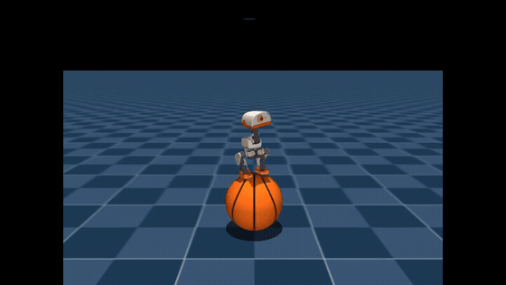

# 小鸭子与小螃蟹：机器人运动策略联合组队学习招募

让小鸭子站上篮球，让小螃蟹迈开六条腿，再亲手改变它们的动作。我们把 MicroDuck 和 Jumper（跳跳）的现有教程合成一个 **21 天联合专题**：从可播放的仿真演示出发，读懂控制与训练代码，完成一次参数对照和自己的机器人作品。

本专题面向对地瓜机器人生态、运动控制与强化学习感兴趣的学习者。MicroDuck 主线包含地瓜 RDK X5［机器人开发套件］端侧推理选修；Jumper 来自金钢科技的开源机器人项目，主线采用工作站仿真与训练。两者各自保留模型、代码与来源署名，共享学习组织、讨论和作品展示。

## 先看它们动起来

这里汇总仓库现有的全部 **42 段完整视频**，另附 **53 项动图素材**。按任务、推理端与训练阶段分组，保留失败基线、早期模型和最终模型，方便观察变化。官方参考素材单独列出，具体模型、命令、指标与许可沿用原教程。

网页展示版可直接播放完整视频；仓库表格点击“播放完整视频”。完整录像按文件收录，动图可能是同一录像的压缩版本，不作为新增独立实验计数。

### 小鸭子：训练、控制与交互

| 任务与阶段 | 视频 | 内容与来源 |
| --- | --- | --- |
| 4096 环境、6000 次迭代行走 | [▶ 播放完整视频](../../05-具身场景的深度和强化学习/05-OpenDuckMini与Microduck双足强化学习/assets/local_videos/microduck_4096env_6000iter_walk.mp4) | 本教程训练或控制实验；配置、来源与方法见原章节。 |
| 同一行走策略的命令编舞 | [▶ 播放完整视频](../../05-具身场景的深度和强化学习/05-OpenDuckMini与Microduck双足强化学习/assets/local_videos/microduck_command_dance.mp4) | 本教程训练或控制实验；配置、来源与方法见原章节。 |
| 物理冲量扰动与自动起身 | [▶ 播放完整视频](../../05-具身场景的深度和强化学习/05-OpenDuckMini与Microduck双足强化学习/assets/local_videos/microduck_physical_impulse_recovery.mp4) | 本教程训练或控制实验；配置、来源与方法见原章节。 |
| 开发板推理控制九只小鸭子方阵 | [▶ 播放完整视频](../../05-具身场景的深度和强化学习/05-OpenDuckMini与Microduck双足强化学习/assets/local_videos/microduck_rdk_brain_3x3_12s.mp4) | 本教程训练或控制实验；配置、来源与方法见原章节。 |
| 开发板推理控制单只小鸭子 | [▶ 播放完整视频](../../05-具身场景的深度和强化学习/05-OpenDuckMini与Microduck双足强化学习/assets/local_videos/microduck_rdk_brain_single_12s.mp4) | 本教程训练或控制实验；配置、来源与方法见原章节。 |
| 连续追球与三次踢球 | [▶ 播放完整视频](../../05-具身场景的深度和强化学习/05-OpenDuckMini与Microduck双足强化学习/assets/local_videos/microduck_visual_soccer_continuous_chase.mp4) | 本教程训练或控制实验；配置、来源与方法见原章节。 |
| 篮球平衡任务素材 | [▶ 播放完整视频](../05-MicroDuck运动策略与任务开发专题/01-任务资料/01-MicroDuck篮球平衡强化学习/assets/basketball-balance.mp4) | 本教程训练或控制实验；配置、来源与方法见原章节。 |
| 前进、转向与停止 | [▶ 播放完整视频](../05-MicroDuck运动策略与任务开发专题/03-Notebook/recordings/control_helloworld/microduck_forward_turn_stop.mp4) | 本教程训练或控制实验；配置、来源与方法见原章节。 |

### 小鸭子：工作站任务回放

| 任务与阶段 | 视频 | 内容与来源 |
| --- | --- | --- |
| 球平衡 | [▶ 播放完整视频](../05-MicroDuck运动策略与任务开发专题/03-Notebook/recordings/gpu_videos/ball_balance_gpu_latest.mp4) | 工作站推理与物理仿真。 |
| 篮球平衡 | [▶ 播放完整视频](../05-MicroDuck运动策略与任务开发专题/03-Notebook/recordings/gpu_videos/basketball_gpu_latest.mp4) | 工作站推理与物理仿真。 |
| 梯面攀爬、登桌与起身 | [▶ 播放完整视频](../05-MicroDuck运动策略与任务开发专题/03-Notebook/recordings/gpu_videos/ladder_gpu_latest.mp4) | 工作站推理与物理仿真。 |
| 外力扰动 | [▶ 播放完整视频](../05-MicroDuck运动策略与任务开发专题/03-Notebook/recordings/gpu_videos/perturbation_gpu_latest.mp4) | 工作站推理与物理仿真。 |
| 高跷行走 | [▶ 播放完整视频](../05-MicroDuck运动策略与任务开发专题/03-Notebook/recordings/gpu_videos/stilt_gpu_latest.mp4) | 工作站推理与物理仿真。 |
| 摆动旋转 | [▶ 播放完整视频](../05-MicroDuck运动策略与任务开发专题/03-Notebook/recordings/gpu_videos/swing_gpu_latest.mp4) | 工作站推理与物理仿真。 |
| 行走 | [▶ 播放完整视频](../05-MicroDuck运动策略与任务开发专题/03-Notebook/recordings/gpu_videos/walking_gpu_latest.mp4) | 工作站推理与物理仿真。 |

### 小鸭子：开发板推理

| 任务与阶段 | 视频 | 内容与来源 |
| --- | --- | --- |
| 球平衡 | [▶ 播放完整视频](../05-MicroDuck运动策略与任务开发专题/03-Notebook/recordings/bpu_videos/ball_balance_bpu_latest.mp4) | 开发板推理，工作站负责物理仿真与渲染。 |
| 篮球平衡 | [▶ 播放完整视频](../05-MicroDuck运动策略与任务开发专题/03-Notebook/recordings/bpu_videos/basketball_bpu_latest.mp4) | 开发板推理，工作站负责物理仿真与渲染。 |
| 梯面攀爬、登桌与起身 | [▶ 播放完整视频](../05-MicroDuck运动策略与任务开发专题/03-Notebook/recordings/bpu_videos/ladder_official_pair_bpu_latest.mp4) | 开发板推理，工作站负责物理仿真与渲染。 |
| 外力扰动 | [▶ 播放完整视频](../05-MicroDuck运动策略与任务开发专题/03-Notebook/recordings/bpu_videos/perturbation_bpu_latest.mp4) | 开发板推理，工作站负责物理仿真与渲染。 |
| 高跷行走 | [▶ 播放完整视频](../05-MicroDuck运动策略与任务开发专题/03-Notebook/recordings/bpu_videos/stilt_bpu_latest.mp4) | 开发板推理，工作站负责物理仿真与渲染。 |
| 摆动旋转 | [▶ 播放完整视频](../05-MicroDuck运动策略与任务开发专题/03-Notebook/recordings/bpu_videos/swing_bpu_latest.mp4) | 开发板推理，工作站负责物理仿真与渲染。 |
| 行走 | [▶ 播放完整视频](../05-MicroDuck运动策略与任务开发专题/03-Notebook/recordings/bpu_videos/walking_bpu_latest.mp4) | 开发板推理，工作站负责物理仿真与渲染。 |

### 小鸭子：导航与跨缝跳跃

| 任务与阶段 | 视频 | 内容与来源 |
| --- | --- | --- |
| 走廊导航 | [▶ 播放完整视频](../05-MicroDuck运动策略与任务开发专题/03-Notebook/recordings/lightnav_gpu/corridor_latest.mp4) | 预训练导航模型推理。 |
| 客厅导航 | [▶ 播放完整视频](../05-MicroDuck运动策略与任务开发专题/03-Notebook/recordings/lightnav_gpu/living_room_latest.mp4) | 预训练导航模型推理。 |
| 住宅导航 | [▶ 播放完整视频](../05-MicroDuck运动策略与任务开发专题/03-Notebook/recordings/lightnav_gpu/official_apartment_latest.mp4) | 预训练导航模型推理。 |
| 跨缝跳跃：续训策略 | [▶ 播放完整视频](../05-MicroDuck运动策略与任务开发专题/03-Notebook/recordings/long_jump/long_jump_continued_latest.mp4) | 按模型版本分别保留的跳跃仿真回放。 |
| 跨缝跳跃：导出模型回放 | [▶ 播放完整视频](../05-MicroDuck运动策略与任务开发专题/03-Notebook/recordings/long_jump/long_jump_onnx_latest.mp4) | 按模型版本分别保留的跳跃仿真回放。 |
| 跨缝跳跃：预训练策略 | [▶ 播放完整视频](../05-MicroDuck运动策略与任务开发专题/03-Notebook/recordings/long_jump/long_jump_pretrained_latest.mp4) | 按模型版本分别保留的跳跃仿真回放。 |

### 小螃蟹：自训与阶段对照

| 任务与阶段 | 视频 | 内容与来源 |
| --- | --- | --- |
| 自训舞蹈：最终回放 | [▶ 播放完整视频](../07-Jumper螃蟹机器人专题/assets/dance-final.mp4) | 本教程实验仿真回放；阶段差异见原专题记录。 |
| 自训舞蹈：阶段回放 | [▶ 播放完整视频](../07-Jumper螃蟹机器人专题/assets/dance-trained.mp4) | 本教程实验仿真回放；阶段差异见原专题记录。 |
| 自训跳跃：参考动作残差策略 | [▶ 播放完整视频](../07-Jumper螃蟹机器人专题/assets/jump-trained.mp4) | 本教程实验仿真回放；阶段差异见原专题记录。 |
| 三足行走：第 299 次检查点回放 | [▶ 播放完整视频](../07-Jumper螃蟹机器人专题/assets/tripod-299.mp4) | 本教程实验仿真回放；阶段差异见原专题记录。 |
| 从零训练三足行走：第 200 次检查点 | [▶ 播放完整视频](../07-Jumper螃蟹机器人专题/assets/tripod-fresh200.mp4) | 本教程实验仿真回放；阶段差异见原专题记录。 |
| 从零训练三足行走：第 999 次检查点 | [▶ 播放完整视频](../07-Jumper螃蟹机器人专题/assets/tripod-fresh999.mp4) | 本教程实验仿真回放；阶段差异见原专题记录。 |
| 续训三足行走：末期回放 | [▶ 播放完整视频](../07-Jumper螃蟹机器人专题/assets/tripod-gpu-final.mp4) | 本教程实验仿真回放；阶段差异见原专题记录。 |
| 未训练基线回放 | [▶ 播放完整视频](../07-Jumper螃蟹机器人专题/assets/zero-baseline.mp4) | 本教程实验仿真回放；阶段差异见原专题记录。 |

### 小螃蟹：上游动作包参考

| 任务与阶段 | 视频 | 内容与来源 |
| --- | --- | --- |
| 上游动作包：舞蹈 | [▶ 播放完整视频](../07-Jumper螃蟹机器人专题/assets/official-dance.mp4) | 上游动作包仿真回放。 |
| 上游动作包：跳跃 | [▶ 播放完整视频](../07-Jumper螃蟹机器人专题/assets/official-jump.mp4) | 上游动作包仿真回放。 |
| 上游动作包：行走跟随视角 | [▶ 播放完整视频](../07-Jumper螃蟹机器人专题/assets/official-walk-follow.mp4) | 上游动作包仿真回放。 |
| 上游动作包：行走 | [▶ 播放完整视频](../07-Jumper螃蟹机器人专题/assets/official-walk.mp4) | 上游动作包仿真回放。 |

### 小鸭子：官方参考视频

| 任务与阶段 | 视频 | 内容与来源 |
| --- | --- | --- |
| 官方真机走路参考 | [▶ 播放完整视频](../../05-具身场景的深度和强化学习/05-OpenDuckMini与Microduck双足强化学习/assets/official_videos/microduck_real_walking.mp4) | 官方项目参考素材；来源与许可见原章节。 |
| 旧款 Open Duck Mini v2 官方仿真参考 | [▶ 播放完整视频](../../05-具身场景的深度和强化学习/05-OpenDuckMini与Microduck双足强化学习/assets/official_videos/open_duck_mini_v2_sim_walking.mp4) | 官方项目参考素材；来源与许可见原章节。 |

### 全部动图与补充阶段素材

以下保留高跷高度对照、浏览器拖拽、摆动、球平衡、爬梯早期阶段、技能串联及其他动态预览。文件名作为素材标识保留，便于返回原教程核对。

| 动态预览 | 素材标识与来源 |
| --- | --- |
|  | [microduck_4096env_6000iter_walk.gif](../../05-具身场景的深度和强化学习/05-OpenDuckMini与Microduck双足强化学习/assets/local_videos/microduck_4096env_6000iter_walk.gif) 来自小鸭子教程 |
|  | [microduck_command_dance.gif](../../05-具身场景的深度和强化学习/05-OpenDuckMini与Microduck双足强化学习/assets/local_videos/microduck_command_dance.gif) 来自小鸭子教程 |
|  | [basketball-balance-preview.gif](../05-MicroDuck运动策略与任务开发专题/01-任务资料/01-MicroDuck篮球平衡强化学习/assets/basketball-balance-preview.gif) 来自小鸭子教程 |
|  | [preview.gif](../05-MicroDuck运动策略与任务开发专题/01-任务资料/01-MicroDuck篮球平衡强化学习/assets/preview.gif) 来自小鸭子教程 |
|  | [microduck_official.gif](../05-MicroDuck运动策略与任务开发专题/01-任务资料/02-mjswan-MicroDuck浏览器物理扰动/assets/microduck_official.gif) 来自小鸭子教程 |
|  | [forward_turn_stop.gif](../05-MicroDuck运动策略与任务开发专题/01-任务资料/07-RDK端侧与网页部署/assets/hello_world/forward_turn_stop.gif) 来自小鸭子教程 |
|  | [microduck_4096env_6000iter_walk.gif](../05-MicroDuck运动策略与任务开发专题/01-任务资料/07-RDK端侧与网页部署/assets/local_videos/microduck_4096env_6000iter_walk.gif) 来自小鸭子教程 |
|  | [microduck_command_dance.gif](../05-MicroDuck运动策略与任务开发专题/01-任务资料/07-RDK端侧与网页部署/assets/local_videos/microduck_command_dance.gif) 来自小鸭子教程 |
|  | [long_jump_continued.gif](../05-MicroDuck运动策略与任务开发专题/01-任务资料/08-MicroDuck跨缝跳跃/assets/long_jump_continued.gif) 来自小鸭子教程 |
|  | [long_jump_onnx.gif](../05-MicroDuck运动策略与任务开发专题/01-任务资料/08-MicroDuck跨缝跳跃/assets/long_jump_onnx.gif) 来自小鸭子教程 |
|  | [long_jump_pretrained.gif](../05-MicroDuck运动策略与任务开发专题/01-任务资料/08-MicroDuck跨缝跳跃/assets/long_jump_pretrained.gif) 来自小鸭子教程 |
|  | [corridor.gif](../05-MicroDuck运动策略与任务开发专题/01-任务资料/精选视频/assets/lightnav/corridor.gif) 来自小鸭子教程 |
|  | [living-room.gif](../05-MicroDuck运动策略与任务开发专题/01-任务资料/精选视频/assets/lightnav/living-room.gif) 来自小鸭子教程 |
|  | [official-apartment.gif](../05-MicroDuck运动策略与任务开发专题/01-任务资料/精选视频/assets/lightnav/official-apartment.gif) 来自小鸭子教程 |
|  | [ball_balance_bpu.gif](../05-MicroDuck运动策略与任务开发专题/01-任务资料/精选视频/assets/notebook-replays/ball_balance_bpu.gif) 来自小鸭子教程 |
|  | [ball_balance_bpu_cached.gif](../05-MicroDuck运动策略与任务开发专题/01-任务资料/精选视频/assets/notebook-replays/ball_balance_bpu_cached.gif) 来自小鸭子教程 |
|  | [ball_balance_gpu.gif](../05-MicroDuck运动策略与任务开发专题/01-任务资料/精选视频/assets/notebook-replays/ball_balance_gpu.gif) 来自小鸭子教程 |
|  | [basketball_bpu.gif](../05-MicroDuck运动策略与任务开发专题/01-任务资料/精选视频/assets/notebook-replays/basketball_bpu.gif) 来自小鸭子教程 |
|  | [basketball_bpu_cached.gif](../05-MicroDuck运动策略与任务开发专题/01-任务资料/精选视频/assets/notebook-replays/basketball_bpu_cached.gif) 来自小鸭子教程 |
|  | [basketball_gpu.gif](../05-MicroDuck运动策略与任务开发专题/01-任务资料/精选视频/assets/notebook-replays/basketball_gpu.gif) 来自小鸭子教程 |
|  | [ladder_bpu.gif](../05-MicroDuck运动策略与任务开发专题/01-任务资料/精选视频/assets/notebook-replays/ladder_bpu.gif) 来自小鸭子教程 |
|  | [ladder_bpu_cached.gif](../05-MicroDuck运动策略与任务开发专题/01-任务资料/精选视频/assets/notebook-replays/ladder_bpu_cached.gif) 来自小鸭子教程 |
|  | [ladder_gpu.gif](../05-MicroDuck运动策略与任务开发专题/01-任务资料/精选视频/assets/notebook-replays/ladder_gpu.gif) 来自小鸭子教程 |
|  | [perturbation_bpu.gif](../05-MicroDuck运动策略与任务开发专题/01-任务资料/精选视频/assets/notebook-replays/perturbation_bpu.gif) 来自小鸭子教程 |
|  | [perturbation_bpu_cached.gif](../05-MicroDuck运动策略与任务开发专题/01-任务资料/精选视频/assets/notebook-replays/perturbation_bpu_cached.gif) 来自小鸭子教程 |
|  | [perturbation_gpu.gif](../05-MicroDuck运动策略与任务开发专题/01-任务资料/精选视频/assets/notebook-replays/perturbation_gpu.gif) 来自小鸭子教程 |
|  | [stilt_bpu.gif](../05-MicroDuck运动策略与任务开发专题/01-任务资料/精选视频/assets/notebook-replays/stilt_bpu.gif) 来自小鸭子教程 |
|  | [stilt_bpu_cached.gif](../05-MicroDuck运动策略与任务开发专题/01-任务资料/精选视频/assets/notebook-replays/stilt_bpu_cached.gif) 来自小鸭子教程 |
|  | [stilt_gpu.gif](../05-MicroDuck运动策略与任务开发专题/01-任务资料/精选视频/assets/notebook-replays/stilt_gpu.gif) 来自小鸭子教程 |
|  | [swing_bpu.gif](../05-MicroDuck运动策略与任务开发专题/01-任务资料/精选视频/assets/notebook-replays/swing_bpu.gif) 来自小鸭子教程 |
|  | [swing_bpu_cached.gif](../05-MicroDuck运动策略与任务开发专题/01-任务资料/精选视频/assets/notebook-replays/swing_bpu_cached.gif) 来自小鸭子教程 |
|  | [swing_gpu.gif](../05-MicroDuck运动策略与任务开发专题/01-任务资料/精选视频/assets/notebook-replays/swing_gpu.gif) 来自小鸭子教程 |
|  | [walking_bpu.gif](../05-MicroDuck运动策略与任务开发专题/01-任务资料/精选视频/assets/notebook-replays/walking_bpu.gif) 来自小鸭子教程 |
|  | [walking_bpu_cached.gif](../05-MicroDuck运动策略与任务开发专题/01-任务资料/精选视频/assets/notebook-replays/walking_bpu_cached.gif) 来自小鸭子教程 |
|  | [walking_gpu.gif](../05-MicroDuck运动策略与任务开发专题/01-任务资料/精选视频/assets/notebook-replays/walking_gpu.gif) 来自小鸭子教程 |
|  | [ball-balance-local-5000iter.gif](../05-MicroDuck运动策略与任务开发专题/01-任务资料/精选视频/assets/task-demos/ball-balance-local-5000iter.gif) 来自小鸭子教程 |
|  | [ball-balance-official.gif](../05-MicroDuck运动策略与任务开发专题/01-任务资料/精选视频/assets/task-demos/ball-balance-official.gif) 来自小鸭子教程 |
|  | [browser-manual-drag-full.gif](../05-MicroDuck运动策略与任务开发专题/01-任务资料/精选视频/assets/task-demos/browser-manual-drag-full.gif) 来自小鸭子教程 |
|  | [ladder-reference.gif](../05-MicroDuck运动策略与任务开发专题/01-任务资料/精选视频/assets/task-demos/ladder-reference.gif) 来自小鸭子教程 |
|  | [ladder-stage-contact-suite.gif](../05-MicroDuck运动策略与任务开发专题/01-任务资料/精选视频/assets/task-demos/ladder-stage-contact-suite.gif) 来自小鸭子教程 |
|  | [ladder-v1-partial.gif](../05-MicroDuck运动策略与任务开发专题/01-任务资料/精选视频/assets/task-demos/ladder-v1-partial.gif) 来自小鸭子教程 |
|  | [ladder-v2-bootstrap-preview.gif](../05-MicroDuck运动策略与任务开发专题/01-任务资料/精选视频/assets/task-demos/ladder-v2-bootstrap-preview.gif) 来自小鸭子教程 |
|  | [ladder-v3-model-1100.gif](../05-MicroDuck运动策略与任务开发专题/01-任务资料/精选视频/assets/task-demos/ladder-v3-model-1100.gif) 来自小鸭子教程 |
|  | [ladder-v3-model-1238.gif](../05-MicroDuck运动策略与任务开发专题/01-任务资料/精选视频/assets/task-demos/ladder-v3-model-1238.gif) 来自小鸭子教程 |
|  | [microduck-skill-suite-overview.gif](../05-MicroDuck运动策略与任务开发专题/01-任务资料/精选视频/assets/task-demos/microduck-skill-suite-overview.gif) 来自小鸭子教程 |
|  | [stilts-200cm.gif](../05-MicroDuck运动策略与任务开发专题/01-任务资料/精选视频/assets/task-demos/stilts-200cm.gif) 来自小鸭子教程 |
|  | [stilts-25cm.gif](../05-MicroDuck运动策略与任务开发专题/01-任务资料/精选视频/assets/task-demos/stilts-25cm.gif) 来自小鸭子教程 |
|  | [swing-local-alpha050.gif](../05-MicroDuck运动策略与任务开发专题/01-任务资料/精选视频/assets/task-demos/swing-local-alpha050.gif) 来自小鸭子教程 |
|  | [swing-public-alpha050.gif](../05-MicroDuck运动策略与任务开发专题/01-任务资料/精选视频/assets/task-demos/swing-public-alpha050.gif) 来自小鸭子教程 |
|  | [walking-obstacle-policy.gif](../05-MicroDuck运动策略与任务开发专题/01-任务资料/精选视频/assets/task-demos/walking-obstacle-policy.gif) 来自小鸭子教程 |
|  | [dance.gif](../07-Jumper螃蟹机器人专题/assets/posters/dance.gif) 来自小螃蟹专题 |
|  | [jump.gif](../07-Jumper螃蟹机器人专题/assets/posters/jump.gif) 来自小螃蟹专题 |
|  | [walk.gif](../07-Jumper螃蟹机器人专题/assets/posters/walk.gif) 来自小螃蟹专题 |

## 你会做出什么

- **看得见的控制闭环：** 从观测到策略推理、关节目标和物理更新，修改命令并观察视频中的变化。
- **小鸭子运动实验：** 体验篮球平衡、外力扰动与高跷，选择球平衡、爬梯或跨缝跳跃继续探索。
- **小螃蟹动作实验：** 理解三足步态，复现行走，并选择跳跃或舞蹈任务分析参考动作与训练过程。
- **自己的可复现作品：** 一份 Notebook［交互式笔记本］、一组参数对照、可在笔记本内播放的视频和清楚的结果说明。

学习过程中会阅读任务、观测、奖励、采样、参数更新、保存和评估代码。已有模型回放、小规模训练与完整训练分别记录；领学员组织大家一起分析失败、定位原因并验证修复。

## 21 天怎么学

| 阶段 | 天数 | 内容与成果 |
| --- | --- | --- |
| 共同起步 | 第 1–3 天 | 环境、模型和控制闭环；跑通小鸭子最小示例，读懂小螃蟹关节与六足步态 |
| 小鸭子实践 | 第 4–8 天 | 平衡与扰动、奖励与训练链路；完成一项有视频的参数对照 |
| 小螃蟹实践 | 第 9–14 天 | 行走训练与评估；选择跳跃或舞蹈，分析参考动作并复现实验 |
| 双机作品 | 第 15–18 天 | 选择一个任务改进，补齐故障复现、定位、修复验证；有条件的小组选修板端推理 |
| 交流展示 | 第 19–21 天 | 同伴复现、视频展示与作品提交 |

每日建议投入 1–1.5 小时，项目阶段另预留两次各 2–3 小时的实践时间。训练耗时取决于设备、任务和配置，长训练由有条件的小组安排，其他同学可以使用已有输出完成代码分析与对照。具体任务与交付标准见[学习指南](学习指南.md)。

## 适合谁、需要什么

具备基础 Python［编程语言］知识，愿意阅读数组、函数和训练代码即可。机器人、强化学习、三维设计爱好者可以组成 3–5 人小组，分工阅读代码、运行实验、整理视频，再交换复现。

基础入门不要求实体机器人或开发板；小鸭子最小示例可用 CPU［中央处理器］运行。训练任务需要对应教程支持的 GPU［图形处理器］环境，报名后按实际设备安排实践组。开发板及实体机器人实验属于选修，自备或使用经组织者确认的设备。

## 如何参与

招募学员和愿意讲解代码、带领排障、帮助复现的领学员。请在本仓库的[讨论区](https://github.com/datawhalechina/every-embodied/discussions)交流意向，说明基础、可用设备、感兴趣的任务和愿意承担的分工。正式报名入口、开营日期、直播安排与算力名额由当期组织者发布；本方案按开营后的相对天数执行。

先看[小鸭子演示总览](../05-MicroDuck运动策略与任务开发专题/01-任务资料/精选视频/README.md)和[小螃蟹行走、跳跃与舞蹈视频](../07-Jumper螃蟹机器人专题/README.md#先看跳跳的动作)，再带着一个想试的动作加入我们。
