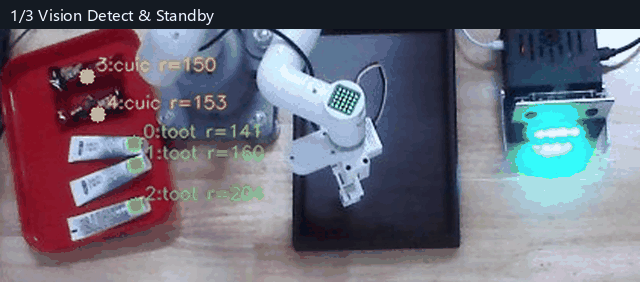
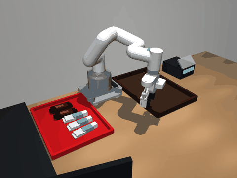
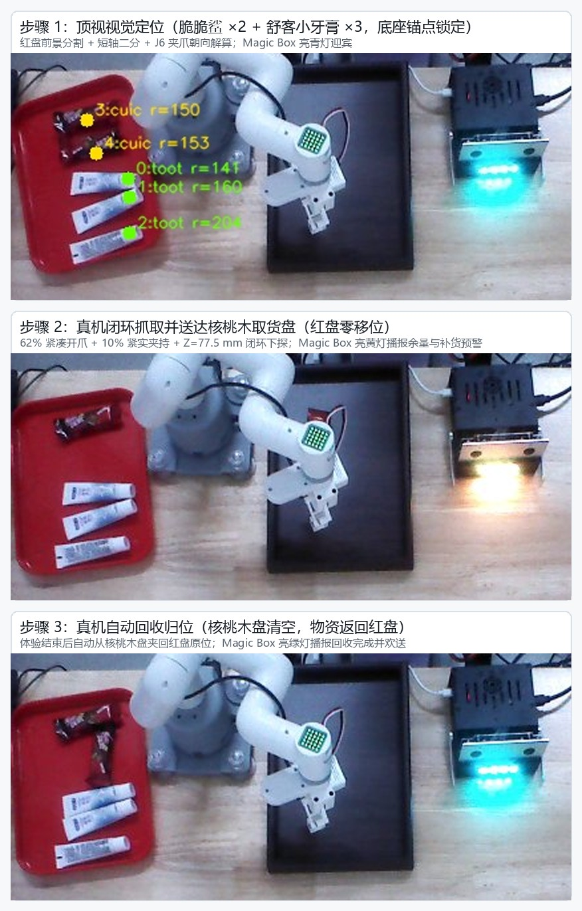
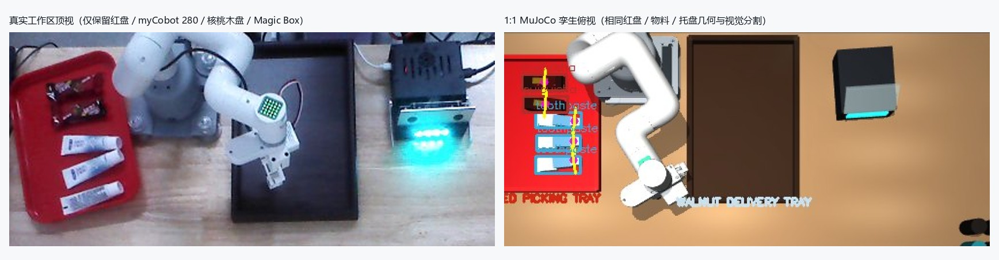
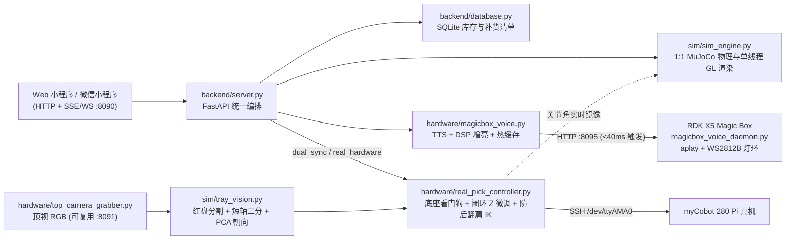
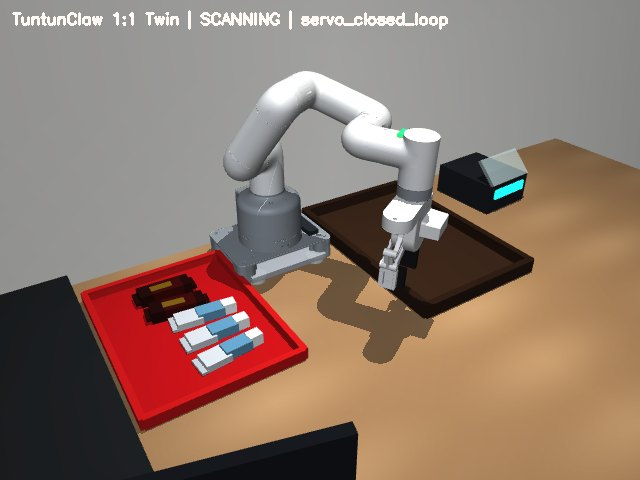
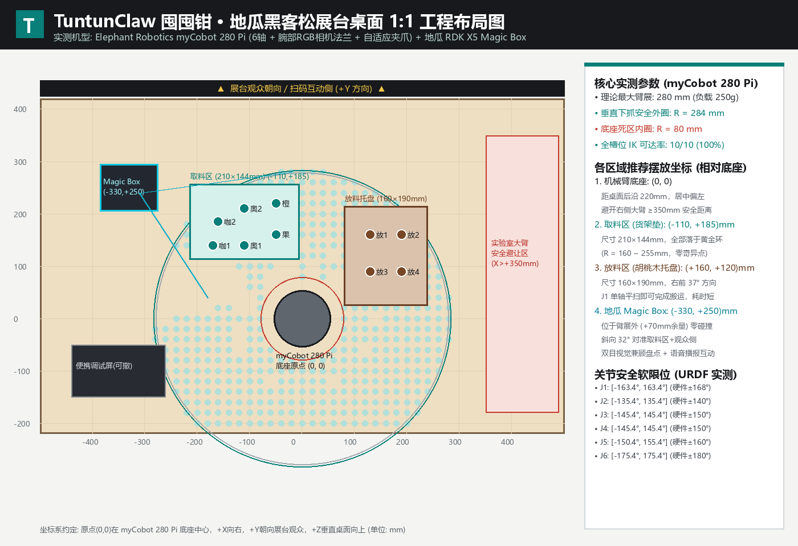

# TuntunClaw（囤囤钳）：桌面机械臂 1:1 仿真、真机闭环抓取与低延迟语音补货实战

本专题记录并开源了一套面向展台与桌面场景的具身智能补货系统 **TuntunClaw（囤囤钳）**。它以 **Elephant Robotics myCobot 280 Pi** 六轴机械臂和 **地瓜 RDK X5 Magic Box** 为真机平台，同时提供完全等价的 **1:1 MuJoCo 数字孪生仿真环境**、**顶视视觉定位与随机摆放抓取链路**、**低延迟五阶段语音/灯环联动**以及 **Web 小程序 + SQLite 补货清单**。

读完并按步骤运行本章，你将完成三件事：

1. 在没有真机的普通 PC 上，跑通 1:1 MuJoCo 桌面物理仿真，验证“顶视扫描 → 闭环抓取递送 → 自动回收归位”全链路。
2. 理解不依赖大模型 3D 建模的本地视觉位姿解算机制，掌握同款物体随机摆放时的实时坐标映射、`J6` 夹爪朝向计算以及防撞/防后翻肩 IK 约束。
3. 接入真实 `myCobot 280 Pi`、顶视 RGB 相机与 `RDK X5 Magic Box`，启动 `dual_sync` 虚实双同步模式，完成零人工干预的真机取送、余量播报与自动回收闭环。

---

## 1. 先看效果：真机工作区切片与 1:1 仿真预览

下面的实拍素材均严格裁切至桌面核心工作区（仅保留左侧红色取料盘、夹持在桌边的 `myCobot 280 Pi`、右侧核桃木取货盘与 `RDK X5 Magic Box`），便于聚焦观察视觉定位点、夹爪运动与灯效状态变化。

| 真机工作区三阶段关键帧预览（实拍） | 1:1 MuJoCo 数字孪生抓取与回收回放（仿真） |
| --- | --- |
| <br>**图 1** 真机工作区三阶段实拍关键帧预览（顶视定位 → 送达核桃木盘亮黄灯预警 → 自动回收归位亮绿灯）。 | <br>**图 2** 本机 MuJoCo 1:1 物理仿真回放（`servo_closed_loop` 策略完成脆脆鲨抓取递送与自动回收）。 |

图 3 展示了同一轮真机测试中三个关键阶段的静态高清晰切片：从红盘识别 2 条雀巢脆脆鲨与 3 支舒客小牙膏，到机械臂稳稳将脆脆鲨放入核桃木盘且红盘零移位，再到体验结束后自动将脆脆鲨夹回红盘原位。

<p align="center">
  
</p>
<p align="center"><strong>图 3</strong> 真机实测三阶段切片：顶视 5 物料精准定位（上）、脆脆鲨入盘与 Magic Box 黄灯低库存播报（中）、自动回收归位与绿灯欢送（下）。</p>

图 4 对比了真实顶视工作区与 1:1 MuJoCo 孪生俯视图。两者共享同一套前景分割与朝向解算模块 `code/sim/tray_vision.py`，可在仿真中先调通全部逻辑，再平滑迁移到真机执行。

<p align="center">
  
</p>
<p align="center"><strong>图 4</strong> 真实工作区顶视（左）与 1:1 MuJoCo 孪生俯视（右）的几何及检测框对齐对比。</p>

---

## 2. 软硬件准备与运行路线

本专题支持**纯仿真零硬件**和**真机 + 语音盒双同步**两条路线，开源代码位于同级目录 [`./code/`](./code/README.md)。

| 模块 | 纯仿真路线（零硬件） | 真机 + 语音双同步路线（`dual_sync`） |
| --- | --- | --- |
| 运行主机 | Windows / Linux / macOS，Python 3.10–3.12 | 同左（需与机械臂、Magic Box 在同一局域网） |
| 机械臂 | 内置 16 个官方 `myCobot 280 Pi` STL 网格 + MuJoCo 物理 | Elephant Robotics `myCobot 280 Pi` + 自适应夹爪 + 桌边夹具 |
| 视觉输入 | MuJoCo 离屏渲染 5 路虚拟相机 | 顶视 USB RGB 相机（640×480）+ 可选侧视相机与腕部 `/dev/video0` |
| 语音与灯环 | 接口降级静默运行，页面实时显示播报气泡 | 地瓜 RDK X5 Magic Box（运行 `magicbox_voice_daemon.py`，端口 `8095`） |
| 核心依赖 | `mujoco`、`numpy`、`opencv-python`、`fastapi`、`uvicorn` | 额外使用 `paramiko`、`edge-tts`、`ffmpeg`（可选） |

开始前先约定目录变量，后续所有命令均以此为工作目录：

```bash
export PROJECT_ROOT=/path/to/every-embodied/16-专题组队学习/08-TuntunClaw桌面抓取与语音补货实战/code
cd "$PROJECT_ROOT"
python -m pip install -r requirements.txt
```

在 Windows PowerShell 中可使用：

```powershell
$env:PROJECT_ROOT = "C:\path\to\every-embodied\16-专题组队学习\08-TuntunClaw桌面抓取与语音补货实战\code"
Set-Location $env:PROJECT_ROOT
python -m pip install -r requirements.txt
```

---

## 3. 系统架构与数据流

整套系统围绕单进程 FastAPI 后端（默认端口 `8090`）组织，前端通过 REST 下发动作、通过 SSE/WebSocket 接收实时状态推送，后端根据 `execution_mode` 决定仅驱动 MuJoCo 仿真，或在驱动真机的同时将关节角实时镜像回 1:1 仿真引擎。



**图 5** TuntunClaw 进程、端口与控制/视觉/语音数据流。

| 组件文件 | 输入 | 核心职责 | 输出 / 硬件副作用 |
| --- | --- | --- | --- |
| `code/sim/tray_vision.py` | 640×480 顶视 BGR 图像 | 红盘前景分割、白管牙膏帽/尾区分、并排脆脆鲨短轴二分、PCA 角度计算 | 物料计数、像素中心、世界坐标与夹爪朝向 `jaw_az_rad` |
| `code/sim/sim_engine.py` | 动作指令或真机关节角 | 1:1 MuJoCo 物理步进、三策略抓取、自动回收与 5 路离屏渲染 | JPEG 视频帧与实时遥测字典 |
| `code/hardware/real_pick_controller.py` | 顶视帧 + 目标 SKU | 底座防倾倒视觉看门狗、前屈肩 IK、闭环 Z 下探与真机取送/回收 | 控制真实 6 轴关节与夹爪，并镜像到仿真 |
| `code/hardware/magicbox_voice.py` | 五阶段文案与音色预设 | 语音合成、小喇叭高频增亮滤波、上传到 Magic Box `/dev/shm` | `<40 ms` 低延迟播放 + 同步 WS2812B 灯色 |
| `code/backend/server.py` | 前端请求与运行模式 | 编排五阶段语音/动作状态机，维护库存与补货清单 | `http://127.0.0.1:8090/` 控制台与扫码二维码 |

---

## 4. 步骤一：零硬件跑通 1:1 仿真与一键验收

在接触真机前，先在纯仿真里跑通完整的“扫描 → 抓放脆脆鲨 → 抓放舒客小牙膏 → 双向回收 → 真机放料位 IK 校核”。

```bash
cd "$PROJECT_ROOT"
python scripts/verify_sim_pipeline.py
```

**Checkpoint 1：仿真与 IK 全链路回归通过**

预期终端输出如下（数值允许存在小于 `0.5 mm` 的浮点差异）：

```text
[1/4] Initializing 1:1 MuJoCo digital twin...
[2/4] Running overhead tray vision scan...
      Scan counts: {'cuicuisha': 2, 'toothpaste': 3}
[3/4] Running closed-loop pick-and-place + recycle in 1:1 MuJoCo...
      Pick cuicuisha : ok=True ik_err=0.43mm trim=[-1.55, 0.06]
      Pick toothpaste: ok=True ik_err=0.24mm trim=[3.53, -1.21]
      Recycle results: toothpaste=True, cuicuisha=True
[4/4] Verifying real-controller forward-shoulder IK (J2 <= 20 deg) on all walnut drop slots...
      Slot D1: mc=(31.5, 167.2)mm r=170.2mm J2_hover=1.6deg J2_low=-26.5deg
      Slot D2: mc=(172.5, 165.2)mm r=238.9mm J2_hover=-34.4deg J2_low=-49.4deg
      Slot D3: mc=(23.6, 225.0)mm r=226.2mm J2_hover=-27.5deg J2_low=-44.4deg
      Slot D4: mc=(103.3, 215.1)mm r=238.6mm J2_hover=-34.2deg J2_low=-49.3deg
ALL_TUNTUNCLAW_VERIFICATION_CHECKS_PASSED
```

这一步验证了四件事：MuJoCo 网格与物理接触模型正常加载、顶视视觉准确识别全部 5 件物料、`servo_closed_loop` 策略成功完成脆脆鲨与牙膏的取送和回收、以及真机右侧 4 个放料位全部满足前屈肩安全约束（`J2 <= 20°`）。它仅验证仿真与运动学链路，尚未校验真实相机标定和机械臂串口通信。

在仿真引擎 `code/sim/sim_engine.py` 中内置了三种可切换策略，便于教学对比：

| 策略名 | 抓点选择 | 夹爪朝向 `J6` | 腕部二次伺服 | 适用说明 |
| --- | --- | --- | --- | --- |
| `baseline` | 包围盒几何中心 | 固定 `0°` | 关闭 | 对照基线，物体斜放时容易偏心 |
| `oriented` | 牙膏定位圆盖、脆脆鲨定位中心 | 按顶视 PCA 长轴垂直对齐 | 关闭 | 解决随机旋转摆放问题 |
| `servo_closed_loop` | 同 `oriented` | 同 `oriented` | 悬停态按腕部 RGB 残差微调 `±5 mm` | 推荐默认策略，可补偿顶视标定残差 |

---

## 5. 步骤二：启动 Web 小程序与补货控制台

复制环境变量示例后启动统一后端服务（默认安全处于 `simulation` 模式，不会下发任何真机动作）：

```bash
cd "$PROJECT_ROOT"
cp .env.example .env
python backend/server.py
```

**Checkpoint 2：Web 控制台与补货流水就绪**

1. 浏览器打开 `http://127.0.0.1:8090/`，可看到 3D 仿真总览、1:1 俯视、腕部 RGB 等多视角画面（图 6）。
2. 在页面中点击 **「🔍 扫描盘点」**，顶部库存卡刷新为 `雀巢脆脆鲨 ×2`、`舒客+小牙膏 ×3`。
3. 点击 **「▶ 一键5阶段展台全体验」** 或单件点单，观察机械臂在仿真中完成取送后自动扣减库存；当脆脆鲨余量降至阈值 `1` 时，补货清单页自动生成待补货记录；点击 **「↩️ 回收取货区物资」**，机械臂将物品夹回红盘并恢复库存计数。
4. 若需封装为微信小程序，直接用微信开发者工具导入 `code/wechat-miniprogram/` 并修改 `app.js` 中的 `apiBase` 为局域网或内网穿透地址即可（详见 `code/wechat-miniprogram/README.md`）。

<p align="center">
  
</p>
<p align="center"><strong>图 6</strong> 1:1 MuJoCo 展台总览渲染：包含桌边夹持的 myCobot 280 Pi、左侧红盘物料、右侧核桃木取货盘与 Magic Box。</p>

---

## 6. 核心原理：不靠 3D 建模如何实现随机摆放抓取

很多同学初次接触机械臂抓取，会以为必须让腕部相机左右扫描，或者把图像发给多模态大模型做 3D 建模才能算出抓取位姿。在本系统的桌面场景下，这套链路完全在本地毫秒级闭环完成：

1. **为什么不用腕部相机左扫右扫**：桌面正上方架设的顶视 RGB 相机（640×480）一帧就能拍全整个红色取料盘。机械臂在非抓取时段停在右侧高位无遮挡待命位 `CLEAR_VIEW_POSE_DEG = [68°, -30°, -75°, 15°, 0°, 0°]`，既不遮挡红盘，也不遮挡底座视觉锚点。腕部相机退居为可选的“近距放大镜”（用于悬停态 `1~3 mm` 残差微调或观众第一视角直播）。
2. **为什么不需要大模型 3D 建模**：对于平面托盘内高度已知的刚体/半刚体日常小件，抓取位姿本质上是 **4 自由度平面抓取 `(x, y, z_table, yaw)`**。在 `code/sim/tray_vision.py` 中：
   - 先扣掉红盘底色提取前景掩码；
   - 根据亮度与宽度特征分离牙膏管和脆脆鲨，并通过 `_suppress_toothpaste_tails` 过滤掉扁平牙膏尾端、精准锁定圆形牙膏盖，对两根紧贴并排的脆脆鲨按 PCA 短轴自动二分；
   - 通过最小外接矩形得到每个物体的像素中心 `(u, v)` 与长轴角度，再利用针孔标定参数（`CAL_BX, CAL_BY, CAL_PM, CAL_TH_MC_DEG`）将 `(u, v)` 映射到机械臂基座坐标 `(x_mc, y_mc)`，并由 `pick_j6_for_jaw_az` 算出令两指垂直于物体窄边的 `J6` 转角；
   - 高度 `Z` 由标定桌面高度加上下探时的实时坐标闭环微调确定，最终通过 6 轴顶视 IK 求出全部关节角度。
3. **同款物体随机摆放与未知新物体的边界**：
   - **已适配 SKU（脆脆鲨 / 舒客小牙膏）随机摆放**：只要位于红盘可达圆环半径 `130 ~ 265 mm` 内且不紧贴红盘边沿，任意平移或旋转角度均可实时重算坐标和 `J6` 直接抓取，无需重新建模。
   - **临时更换全新未知物体**：只需把 `tray_vision.py` 中的颜色/形状分割替换为 VLM（如 Gemini / Qwen-VL / GroundingDINO）输出目标 2D 框或抓取点像素，下游的像素转 `(x, y)`、角度拟合与 IK 抓取代码可 100% 直接复用，依然不需要 3D 建模。

---

## 7. 步骤三：真机闭环抓取、自动回收与安全护栏

当需要在真实 `myCobot 280 Pi` 上运行时，请先对照图 7 完成桌面物理摆放，确认底座使用桌边夹具牢牢锁紧（纯吸盘在木桌面大力矩回转时存在滑动风险）。

<p align="center">
  
</p>
<p align="center"><strong>图 7</strong> 1:1 桌面布局与可达空间参考：左侧红盘取料区、中间夹持底座、右侧核桃木取货盘与 Magic Box 摆放关系。</p>

在 `.env` 中填入你本地局域网内的机械臂 IP、顶视相机索引，重启 `backend/server.py` 后，按以下安全顺序启动真机：

1. **底座视觉锚点自检**：请求 `GET http://127.0.0.1:8090/api/hardware/safety`。`verify_base_anchored()` 会校验顶视画面中底座法兰区域是否稳定停留在标定位置；若底座发生滑移或倾倒，控制器会直接拦截所有运动。
2. **安全归位至无遮挡待命位**：在网页右上角切换到 `dual_sync` 模式，点击「🏠 回安全位」（或调用 `POST /api/hardware/clear_view`），观察真机低速移动至 `[68°, -30°, -75°, 15°, 0°, 0°]`，且 3D 仿真同步镜像姿态。
3. **验证真机扫描与单件取送/回收**：调用 `GET /api/hardware/scan` 确认检出目标且 `reachable=true`，再在页面点选脆脆鲨执行“抓放 → 自动回收”。

`code/hardware/real_pick_controller.py` 中固化了五条经真机实测验证的安全与稳定参数：

| 护栏 / 调优项 | 参数设定 | 解决的实际问题 |
| --- | --- | --- |
| 前屈肩 IK 约束 | 强制 `J2 <= 20°`（`q[1] <= 0.35 rad`） | 防止通用 IK 求得反折肩解导致大臂向后撞墙 |
| 底座视觉看门狗 | 运动前检查标定中心像素特征 `cool_frac >= 0.45`、`sat_mean >= 55` | 底座松动或倾倒时自动中止运动 |
| 紧凑预开张度 | 下探前开爪 `62%`（而非 `80%`） | 防止宽张开的夹爪蹭歪红盘边沿或碰倒相邻物料 |
| 两阶段闭环 Z 微调 | 先下至 `Z=84 mm`，按实测坐标闭环微调至 `77.5 mm`，硬底线 `>= 75.0 mm` | 抵消机械臂重力下垂，既稳抓薄件又不刮擦托盘 |
| 邻域开阔度优先 + 防堵转夹持 | 优先抓最近邻距离最大的目标；夹持比脆脆鲨 `10%` / 牙膏 `8%`（大于 `0%`） | 避免相邻牙膏盖干涉与夹爪舵机堵转过热 |

---

## 8. 步骤四：RDK X5 Magic Box `<40 ms` 清亮五阶段语音

如果每次播报都现场调用云端 TTS 再经 SSH 传输播放，现场体感往往会有 `1.5 ~ 3 s` 延迟，且小尺寸扬声器容易发闷。`code/hardware/magicbox_voice.py` 与 `code/hardware/magicbox_voice_daemon.py` 采用**“高频话术后台预合成 + 小喇叭声学增亮 + 内存盘常驻播放”**架构：

1. **部署守护进程到 Magic Box**：将 `code/hardware/magicbox_voice_daemon.py` 上传到 RDK X5，并在板上常驻运行（监听 `8095` 端口，缓存目录 `/dev/shm/tuntun_voice/`）：

   ```bash
   scp code/hardware/magicbox_voice_daemon.py sunrise@<MAGICBOX_HOST>:~/tuntunclaw_voice_daemon.py
   ssh sunrise@<MAGICBOX_HOST> "nohup python3 ~/tuntunclaw_voice_daemon.py --port 8095 >/tmp/tuntun_voice.log 2>&1 &"
   ```

2. **小喇叭清亮声学滤波**：主机端使用 `edge-tts`（推荐清亮元气女声 `zh-CN-XiaoyiNeural`）合成后，经 `ffmpeg` 做 `highpass=145Hz`（切掉易破音低频）、`+4.2 dB @ 3.2 kHz` 与 `+2.8 dB @ 6.2 kHz` 人声明亮度提升、`dynaudnorm` 动态响度均衡并统一输出 48 kHz 立体声 PCM WAV。
3. **服务启动自动预热**：`backend/server.py` 启动时在后台将五阶段高频台词提前上传至 Magic Box 内存盘，现场触发热缓存片段实测延迟约 `10 ~ 40 ms`，同步切换 WS2812B 灯环颜色：

| 阶段 | 触发时机 | 灯环颜色 | 播报内容示例 |
| --- | --- | --- | --- |
| 阶段 1 迎宾 | 观众走近 / 点击迎宾 | 青色 | 你好呀，欢迎来到地瓜机器人展台，我是囤囤钳！请问你想要点什么东西呢？ |
| 阶段 2 取送中 | 机械臂离位瞬间 | 蓝色 | 好的，囤囤钳正在为你取送雀巢脆脆鲨，请稍候一下！ |
| 阶段 3 送达与余量 | 放下物品后 | 绿色 / 黄色（低库存） | 雀巢脆脆鲨已经取送完毕！目前还剩 1 条，已触发补货提醒。温馨提示，请把物资放回取货区，本展台物资仅供现场演示使用哦！ |
| 阶段 4 准备回收 | 点击回收或演示倒计时结束 | 暖橙色 | 体验结束啦，机械臂现在正在准备回收雀巢脆脆鲨，请稍离取货区。 |
| 阶段 5 回收完成 | 放回红盘并归位 | 绿色 | 雀巢脆脆鲨已经回收完成，当前库存恢复为 2 条。感谢体验囤囤钳，欢迎下次再来玩呀！ |

---

## 9. 常见故障与排障清单

| 现象 | 常见原因 | 排查与恢复方法 |
| --- | --- | --- |
| 机械臂下探后空抓，或红盘被蹭偏 | 预开爪过大碰到红盘边沿，或目标紧贴托盘侧壁 | 保持 `real_pick_controller.py` 中 `0.62` 紧凑开爪；将靠近红盘右边沿的牙膏盖向盘内挪动约 `1 cm`；先用高位悬停拍照核对 XY 与朝向 |
| `/api/camera/top.jpg` 返回 `503` | 本机已运行 `web_align_server.py`（`8091` 端口）或其他程序占用了 DirectShow 摄像头 | `TopOrbbecGrabber` 已支持自动回落读取 `http://127.0.0.1:8091/api/camera/top.jpg`；若无 `8091` 服务，检查 `.env` 中 `TOP_CAM_INDEX` |
| 主机调用 Magic Box `8095` 返回 `502` | Windows 系统代理劫持了局域网 `192.168.x.x` HTTP 请求 | 局域网请求必须使用 `urllib.request.build_opener(urllib.request.ProxyHandler({}))`，代码中已默认启用 |
| MuJoCo 在中文目录下加载 XML 报错 | MuJoCo 底层 C 文件接口对 Windows 中文路径支持不佳 | `workspace_analysis.py` 已改用 `from_xml_string(xml_text, assets=...)` 内存加载，确保通过 `load_model()` 入口加载场景 |
| 真机串口首次 `get_angles()` 返回空列表 | 树莓派 `/dev/ttyAMA0` 打开后需要约 `150–400 ms` 握手预热 | `real_mycobot_bridge.py` 已在所有指令前加入 `time.sleep(0.15~0.4)`；同时核对波特率为 `1000000` |
| 顶视检测到假脆脆鲨或两根脆脆鲨合并成一个框 | 牙膏间阴影面积过小被误判，或两根脆脆鲨并排紧贴 | `tray_vision.py` 已将真机脆脆鲨最小面积提高至 `420`，并对 `area >= 1500` 的合并块执行短轴自动二分 |

---

## 10. 开源代码与复现边界

- **开源代码入口**：[`./code/README.md`](./code/README.md)（包含完整仿真引擎、16 个 `myCobot 280 Pi` STL 网格、真机控制器、Magic Box 语音守护进程、FastAPI 后端、Web 小程序与微信小程序工程）。
- **已验证项**：纯仿真一键回归脚本 `code/scripts/verify_sim_pipeline.py`；真实 `myCobot 280 Pi` 桌面闭环抓取脆脆鲨、放入核桃木盘、Magic Box 同步五阶段语音/灯效及自动回收归位全流程；6 轴舵机运行后温度处于 `33–55 °C` 正常区间。
- **迁移注意**：不同主机与桌面高度下，顶视相机像素到机械臂坐标的 4 个标定参数（`CAL_BX, CAL_BY, CAL_PM, CAL_TH_MC_DEG`）及抓握高度 `Z` 需按实际支架重新标定；本开源代码已清理全部私有局域网 IP、默认密码、运行期数据库与临时缓存，请通过 `.env` 配置本机参数。
- **上游参考**：
  - [Elephant Robotics myCobot 280 Pi 官方文档](https://docs.elephantrobotics.com/docs/mycobot_280_pi_cn/) 与 [mycobot_ros](https://github.com/elephantrobotics/mycobot_ros)（机械臂与夹爪 3D 模型来源，BSD-3-Clause）
  - [OpenClaw 家庭物资助手专题（main 主干）](https://github.com/datawhalechina/every-embodied/tree/main/16-%E4%B8%93%E9%A2%98%E7%BB%84%E9%98%9F%E5%AD%A6%E4%B9%A0/02-OpenClaw%E5%AE%B6%E5%BA%AD%E7%89%A9%E8%B5%84%E5%8A%A9%E6%89%8B)（同系列家庭物资管理与飞书多维表格参考）
