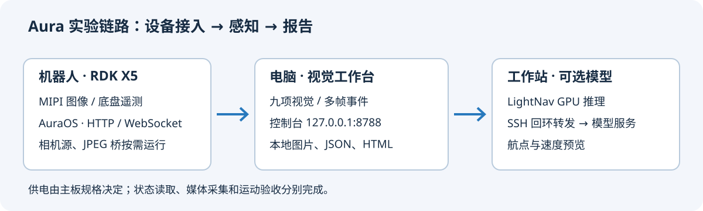
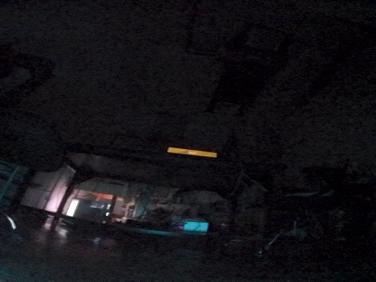

# 02 SDK、遥测与视觉工作台

本章把设备通信、图像采集和算法推理连接起来。代码位于 [`code/src/aura_robot`](../code/src/aura_robot)，电脑侧基础安装只依赖 WebSocket 通信库；视觉、OCR 和深度分别作为额外依赖启用。

## 2.1 先理解三个接口层

| 层次 | 入口 | 负责什么 |
| --- | --- | --- |
| AuraOS Skill | MANIFEST、skill.md、`run(context, task)` | 声明技能、权限、宿主工具 |
| 本样机 daemon | HTTP 8765、WebSocket `/ws/sdk` | 状态、媒体、应用与实际设备调用 |
| X5 板载 ROS 2 / BPU | topic、node、launch | 底盘、MIPI、推理节点与消息链路 |

这三个层次可以协作，验收对象不同。商店格式校验通过只说明包结构正确，不能替代相机采集和底盘实际响应。



图中电脑侧承担较重的视觉模型；工作站还可以承担导航策略或仿真。整机不需要把所有模型都装进 X5。

## 2.2 只读诊断和原始回执

在已激活的 `code/.venv`、`code` 目录执行：

```bash
python -m aura_robot.debug --host YOUR_ROBOT_IP probe --output artifacts/probe.json
python -m aura_robot.debug --host YOUR_ROBOT_IP telemetry --count 5 --output artifacts/telemetry.json
python -m aura_robot.debug --host YOUR_ROBOT_IP battery --count 3 --output artifacts/battery.json
python -m aura_robot.debug --host YOUR_ROBOT_IP apps list
```

SDK 的 HTTP 诊断路径包含 `/api/daemon/status`、`/api/media/status`、`/api/motion/status`、`/api/motion/telemetry` 和 `/api/apps`，来自样机源码与实测。本课程保留了超时、响应体上限、请求 ID 和返回类型检查。机器人局域网流量不走电脑互联网代理。

遥测可能缺帧，轮速或 IMU 没收到时保留缺失字段，不填零伪装静止。电池查询是本项目依据厂家 C1 帧增加的扩展：已读到有效电压，但充电位、SOC 百分比、剩余时间尚未标定。电压与 SOC 的映射还受电芯串数、放电曲线和负载影响，不能用电压除以满电电压生成电量百分比。

这项扩展要求设备端已经安装相应补丁；新出厂固件可能没有。补丁应装进已有串口持有者，不从第二个进程抢开电机串口。未装补丁时先完成其余 SDK 练习。

## 2.3 新鲜相机画面

```bash
python -m aura_robot.debug --host YOUR_ROBOT_IP --timeout 30 camera --output artifacts/camera-a.jpg
python -m aura_robot.debug --host YOUR_ROBOT_IP --timeout 30 camera --output artifacts/camera-b.jpg
```

在两次拍摄间移动一张卡片。两张可打开、内容随动作变化的图片，比单次 HTTP 200 更能证明采集持续更新。样机的 JPEG 桥和 MIPI 服务是自建适配，若没有安装，应接入当前固件的真实相机源；不要将缓存图片当成实时相机。



固定仰视影响近处地面覆盖。视觉报告要同时保留原图与标注图，这样能区分目标不在画面、光照差、模型误检和控制错误。

## 2.4 分组启用视觉能力

```bash
python -m pip install -e '.[vision,ocr]'
python -m aura_robot.vision --help
python -m aura_robot.vision doctor --device cpu --output artifacts/vision-doctor.json
python -m aura_robot.vision run --host YOUR_ROBOT_IP --profile inspection --device cpu --frames 6 --fps 1 --output artifacts/inspection
python -m aura_robot.vision run --host YOUR_ROBOT_IP --profile interaction --device cpu --frames 10 --fps 1 --output artifacts/interaction
```

准备模型时核对 `vision.py` 中的加载位置、来源和模型许可证，再将文件放到期望目录；本专题不分发权重。`doctor` 可检查哪些模型仍缺失。`inspection` 组合图像质量、QR、ArUco 和 OCR；`interaction` 组合质量、人物检测和姿态。电脑端模型结果来自电脑推理，不能写成 X5 BPU 吞吐。

`report.html` 放原图、标注图和每项结果，`results.json` 保存结构化数据；跨帧事件另由事件模块生成。`--fps` 是请求采样频率，真实完成速率要按时间戳计算。

## 2.5 深度与人脸的边界

双目深度要有左右图同步、左右内参、畸变参数、外参和已知量纲的基线。两张图能生成视差图，不能自动说明距离以米计准确。用棋盘格标定并在已知距离的物体上核对误差，才可用于近距离控制。

单目深度、YOLO、人体关键点、二维码、OCR 各有输出语义。人物检测只确认画面中有人；人脸检测只定位脸；把脸匹配到某个身份还需经授权的人脸库与独立评测。本课程的人物招呼闭环不需要先做人脸身份识别。

## 2.6 故障定位与作业

| 现象 | 先检查 | 处理依据 |
| --- | --- | --- |
| SDK 超时 | IP、8765、daemon 日志 | 先恢复通信再运行模型 |
| 两次图片一样 | 采集时间、缓存、曝光源 | 确认画面随真实动作变化 |
| 检测很慢 | 设备、输入尺寸、各阶段耗时 | 先量化采集/解码/推理，再降低负载 |
| 麦克风文件有长度却无声 | PCM RMS、峰值、启动瞬态 | 区分采集通路与语音识别 |
| battery 返回未知 | 是否安装扩展、原始帧 | 保留未知，不推算百分比 |

提交一组两帧新鲜图、视觉报告、缺帧统计和模型运行位置说明。保留一例失败图并解释原因。扩展练习：从遥测 JSON 计算相邻样本间隔，按缺失值而非零值统计有效比例。
