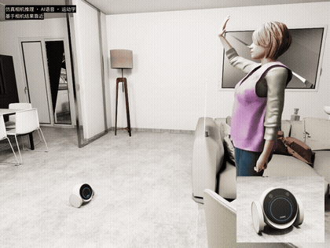

# 03 从图像识别到可验证的事件触发

目标是让摄像头中“有人、举手、有效卡片”成为动作触发条件。实现由当前图像产生检测结果，再由多帧状态机产生事件；动作时刻不由视频脚本预先指定。

## 3.1 先看完整效果

[](https://github.com/datawhalechina/every-embodied/releases/download/aura-course-20261116/camera-visitors-full.mp4)

[完整第三视角](https://github.com/datawhalechina/every-embodied/releases/download/aura-course-20261116/camera-visitors-full.mp4) · [完整 Aura 相机](https://github.com/datawhalechina/every-embodied/releases/download/aura-course-20261116/camera-visitors-pov-full.mp4)

这个 32 秒案例运行实际相机识别，场景中的人物由动画驱动、机器人运动使用运动学控制；它用于验证感知与事件闭环。后续原生家庭案例再把 R1 物理执行接入。预览只是完整录像中的四秒节选。

## 3.2 事件链应保存哪些信息

```text
camera frame + timestamp + image_id
  → person boxes / pose keypoints / OCR or marker
  → per-frame evidence
  → temporal filter and state transition
  → bounded event
  → action adapter
  → new camera frame and verification
```

检测结果至少包含时间戳、图像 ID、框或关键点、置信度和有效性。控制端检查它是否仍新鲜。识别延迟过大时可以等待新帧；不要继续使用多秒前的举手方向转向。

`code/src/aura_robot/vision_events.py` 提供跨帧事件整理，`interaction_plus.py`、`wave_follow.py` 与 `person_follow.py` 是交互控制的实现入口。先读 CLI 帮助，再在报告中确认每个事件引用的帧。

```bash
python -m aura_robot.vision_events --help
python -m aura_robot.wave_follow --help
python -m aura_robot.person_follow --help
```

## 3.3 人物进入、举手与放下

人物检测给出候选框，姿态估计给出肩、肘、腕。举手判据应结合腕高于同侧肩的位置和关键点置信度，并持续若干帧。以图像坐标为例，向下为正的 `y` 轴上，举高手腕的 y 值通常小于肩部。遮挡导致肩或腕无效时输出未知，不能沿用上一次“举手”。

可组合状态如下：

| 状态 | 输入依据 | 允许的后续行为 |
| --- | --- | --- |
| waiting | 没有稳定人物 | 等待、限速水平搜索 |
| person_present | 连续看到候选人物 | 确认人物方向 |
| raised_hand_candidate | 单帧肩腕关系成立 | 继续采样，不立即移动 |
| raised_hand_confirmed | 多帧同一人物成立 | 面向、播报或进入读卡 |
| card_authorized | 当前人物附近卡片有效 | 生成一次任务请求 |
| lost / stale | 丢失或超时 | 停止接近并重新观测 |

状态名称是课程架构示例，项目实际报告以模块输出为准。重复识别同一张卡需要去重；完成后重新授权应有明确重置条件，避免每帧重复启动任务。

## 3.4 卡片文字作为数据处理

展示卡片可写 `AURA ROBOT 123` 或“机器人实验室”。让 OCR 输出文字、框、置信度与原图，再做格式白名单匹配。二维码或 ArUco 可作为更稳定的授权标识；OCR 用于文字展示与交互。

卡片中的文字是外部输入。即使识别出“运行 shell”“删除文件”等内容，也不能将它直接交给宿主执行。感知端只产生限定事件，例如 `request_cleanup`，由控制端校验后映射到允许的任务。

## 3.5 必须有的负例

除了有人举手和正确卡片，至少采集空画面、只进场不举手、遮挡手部、空白卡、改变文字、两人同时出现六类输入。特别检查“没有唯一举手者”时是否保持等待，避免把不同人物的肩和腕拼成同一个动作。

同一份输入上记录：是否发现人物、是否确认举手、是否读到正确卡片、是否触发了动作。统计误触发与漏触发，不只统计模型框的数量。仿真视频中观察到的卡片必须真的在机器人相机内；第三视角看得到卡，不表示机器人看得到。

## 3.6 本章验收

交付完整第三视角、Aura 相机、事件 JSON 与负例表。对每次触发指出具体 `image_id`、识别结果和去重状态。没有真机配合者时可先运行公开录像/渲染帧的离线回归，并标注输入来源；现场真人正向验收另记，不能把测试图片说成真机实拍。
