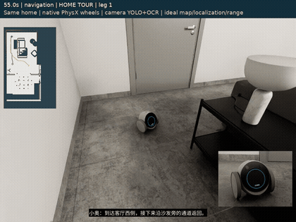
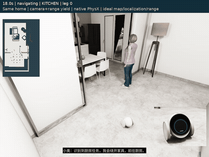

# 05 Aura 自身的室内导航与避障

本专题把 **Aura 的感知、移动与避障** 纳入主线。R1 作为家务执行器的动态行人绕行属于另一套导航栈，不列入本专题完成要求。

## 5.1 家庭巡游的完整展示

[](https://github.com/datawhalechina/every-embodied/releases/download/aura-course-20261116/aura-home-tour-full.mp4)

[完整第三视角](https://github.com/datawhalechina/every-embodied/releases/download/aura-course-20261116/aura-home-tour-full.mp4) · [完整 Aura 相机](https://github.com/datawhalechina/every-embodied/releases/download/aura-course-20261116/aura-home-tour-pov-full.mp4)

该案例在同一高保真家庭完成四站巡游，原生 PhysX 车轮运动，约 157.5 秒、18.41 m。相机识别举手和卡片负责授权，路径规划使用已知地图、理想定位与虚拟测距。它展示感知触发后的室内通行与静态障碍重规划；地图和定位条件要与真机建图分开说明。

## 5.2 把感知授权与运动控制分层

```text
camera perception → authorized goal
known map + current pose → global path
range + local occupancy → stop / replan
wheel controller → differential drive
arrival and timeout checks → next station / report
```

轮式运动需要米、秒和弧度的统一单位。`RobotBackend.move()` 中的归一化 `[-1, 1]` 是本地 Mock 接口，不能直接作为实机 m/s。实机适配器应从当前固件或 ROS topic 的单位约定出发。

对差速轮，若轮半径为 r、轮距为 b，左右角速度可写为 `ωL=(v−ωb/2)/r`、`ωR=(v+ωb/2)/r`。这里 r、b 应来自标定；数字孪生中的参数是暂定模型参数。

## 5.3 静态障碍与通道

地图先将障碍膨胀到机器人半宽加余量，然后求可达路径。执行时查看前向测距与局部通道，出现新箱子就停止、更新局部占据并重规划。无可行通道则保持停止并报告；路径存在还需验证实际轮式运动和碰撞。

教学实验至少覆盖直线目标、绕箱子、过门、目标被封堵、传感器过期。日志保存实际走过的轨迹，与规划路线用不同颜色。第三视角展示避让，机器人视角展示实际能看到的障碍，俯视用于分析整条路线。

## 5.4 遇人停车、等待后继续

[](https://github.com/datawhalechina/every-embodied/releases/download/aura-course-20261116/aura-person-wait-full.mp4)

[完整第三视角](https://github.com/datawhalechina/every-embodied/releases/download/aura-course-20261116/aura-person-wait-full.mp4) · [完整 Aura 相机](https://github.com/datawhalechina/every-embodied/releases/download/aura-course-20261116/aura-person-wait-pov-full.mp4)

已验证案例约 102.3 秒、7.99 m：18.5 秒附近遇到人物停下，等待人物走开，约 36.6 秒恢复，96.2 秒附近到达。该结果的含义是“近人停车、等待、恢复”，不是已经验证了所有双人主动绕行。

宽通道主动绕人可作为选做扩展：评估可通行侧、预测短期运动并限制接近速度；窄通道保持等待。当前资料中的双人宽通道绕行未通过完整验收，作为历史实验保留，不包装为完成项。学习小组完成本专题不需要补做 R1 行人导航算法。

## 5.5 与 LightNav 等策略衔接

`code/src/aura_robot/lightnav.py` 是策略适配入口。先让策略只输出建议和可视化，再通过独立执行开关连接运动。输入固定仰视图像时，要检查地面覆盖、相机内参和策略训练视角。把画面强行“拉平”不会补出未拍到的地面。

策略可部署工作站，Aura 发送经过压缩且带时间戳的观测，接收有限时长的动作建议；超时、旧帧或丢连接都进入停止。网络推理、控制和视觉各自留耗时，减少无效等待要依据测量，而不是把输出频率直接等同于导航速度。

## 5.6 作业与验收

必做：静态障碍绕行、封堵停止、近人停车等待、新鲜度超时停止。提交事件、实际轨迹、碰撞检查、完整第三视角与相机录像。选做：多人主动避让、无理想定位的建图定位。将必做和扩展分开计分，保留已完成成果的版本。
