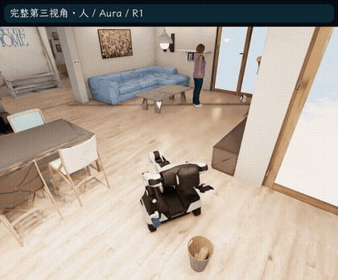
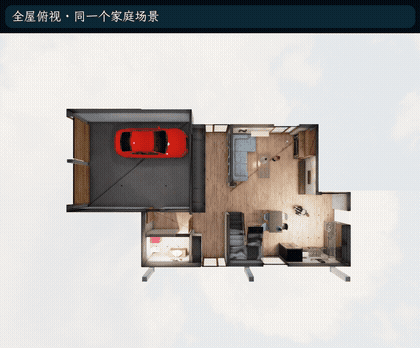
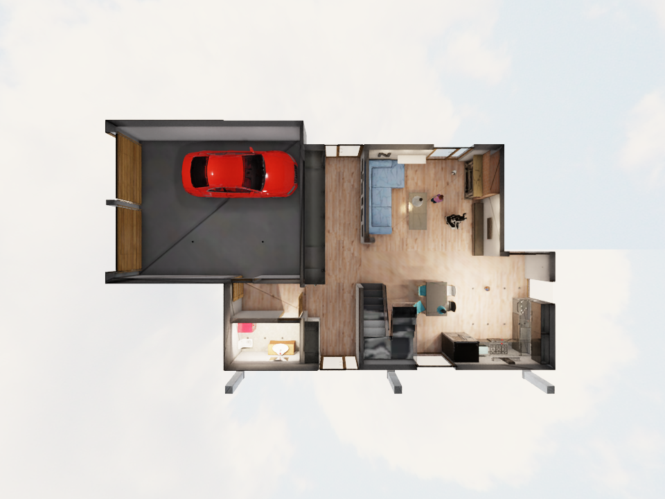
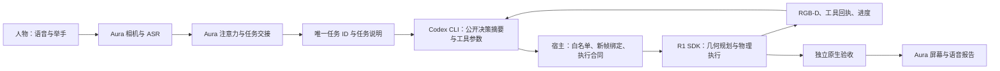

# 07 同一个家庭中的人、Aura 与 R1 Agent

这一章将 Aura 作为交互接口，把移动操作交给 R1 Pro。三者位于同一个原生家庭；开场人物与 Aura 在客厅，R1 从厨房待命区出发，再跨房间收集垃圾。R1 的行人动态避障不作为本课程验收项。

## 7.1 先看完整过程与全屋结构

[](https://github.com/datawhalechina/every-embodied/releases/download/aura-course-20261116/household-observer-full.mp4)

[完整第三视角](https://github.com/datawhalechina/every-embodied/releases/download/aura-course-20261116/household-observer-full.mp4) · [完整 R1 相机](https://github.com/datawhalechina/every-embodied/releases/download/aura-course-20261116/household-r1_head-full.mp4) · [完整 Aura 相机](https://github.com/datawhalechina/every-embodied/releases/download/aura-course-20261116/household-aura_head-full.mp4)

[](https://github.com/datawhalechina/every-embodied/releases/download/aura-course-20261116/household-global-full.mp4)

[完整俯视全程](https://github.com/datawhalechina/every-embodied/releases/download/aura-course-20261116/household-global-full.mp4) · [切换机器人视角](https://github.com/datawhalechina/every-embodied/releases/download/aura-course-20261116/household-robot-full.mp4)

五路录像各 255.7 秒，保留人物开场、交接、三罐任务、返回与报告。视频按仿真时间播放，模型计算时物理暂停；实际墙钟运行时间长于视频。录像包含已执行前缀、明确标记的恢复边界与接续片段，恢复细节在第九章。



## 7.2 六步任务与角色分工

1. 人物从客厅较远处走向 Aura，招呼并挥手，提出“帮我把垃圾收拾一下”。
2. Aura 接收语音，通过自身相机寻找人物并水平转向，显示任务，向 R1 发送交接。
3. R1 从厨房待命区域出发，使用新相机观测搜索不同位置的饮料罐。
4. R1 在目标附近调整底盘、躯干和末端，用 RGB-D 与几何工具规划抓取。
5. 保持夹持运输至原垃圾桶，按接近、对齐、下降、释放、稳定验收的顺序投放。
6. 三罐验收后返回客厅的可见空地，停稳，由 Aura 报告结果。

人物采用写实角色和编排骨骼动画，语音为合成输入；ASR 与相机识人实际运行。Aura 在这一家庭案例中使用相机闭环的运动学转向适配器，R1 使用原生 PhysX 与 SDK assisted grasp。它与第五章 Aura 车轮原生 PhysX 导航是不同实验配置。

## 7.3 架构：谁做决定，谁执行



大模型按任务阶段选择工具，不负责逐物理步输出轮速和关节角。找人水平控制、动作内部插值、超时与停止留在确定性适配器；工具完整结束后再做下一次决策，减少细碎调用。

## 7.4 代码如何阅读

| 模块 | 功能 |
| --- | --- |
| `aura_household_exec/attention.py` | 识人、招呼与转向状态 |
| `aura_household_world/inbox.py` | Aura 请求与任务记录 |
| `aura_household_exec/controller.py` | Codex exec、结构化决策、新帧绑定 |
| `context.py / macros.py` | 紧凑上下文与有测量回执的动作宏 |
| `placement_contract.py` | 拦截持物阶段提前张爪的工具误用 |
| `durable.py / native_checkpoint.py` | 工具边界成对保存状态 |
| `three_can_verifier.py / return_goal.py` | 原生投放和返回条件核验 |

代码在 [`code/integrations`](../code/integrations)。模型上下文包含当前 RGB-D、必要工具接口、已完成事实和公开回执，不包含验收器隐藏对象坐标。全屋图与评估器真值用于读者分析，不作为模型搜索物体的答案输入。

## 7.5 复现实验的分级入口

先在普通 CPU 电脑运行公开记录审查：

```bash
cd code
python tools/course_lab.py audit --root ..
python -m unittest discover -s tests -v
python -m integrations.aura_household_exec.run_live --help
```

`audit` 和 Notebook 不启动模型、仿真或真机。完整原生任务还需已授权的 BEHAVIOR 数据、上游 RoboHarness、可用的仿真环境和已绑定的 R1 workspace。详见 [`code/README.md`](../code/README.md) 的配置和执行顺序；不能把只有视频播放器的电脑当作已安装原生仿真。

历史模型入口是 Codex CLI `exec` 指定 `gpt-6.1-sol` / `xhigh`，使用当时工作站的登录通道。本课不把该名称当作所有账号的固定可用模型；复现者应使用自己已具备权限的 CLI 模型，保留实际模型与版本记录。没有 API key 也不能据此判定 CLI 通道不可用。

## 7.6 本章验收

提交同场景全屋图、角色初始位置、任务 ID、相机 ID、交接事件与首个 R1 动作之间的关联。解释“人说话到 Aura 接收”“Aura 交接到 R1 开始”两段延迟。完整过程展示公开决策摘要、工具参数、工具结果和图像，不展示或索取模型私有思维链。
