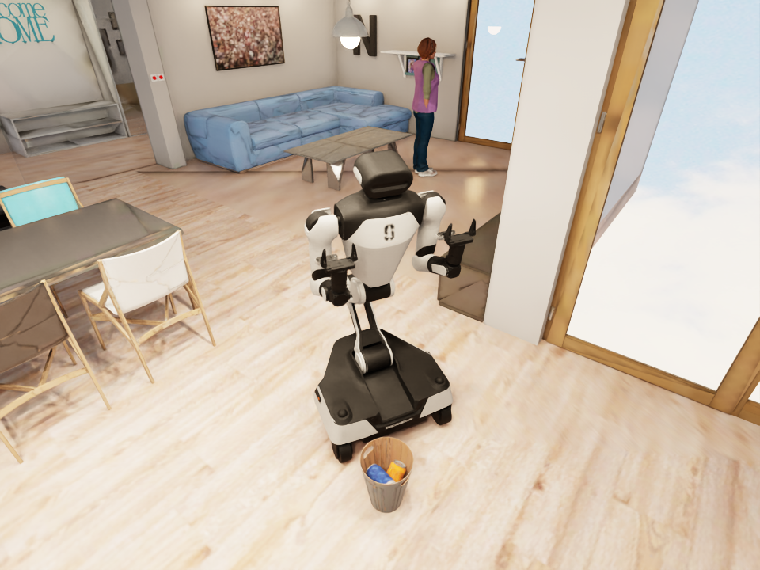
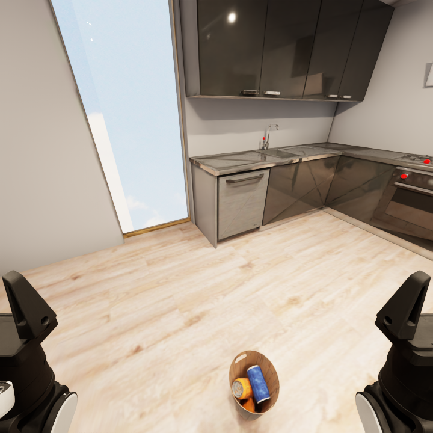

# 08 为什么抓到了罐子，却没有投进垃圾桶

垃圾收集可以分解成 Pick and Place，但持物移动、桶口约束与释放时机仍需要分别处理。本章沿实际失败和修复链分析，避免只把成败归因于模型“聪不聪明”。

## 8.1 RGB-D 已经在使用，接口语义才是关键

原失败链同时跟踪罐子、桶内部和桶沿，并将像素反投影到机器人坐标。独立复算同帧坐标与 SDK 三点坐标，最大单像素差约 2.544 mm。不能将旧图 `img_0032` 的选点与新图 `img_0033` 的更新位置混着比较。

真正发现的接口错误是：持罐放置时调用了抓取接近执行器 `exec_plan_pose`。这个接口执行前会主动张开所选夹爪，导致罐子在桶外提前掉落。回执出现 `open_selected_before_motion_then_hold_observed_qpos`，原生状态从持罐变成无夹持。换更大的模型并不会修复这种执行器合同错误。

## 8.2 从像素到几何目标

相机内参 K、深度 z 和像素 `(u,v)` 给出相机点：

```text
Xc = (u-cx) * z / fx
Yc = (v-cy) * z / fy
Zc = z
Pb = T_base_camera · [Xc, Yc, Zc, 1]
```

深度先确认是光轴 z 还是射线距离，坐标轴方向、单位与外参必须与 SDK 一致。选择桶沿不是选择桶中心，薄边缘的深度可能来自背景，最好检查相邻像素和多个支撑点。目标点必须绑定当前图像 ID，移动后重新观测，不盲目复用旧计划。

## 8.3 正确的容器投放阶段

| 阶段 | 保持/改变什么 | 观察什么 |
| --- | --- | --- |
| 持物运输 | 夹爪保持闭合，臂姿态安全 | assisted grasp 是否仍有效 |
| 抬升 | 将整罐送到桶沿上方 | 罐底和桶沿实际高度 |
| 水平对齐 | 罐子投影覆盖开口 | 相机和测量结果 |
| 测量下降 | 小步更新高度 | 低位 IK 是否可达、实际位移 |
| 显式释放 | 单独发出张爪 | 夹持目标解除 |
| 稳定检查 | 不再推动罐子 | 原生 Inside、低速度、连续样本 |

参考固定版本的 [RoboHarness 容器放置 Skill](https://github.com/BinceQu/RoboHarness/blob/d58e2defb25b9167a1ef14ab778995bf9e9de42f/harness/v2/R1_pro/skills/place-object-in-container/SKILL.md)。RoboHarness 为像素点持续跟踪、几何约束和运动执行提供工具；本项目增加 Aura 交接、持物接口合同、成对恢复与结果报告，不重新宣称上游论文成绩。

末端工具 `x/y/z` 与 `forward/leftward/upward` 可能分别使用基座方向和相机方向，调用前读 schema 与源码。低位 IK 失败时可改变底盘、躯干高度或腕姿，而不是重复相同不可达目标。

## 8.4 单罐到三罐的实际结果

首个黄色罐 `can_of_soda_115` 完成后，从检查点接续橙罐 `114` 和蓝罐 `113`。左爪、右爪分别完成后两罐抓持。三罐在接续运行 native tick 3405 首次全部满足 Inside、释放和稳定，原生任务谓词完成。





证明文件：[three-cans-proof.json](../assets/evidence/three-cans-proof.json)。验收使用连续样本与原生状态；模型的 `done` 文本、剪辑中的字幕或屏幕表情不能替代它。

## 8.5 减少决策碎片

将可确定的抬升、对齐、下降和释放包装为带测量反馈的宏，但保留各子工具结果、终止条件和失败退出。模型保留目标选择、异常处理和任务阶段切换。不能因为要减少轮数就省掉释放确认或使用旧图导航。

本次接续清理 77 次模型选择，返回两段合计 9 次，包含只读测量与技能切换。公开计数保留，不把接口改进写成未经对照测量的性能提升。学习小组可统计各类调用耗时，再比较压缩上下文或宏动作前后的有效进展。

## 8.6 作业

从公开事件中找一次抓取、一次携物移动、一次释放，画出帧 ID、关键点、工具和结果之间的对应关系。设计一个“提前张爪”回归输入，确认 `placement_contract.py` 拒绝该动作，同时不影响正常抓取。再解释 `Inside`、释放、低速稳定各自排除了哪种假成功。
