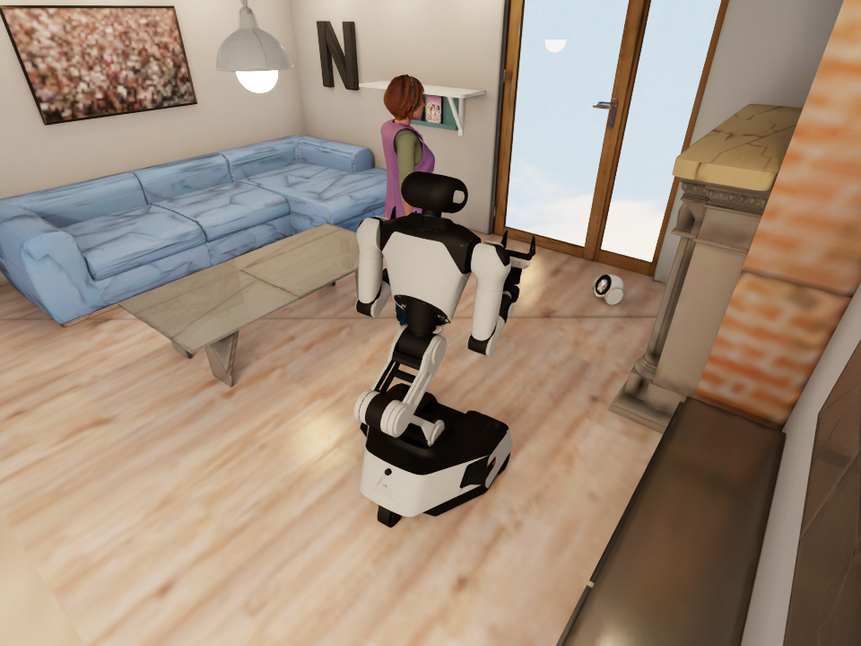

# 09 中断后接着做：检查点、进度与完成判据

长程任务不能只保存视频。可恢复执行至少需要物理状态、应用状态、Agent 进度，以及它们属于同一完成工具边界的证据。保存检查点后继续运行，只有新观测或验收发现问题才进入恢复处理。

## 9.1 成对存档的三层结构

| 层 | 保存内容 | 缺失会怎样 |
| --- | --- | --- |
| 原生场景 | 对象、关节、抓持约束、物理步 | 重放命令无法可靠重建接触现场 |
| 应用旁档 | 人物骨骼、Aura 朝向/屏幕、交互时钟 | 场景与交互进度错位 |
| Agent 检查点 | 已完成事实、工具回执、Skill、文件哈希 | 可能重抓已投放罐子或引用旧图 |

在完整运动工具结束后原子保存检查点，避免保存半个工具执行。临时文件写完再替换，保留逐轮档案；最新目录不完整时跳过它，寻找最近一组完整配对文件。

## 9.2 这次是怎样接续的

从原生快照恢复 149 个对象、R1 关节和抓持约束。两次恢复核验的最大位置误差约 0.113 mm 与 0.00525 mm；一次持罐恢复后保持 16 步检查没有丢持。旧档案没有人物精确骨骼旁档时，以保存的路线与空闲姿态恢复；新档案保存精确骨骼属性。

旧执行前缀中首罐已进入原桶。恢复后重新计算原生 Inside，确认没有重置首罐，再继续后两罐。旧相机 ID、像素点击、运动计划和未决命令都不重播；新会话从新拍的 RGB-D 开始。

完整录像由 **1203 帧旧执行前缀 + 15 帧恢复提示 + 1339 帧接续** 组成，各路 2557 帧、10 fps。两个原生 episode 的边界在片中明确标记；恢复回退约 1.4667 秒。这样保留已做过的过程，又不会把恢复剪辑称为一次不中断原生运行。

## 9.3 完成事实如何避免被遗忘

曾出现两个上下文问题：Skill 切换后把已投放的橙罐重新列为待处理；远处白色 Aura 被描述为橙罐。宿主以已保存释放回执和相机结果固定黄/橙/蓝的进度，并补充“白色圆屏两轮是协作者 Aura”的外观说明。两次纠正保留在公开记录，不注入隐藏物体位置。

持久化事实只写已验收内容，例如“114 已释放且在桶内”。预计动作、计划目标和模型猜测单独记录，不提前升级为事实。每次恢复重新检查与现场有关的条件，避免只相信旧摘要。

## 9.4 `done` 也需要检查，不通过就继续

第一段返回说明只有“看到协作者，保持至少 1 m”，R1 在距 Aura 约 3.51 m 处结束，离预期报告位置过远。随后增加明确范围和可选 `goal_guard`：模型请求结束时检查；未通过就返回公开反馈并继续下一轮。

下列是实际返回阶段 `code-v12` 的完整任务提示，保留原始要求供学习复现：

```text
三个饮料罐已经全部释放并稳定在原垃圾桶内，清理目标原生验收通过。现在只做返回：从厨房返回客厅，在能看见Aura或访客的一块可见空地停稳，方便Aura向人报告结果。不要重做搜索垃圾、抓取或投放。白色圆屏两轮物体是Aura，人物和Aura都是协作者。
只用当前相机检查通道，选择可见空地导航；不要把人物或Aura当作直接接近的点击目标。目标是在Aura约1.2至2.3米范围内，距访客至少1米的空地停稳；不能只因远处看见人就结束。上一段已经走到客厅入口，继续当前位置，不重走厨房路径。用当前RGB-D和measure_shoulder_distance实际测量Aura（白色圆屏两轮）的距离，再选择相邻空地前进；测量是只读，不能把协作者当成抓取目标。优先较长的可见通行段。双臂保持空手收拢，禁止操作物体。满足范围后才能done，宿主未通过时会给出公开反馈并自动继续；每次运动仍自动存档，完整公开输入、相机和回执归档。
```

提示的操作范围为 1.2–2.3 m；宿主现有 evaluator 使用 1.0–2.4 m 的验收容差。它们分别是操作要求和实现容差，不应混写为同一个数值。最终距 Aura 中心约 2.15995 m，距访客约 1.24387 m，最后 0.4 秒位移约 9.54e−7 m。静止核验后记录 Aura 结果报告。



[返回证明](../assets/evidence/return-proof.json) · [整体完成证明](../assets/evidence/household-proof.json)

## 9.5 本地审计与恢复入口

```bash
cd code
python tools/course_lab.py audit --root ..
python -m integrations.aura_household_exec.resume_bundle /path/to/pipeline/host --output /path/to/recovery-bundle.json
```

后一条仅选择和检查档案；真正恢复需在相同原生环境加载快照、核对物体和抓持，再放行 Agent。最终任务档案标记 complete，避免恢复后从头清理。本次最终档案已保存与核对哈希，最终档案本身未再独立重载；实际重载验收针对前面的恢复点。

## 9.6 本章作业

实现一次在工具边界中断后继续的 CPU 状态机练习，确认不会重复已确认的释放动作；再用修改过哈希、缺失旁档、过期帧三个反例检验拒绝路径。原生复现组额外提交恢复前后对象误差与抓持检查。检查点是持续推进的基础设施，不是等待人工说“继续”的终点。
