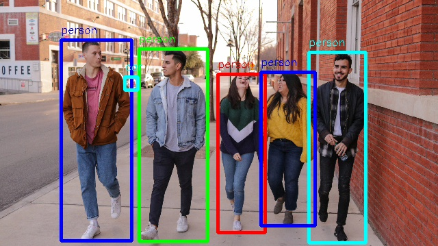
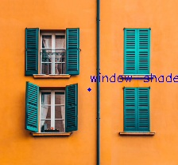
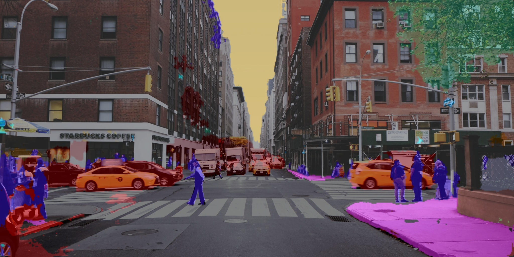

# 11 扩展实验：X5 板载 BPU、手势与深度

前面的视觉工作台在电脑端推理。本章把模型运行位置改为 Aura 内部的 RDK X5 BPU：先用设备随包固定图验证模型、运行库和后处理，再切换真实相机。这是板载算法扩展，不影响主线课程验收。

## 11.1 核对已有安装，不覆盖当前环境

样机历史环境为 Ubuntu 22.04.5、ROS 2 Humble、TogetheROS Humble。已记录包版本包括 `tros-humble 2.5.2`、`dnn-node-example 2.6.1`、`mono2d-body-detection 2.4.2`、`hand-gesture-detection 2.4.1` 和 `hobot-stereonet 2.5.5`。这些是样机记录，不是所有机器必须安装的组合。

在机器人终端先执行：

```bash
source /opt/ros/humble/setup.bash
source /opt/tros/humble/setup.bash
ros2 pkg prefix dnn_node_example
ros2 pkg prefix hand_gesture_detection
ros2 pkg prefix hobot_stereonet
ros2 node list
ros2 topic list
```

包存在不表示节点正在运行。X3、X5、S100 等平台的模型格式和启动文件不同；遇到缺包先核对本机版本与安装说明，不直接覆盖到网上最新主分支。

## 11.2 固定图运行目标检测、分类与分割

| 任务 | 样机配置 | 随包输入 | 已观察输出 |
| --- | --- | --- | --- |
| YOLOv8 检测 | `yolov8workconfig.json` | `test.jpg` | person、car 等框 |
| MobileNetV2 分类 | `mobilenetv2workconfig.json` | `target_class.jpg` | window-shade，原始分数约 0.561912 |
| MobileNet-UNet 分割 | `mobilenet_unet_workconfig.json` | `raw_unet.jpg` | 19 类语义叠加 |

以下命令与历史实测的 YOLO 参数一致。在新的临时目录运行，不与其他 BPU 实验并发：

```bash
source /opt/ros/humble/setup.bash
source /opt/tros/humble/setup.bash
export ROS_DOMAIN_ID=43
export ROS_LOCALHOST_ONLY=1
TASK_DIR=$(mktemp -d /var/tmp/aura-yolo-XXXXXX)
cd "$TASK_DIR"
cp -r /opt/tros/humble/lib/dnn_node_example/config ./config
timeout --signal=INT --kill-after=4s 18s \
  ros2 run dnn_node_example example --ros-args \
  -p feed_type:=0 -p image_type:=0 -p dump_render_img:=1 \
  -p config_file:=config/yolov8workconfig.json -p image:=config/test.jpg
ls -lh render_feedback_*.jpeg
```

预期是模型加载、后处理消息和 `render_feedback_0_0.jpeg`。`timeout` 到时可能返回 124，要结合图像和日志判断；18 秒是启动与停留的限时，不是单张推理耗时。分类与分割替换成表中配置和输入，先检查 JSON 内的模型路径确实存在。







以上三图由样机 X5 在随包测试图生成，是固定图算法验证，不是当前家庭实拍。分类为整图标签；语义分割是像素类别，不能直接当作可通行性或实例分割。

## 11.3 手势链路不是一个节点

人体/手区域 → 人体关键点 → 手关键点 → 手势分类，另有人脸关键点分支。下游依赖上游消息；只启动手势分类可能没有结果。历史固定图链收到 YOLO/人体/手点/手势/人脸点消息约 90/90/89/87/89 条，手点 42、人脸点 106、人体点 19。

手势 ID 包括点赞 2、V 3、静音 4、手掌 5、OK 11、拇指左/右 12/13、666 为 14。举起手臂的几何关系、手掌类别、动态招手需要分别建模；V 分类成功不能代替招手唤醒。

切到相机前，先按第二章核查新鲜帧、编码尺寸和时间戳。Aura 样机使用 MIPI 与自建桥，USB 相机启动示例需要调整图像源。先只运行感知，不自动连 `body_tracking` 或速度转发，再验证输入有效、消息一致与实际人员动作。

## 11.4 光流、双目深度与导航的接口

PWCNet 光流描述相邻两帧的像素位移；不带标定与尺度时不能直接转换成米制速度。StereoNet 或其他双目模型需要同步双图、内外参、基线和正确的图像格式。保存视差/深度图时记录无效值区域；在已知距离上检查误差，才把数值送进控制。

LightNav 工作站策略可以消费图像与任务，但控制适配器仍应独立检查观测新鲜度、动作时长、停止条件和真实通道。仿真已知地图、理想位姿与虚拟测距是第五章案例的具体条件；替换成真机定位与传感器时重新验收这一层。

## 11.5 版本警告与本章提交物

历史 HBRT 3.15.55.0 曾对不同模型编译版本给出警告。保留原始日志，选择同一 OpenExplorer 工具链配套的模型与运行库后做独立回归，不以“生成了图”替代兼容性和精度检查。

提交包版本、模型配置、固定图及其哈希、板端原始输出、退出状态、运行位置和时间测量口径。固定图→相机的迁移另提交真实人员动作输入与消息。结束时只停止自己启动的节点，恢复实验前的相机状态，不清理全局 ROS 进程。

参考：[D-Robotics RDK 文档](https://d-robotics.github.io/rdk_doc/)、[手势交互官方案例](https://developer.d-robotics.cc/x5_cases_doc/en/intermediate/gesture_game)。
