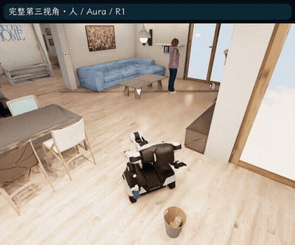
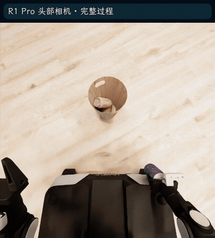
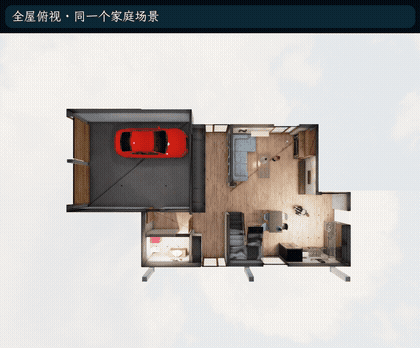
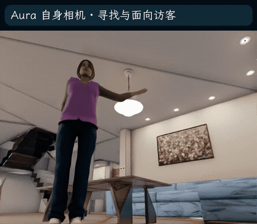
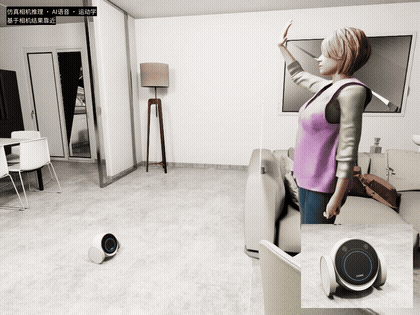
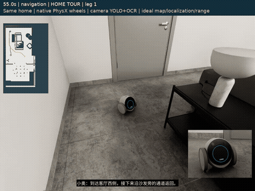
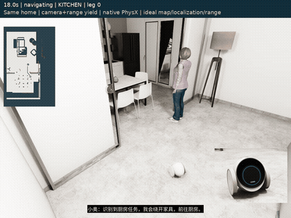

# Aura 交互机器人与具身 Agent：14 天组队学习

从稳定连接一台 FrontierX Aura 开始，做出“看卡片、识别举手、找人转向、室内巡游”的交互机器人，再把 Aura 接入同一家庭中的 R1 Pro，让家务 Agent 完成三罐垃圾收集、返回与结果报告。课程提供步骤、源代码、Notebook、失败分析和完整多视角视频。

[学习计划](学习计划.md) · [招募说明](招募说明.md) · [完整视频目录](视频目录.md) · [代码与运行](code/README.md) · [来源与许可](来源与许可.md)

## 先看完整家庭任务

[](https://github.com/datawhalechina/every-embodied/releases/download/aura-course-20261116/household-observer-full.mp4)

**人走近 Aura → 语音招呼与相机找人 → R1 跨房间搜索 → 抓取运输、逐罐投放 → 返回客厅 → Aura 报告。** 上图是四秒节选，下面均为完整录像。

| 完整第三视角 | 完整 R1 相机 |
| --- | --- |
| [](https://github.com/datawhalechina/every-embodied/releases/download/aura-course-20261116/household-observer-full.mp4) | [](https://github.com/datawhalechina/every-embodied/releases/download/aura-course-20261116/household-r1_head-full.mp4) |
| [观看完整 4:15.7 视频](https://github.com/datawhalechina/every-embodied/releases/download/aura-course-20261116/household-observer-full.mp4) | [观看完整 4:15.7 视频](https://github.com/datawhalechina/every-embodied/releases/download/aura-course-20261116/household-r1_head-full.mp4) |

| 全屋俯视全过程 | Aura 相机全过程 |
| --- | --- |
| [](https://github.com/datawhalechina/every-embodied/releases/download/aura-course-20261116/household-global-full.mp4) | [](https://github.com/datawhalechina/every-embodied/releases/download/aura-course-20261116/household-aura_head-full.mp4) |
| [看房间、跨房间移动与最终位置](https://github.com/datawhalechina/every-embodied/releases/download/aura-course-20261116/household-global-full.mp4) | [看人物招呼与找人过程](https://github.com/datawhalechina/every-embodied/releases/download/aura-course-20261116/household-aura_head-full.mp4) |

[第五路：接力机器人视角](https://github.com/datawhalechina/every-embodied/releases/download/aura-course-20261116/household-robot-full.mp4) · [同步播放器](demo/index.html) · [公开事件](assets/evidence/public-events.json) · [三罐原生证明](assets/evidence/three-cans-proof.json)

五路各 255.7 秒，含明确标记的检查点恢复边界。人物是写实动画角色，语音为合成输入；ASR、图像识别和 R1 原生物理执行实际运行。视频按仿真时间播放，模型计算时物理暂停。方法、来源和验收范围在对应章节展开。

## Aura 自己也会移动与交互

| 举手与读卡 | 家庭导航 | 遇人停车后继续 |
| --- | --- | --- |
| [](https://github.com/datawhalechina/every-embodied/releases/download/aura-course-20261116/camera-visitors-full.mp4) | [](https://github.com/datawhalechina/every-embodied/releases/download/aura-course-20261116/aura-home-tour-full.mp4) | [](https://github.com/datawhalechina/every-embodied/releases/download/aura-course-20261116/aura-person-wait-full.mp4) |
| [完整视频及相机](01-学习资料/03-识人举手与卡片触发.md) | [完整视频及相机](01-学习资料/05-Aura室内导航与避障.md) | [完整视频及相机](01-学习资料/05-Aura室内导航与避障.md) |

主线覆盖 **Aura 的接入、感知、交互、自身导航与避障**。R1 是家务执行器案例；R1 绕人避障属于独立导航算法，不纳入本专题必做项。Aura 当前已验证静态障碍重规划和近人停车等待，双人主动绕行作为选做研究保留。

## 学习目标和章节

| 章节 | 主要成果 | 配套练习 |
| --- | --- | --- |
| [01 硬件供电与稳定连接](01-学习资料/01-硬件供电与稳定连接.md) | 分清供电、串口、局域网与服务 | 联网故障记录 |
| [02 SDK、遥测、相机与视觉](01-学习资料/02-SDK遥测相机与视觉工作台.md) | 新鲜相机、协议与模型结果 | Notebook 01 / 02 |
| [03 识人、举手与卡片](01-学习资料/03-识人举手与卡片触发.md) | 图像闭环触发与负例 | Notebook 03 |
| [04 圆屏、语音与官方 Skill](01-学习资料/04-圆屏语音与官方Skill.md) | 状态显示、语音和技能合同 | Skill 包入口 |
| [05 Aura 导航与避障](01-学习资料/05-Aura室内导航与避障.md) | 巡游、静态绕行、遇人等待 | 轨迹和停止条件 |
| [06 MuJoCo / Blender](01-学习资料/06-参数化建模与MuJoCo-Blender.md) | 参数化外形与圆屏仿真 | Notebook 04 |
| [07 同家庭人 / Aura / R1](01-学习资料/07-同家庭人-Aura-R1-Agent.md) | 语音视觉交接、工具控制 | 架构与 workspace |
| [08 RGB-D 几何与三罐投放](01-学习资料/08-RGBD几何抓取与三罐投放.md) | 持物、投放、原生验收 | Notebook 05 |
| [09 检查点恢复与自动推进](01-学习资料/09-检查点恢复与自动推进.md) | 成对存档、进度、done 检查 | Notebook 06 |
| [11 X5 板载 BPU 与深度扩展](01-学习资料/11-X5板载BPU与深度扩展.md) | 板载检测、分类、分割与手势 | 固定图与真实相机迁移 |
| [10 组队项目与贡献](01-学习资料/10-组队项目验收与贡献.md) | 验收矩阵与成果展示 | 最终报告 |

## 三分钟先运行离线部分

无需 Aura、GPU、API key 或外部资产，Python 3.11+ 即可：

```bash
# 进入本专题目录后
cd code
python tools/course_lab.py audit --root ..
python -m unittest discover -s tests -v
python tools/course_lab.py twin --root .
```

预期：本地媒体索引与验收文件一致，三罐证明与返回证明通过，代码合同测试通过，MJCF 资源齐全。打开 [`03-Notebook`](03-Notebook/README.md) 按顺序学习。连接真机和原生仿真时再按章节安装额外依赖，避免修改已有工作站环境。

完整视频位于[同仓视频 Release](https://github.com/datawhalechina/every-embodied/releases/tag/aura-course-20261116)，共 11 路。GitHub 文档可直接查看动图和图片；同步视频播放器需用静态 HTTP 服务打开，本地命令见代码说明。

## 当前验证范围

三罐已全部进入原桶、解除夹持且稳定，R1 返回后距 Aura 中心约 2.16 m、距访客约 1.24 m，停稳并完成报告。终点存档已保存；历史恢复点做过实际重载核验。真机电池已读电压，SOC/充电状态未标定；真机麦克风近无声问题单独保留。数字孪生是参数化重建，尚无全部工程尺寸、质量和惯量标定。

本专题新增独立课程目录，保留此前所有成果；代码与材料按仓库许可及逐项第三方说明使用。欢迎提交复现记录、故障证据和增量改进。
