# 完整视频目录

所有 MP4 均为本项目已有实验录像。下面预览是四秒节选，点击查看完整有声视频。家庭五路使用同一时间轴，具体环境与限制见对应章节。

## 完整第三视角

[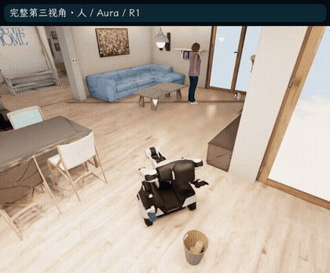](https://github.com/datawhalechina/every-embodied/releases/download/aura-course-20261116/household-observer-full.mp4)

[完整视频](https://github.com/datawhalechina/every-embodied/releases/download/aura-course-20261116/household-observer-full.mp4) · 255.7 秒 · 22.4 MiB

## R1 机器人相机

[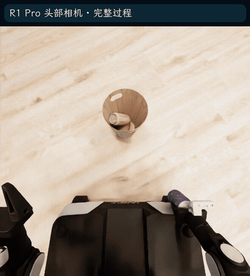](https://github.com/datawhalechina/every-embodied/releases/download/aura-course-20261116/household-r1_head-full.mp4)

[完整视频](https://github.com/datawhalechina/every-embodied/releases/download/aura-course-20261116/household-r1_head-full.mp4) · 255.7 秒 · 23.6 MiB

## Aura 自身相机

[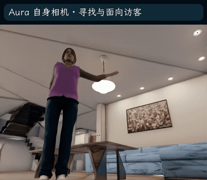](https://github.com/datawhalechina/every-embodied/releases/download/aura-course-20261116/household-aura_head-full.mp4)

[完整视频](https://github.com/datawhalechina/every-embodied/releases/download/aura-course-20261116/household-aura_head-full.mp4) · 255.7 秒 · 6.0 MiB

## 全屋俯视

[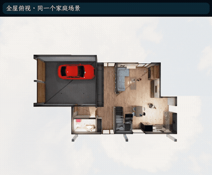](https://github.com/datawhalechina/every-embodied/releases/download/aura-course-20261116/household-global-full.mp4)

[完整视频](https://github.com/datawhalechina/every-embodied/releases/download/aura-course-20261116/household-global-full.mp4) · 255.7 秒 · 4.3 MiB

## 机器人接力视角

[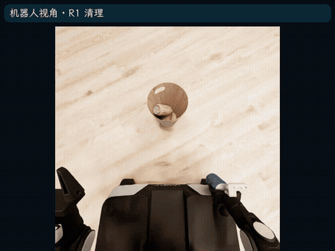](https://github.com/datawhalechina/every-embodied/releases/download/aura-course-20261116/household-robot-full.mp4)

[完整视频](https://github.com/datawhalechina/every-embodied/releases/download/aura-course-20261116/household-robot-full.mp4) · 255.7 秒 · 20.8 MiB

## 摄像头识人、举手与读卡

[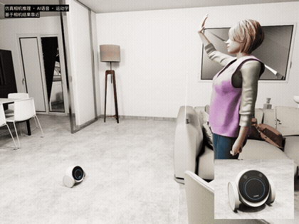](https://github.com/datawhalechina/every-embodied/releases/download/aura-course-20261116/camera-visitors-full.mp4)

[完整视频](https://github.com/datawhalechina/every-embodied/releases/download/aura-course-20261116/camera-visitors-full.mp4) · 32.0 秒 · 2.7 MiB

## 识人读卡：Aura 相机

[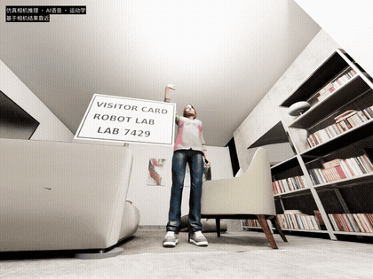](https://github.com/datawhalechina/every-embodied/releases/download/aura-course-20261116/camera-visitors-pov-full.mp4)

[完整视频](https://github.com/datawhalechina/every-embodied/releases/download/aura-course-20261116/camera-visitors-pov-full.mp4) · 32.0 秒 · 2.8 MiB

## Aura 家庭导航：完整第三视角

[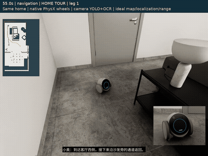](https://github.com/datawhalechina/every-embodied/releases/download/aura-course-20261116/aura-home-tour-full.mp4)

[完整视频](https://github.com/datawhalechina/every-embodied/releases/download/aura-course-20261116/aura-home-tour-full.mp4) · 157.5 秒 · 29.0 MiB

## Aura 家庭导航：完整相机视角

[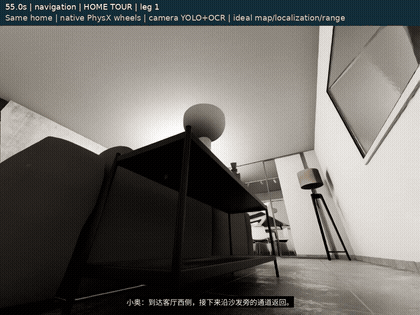](https://github.com/datawhalechina/every-embodied/releases/download/aura-course-20261116/aura-home-tour-pov-full.mp4)

[完整视频](https://github.com/datawhalechina/every-embodied/releases/download/aura-course-20261116/aura-home-tour-pov-full.mp4) · 157.5 秒 · 21.0 MiB

## Aura 遇人停车、等待、继续

[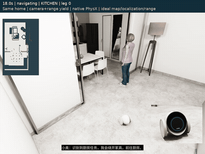](https://github.com/datawhalechina/every-embodied/releases/download/aura-course-20261116/aura-person-wait-full.mp4)

[完整视频](https://github.com/datawhalechina/every-embodied/releases/download/aura-course-20261116/aura-person-wait-full.mp4) · 102.3 秒 · 14.6 MiB

## Aura 遇人等待：相机视角

[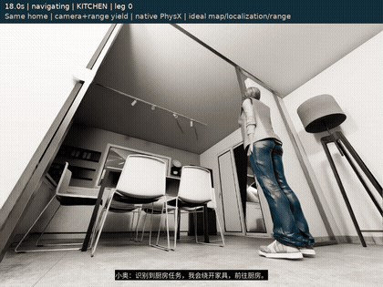](https://github.com/datawhalechina/every-embodied/releases/download/aura-course-20261116/aura-person-wait-pov-full.mp4)

[完整视频](https://github.com/datawhalechina/every-embodied/releases/download/aura-course-20261116/aura-person-wait-pov-full.mp4) · 102.3 秒 · 15.0 MiB
