# 01 · 星海图机器人双手弹琴

演播室成片里，R1 Pro 用双 Shadow Hand［灵巧手］弹奏《我爱你，中国》，身后的电视大屏随乐曲切换画面。成片长 34.6 秒，保留琴键声音。[播放演播室成片](../../06-策略抓取或抓取VLA/大模型控制、VLA、VLM/20-GPT6-Astra机器人弹琴与上下文工程/assets/piano-xiaohongshu.mp4) · [小红书完整版](https://www.xiaohongshu.com/explore/6ac373a8000000000a02209c?xsec_token=AB1VkPJCiZ9JR012UmZ5XPREYBX5v5UZafYfhVPVyAFQM=&xsec_source=pc_user) · [B 站完整版](https://www.bilibili.com/video/BV1FhHW6dERA/)

## 数据怎样流动

1. 读取机械臂和手腕状态，把当前手腕目标与琴的位置变化交给 G0.5 生成双臂候选。
2. 校验候选在动作范围内，逆运动学校正手腕到琴键的相对位置。
3. 按乐谱调度手指关节，先抬手，让琴移动，再对准并安全下落。
4. 从仿真琴键关节读取真实触发和时间戳，检查误触、顺序和节拍。

历史演示中的《我爱你，中国》、中途位置扰动和短练习物理回放各有独立结果。完整曲目的录制、手腕恢复、原始控制器与音乐来源说明见[弹琴原教程](../../06-策略抓取或抓取VLA/大模型控制、VLA、VLM/20-GPT6-Astra机器人弹琴与上下文工程/README.md)。

## 手腕到位和按键是两层控制

移琴改变了琴键在场景坐标系中的位置。控制器根据移琴后的几何位置更新手腕目标，再用逆运动学反求关节构型。双臂候选提供关节姿态参考，求解器还要同时压低手腕位置和方向误差。手腕到位后，专用演奏控制器按乐谱给手指发送目标。验证时从琴键关节的运动检测触发，再和预期音符逐项对照。看本章的移琴片段时，可以把抬手、对准和落手三个阶段与这些信号对应起来。[原理导读](00-原理导读.md)

## 物理回放

在本专题目录用 Python［脚本运行环境］3.10 创建环境。无图形环境可去掉 `--viewer`。

```bash
python3.10 -m venv .venv
. .venv/bin/activate
python -m pip install 'mujoco==3.1.6' 'numpy==1.26.4'
python reproduce.py --piano --viewer
```

窗口中的绿色琴键来自物理触发。验证文件 `reproduction-output/piano/native_replay_report.json` 记录 11 次触发，`onset_sequence_matches` 为 `true`，`model_calls` 为 0。仿真输入是已归档的执行器目标，每步推进物理引擎并读取琴键。录制声音可从原教程视频听到。

要重新生成 G0.5 双臂候选，从原教程的 [G0.5 策略接入](../../06-策略抓取或抓取VLA/大模型控制、VLA、VLM/20-GPT6-Astra机器人弹琴与上下文工程/G05.md)开始。[回放与验证说明](../../06-策略抓取或抓取VLA/大模型控制、VLA、VLM/20-GPT6-Astra机器人弹琴与上下文工程/REPRODUCTION.md)链接到控制脚本、位姿度量及音乐复验数据。


## 回放视频与时间截图

每格标注所链接视频的时间，点开可查看原图。

### 演播室成片 · 《我爱你，中国》

[播放录像](../../06-策略抓取或抓取VLA/大模型控制、VLA、VLM/20-GPT6-Astra机器人弹琴与上下文工程/assets/piano-xiaohongshu.mp4)

| [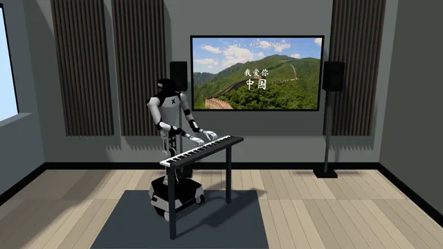](assets/frames/piano-studio-01.webp) | [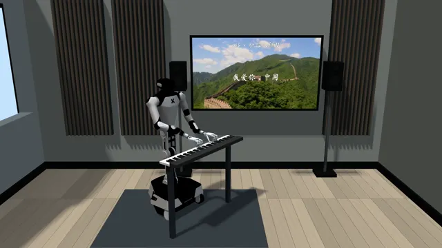](assets/frames/piano-studio-02.webp) | [](assets/frames/piano-studio-03.webp) |
| --- | --- | --- |
| 1 秒 | 5 秒 | 9 秒 |

| [](assets/frames/piano-studio-04.webp) | [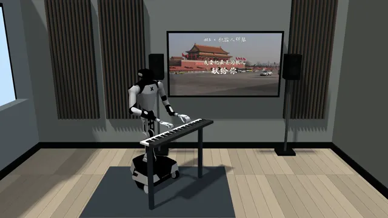](assets/frames/piano-studio-05.webp) | [](assets/frames/piano-studio-06.webp) |
| --- | --- | --- |
| 13 秒 | 17 秒 | 21 秒 |

| [](assets/frames/piano-studio-07.webp) | [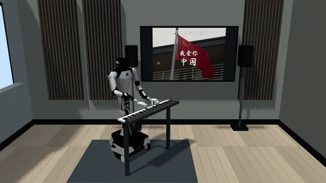](assets/frames/piano-studio-08.webp) | [](assets/frames/piano-studio-09.webp) |
| --- | --- | --- |
| 26 秒 | 31 秒 | 34 秒 |


### 中途位移与重新对准

[播放录像](../../06-策略抓取或抓取VLA/大模型控制、VLA、VLM/20-GPT6-Astra机器人弹琴与上下文工程/assets/public-relocation-demo.mp4)

| [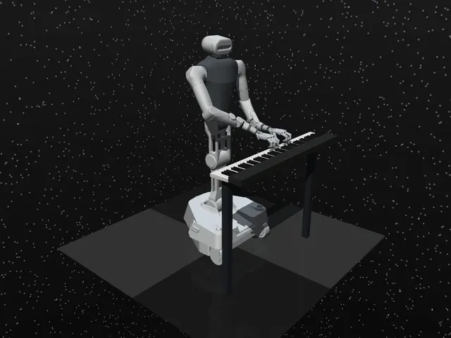](assets/frames/piano-recovery-01.webp) | [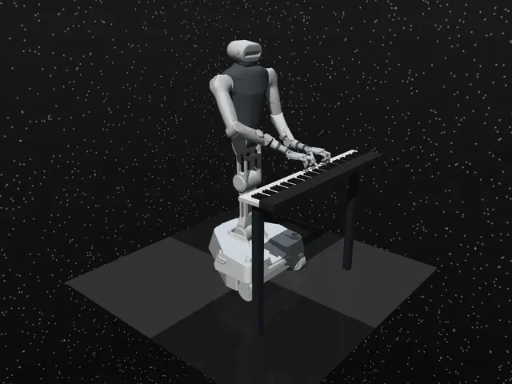](assets/frames/piano-recovery-02.webp) | [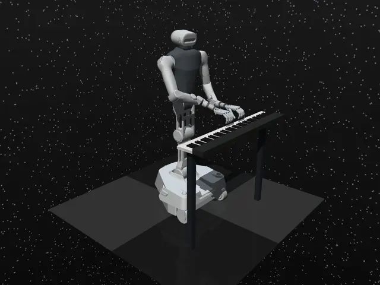](assets/frames/piano-recovery-03.webp) |
| --- | --- | --- |
| 1 秒 | 3.5 秒 | 4.8 秒 |

| [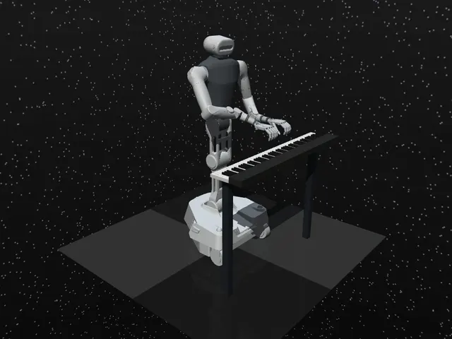](assets/frames/piano-recovery-04.webp) | [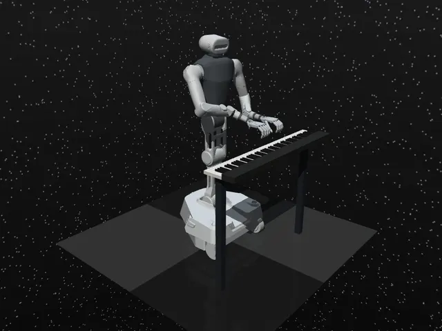](assets/frames/piano-recovery-05.webp) | [](assets/frames/piano-recovery-06.webp) |
| --- | --- | --- |
| 5.6 秒 | 6.8 秒 | 8.2 秒 |

| [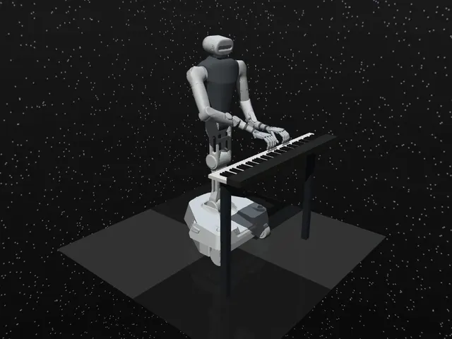](assets/frames/piano-recovery-07.webp) | [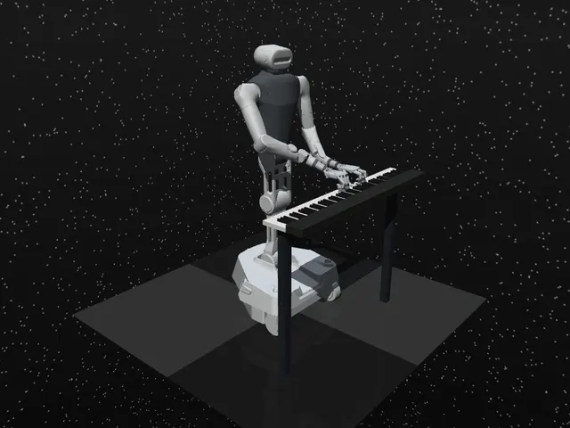](assets/frames/piano-recovery-08.webp) |
| --- | --- |
| 9.5 秒 | 12.7 秒 |
