# 03 · RoboHarness 万圣节收纳

在 BEHAVIOR-1K 家庭仿真实例 301 对照三条运行路径，分别用纯上层推理、接入关闭原生思维链的 G0.5、接入开启原生思维链的 G0.5。三个原生终局分均为 1.0。[小红书完整版](https://www.xiaohongshu.com/explore/6b019d8c000000001802e0b7?xsec_token=ABl4vfrbBHNES09U31x3CEc-ve4pQ3So1019yNsyF06oQ=&xsec_source=pc_user) · [B 站完整版](https://www.bilibili.com/video/BV1huyezgEAH/)

## 从观察到阶段交接

1. 从机器人头部画面找目标，通过深度把画面上的目标转成场景位置。导航到工作面，复核手臂与目标的相对位置。
2. 上层推理依次处理锅具、抽屉、蜡烛和关抽屉等子目标。选定手臂后，按当前图像、观测序号、会话与关节状态生成候选。
3. 按位置、关节增量、夹爪意图与目标跟踪验证候选。短动作段以实际执行回执为准，每步校验新观测。候选无效、跟踪丢失或需要精确对准时重新观察或交给几何工具。
4. 完成一个阶段后记录抓取、物体位置或抽屉位移。发生底盘移动时重新测量；根据确认后的画面和位移进入下一个阶段。

| 同一实例 301 | 原生终局分 | 原生步数 | 上层词元 | G0.5 调用 | G0.5 执行步 |
| --- | ---: | ---: | ---: | ---: | ---: |
| 纯上层推理 | 1.0 | 16,785 | 149,962,542 | 0 | 0 |
| G0.5 无原生思维链 | 1.0 | 27,010 | 170,351,037 | 7 | 144 |
| G0.5 有原生思维链 | 1.0 | 13,421 | 33,524,727 | 55 | 168 |

上层词元包含缓存输入。无原生思维链组沿用早期轨迹后续跑，动作流按观测序号拼接，包含本次 152,431,364 和复用轨迹归属的 17,919,673 个词元。G0.5 调用含生成后未采纳的候选。三个回合的推理强度、阶段入口与控制流程均有差异，结果适用于本实例。[逐回合指标](data/halloween/runs.json) · [原生评测摘录](data/halloween/native-outcomes.json)

## 为什么阶段之间要重新观测

以蜡烛入抽屉为例，拉开抽屉改变了容器位置，转动底盘又改变了相机相对于抽屉的位姿。上层控制要根据新画面重新确认抽屉和蜡烛的位置，再交给下一段动作。二维目标框能告诉控制器在画面哪里找目标，深度和相机位姿用于估计机器人实际要伸向的位置。执行后用新画面检查蜡烛是否进入抽屉，再决定是否关抽屉。对照本章的分段录像时，可以分别标出目标定位、接触和阶段完成的时刻。[原理导读](00-原理导读.md)

## 一键核对原始动作

在专题目录运行：

```bash
python3 reproduce.py
```

三条动作流各从观测序号 43 开始，分别包含 16,742、26,967、13,378 条连续动作。每条动作包含 27 个数值。脚本检查起止序号、步进、动作维度、数值及原始散列；初始化动作与回合原生总步数按不同口径记录。

## 在仿真里回放选定的一条

需要安装 RoboHarness 的控制器与 BEHAVIOR-1K 仿真环境，准备数据及授权，并使用以下固定版本。[RoboHarness 安装文档](https://github.com/BinceQu/RoboHarness/blob/d58e2defb25b9167a1ef14ab778995bf9e9de42f/docs/setup.md)

`TOPIC` 和 `HARNESS` 分别指专题和 RoboHarness 目录。 `DRIVER_PYTHON` 指 R1 Pro 控制环境，`EVAL_PYTHON` 指官方评测环境。按照安装文档设置数据目录。输出盘要留出仿真缓存和评测器要求的磁盘保留空间。脚本为评测器创建独立缓存，避免把并行运行的缓存分配给回放。在 RoboHarness 检出下面的提交及其子模块：

```bash
git -C "$HARNESS" checkout d58e2defb25b9167a1ef14ab778995bf9e9de42f
git -C "$HARNESS" submodule update --init --recursive
```

准备好后，在本专题目录导出 `HARNESS`、`DRIVER_PYTHON`、`EVAL_PYTHON`、`OMNIGIBSON_DATA_PATH` 后，可以用一条命令启动两个进程：

```bash
python3 simulation_replay.py halloween --method pink --limit 120 \
  --output ./reproduction-output/halloween-pink-120
```

去掉 `--limit` 回放完整动作流。输出目录需为新目录。如果要分别观察两个服务的日志，可按下面的命令拆开运行。

从本专题目录启动回放服务。以下以有原生思维链的回合开头 120 条为例，便于先核对初始化状态。

```bash
export RUN=$(mktemp -d)
echo "$RUN"
export LIMIT=120
export METHOD=pink
export PORT=19401
PYTHONPATH="$HARNESS/harness/v2/R1_pro" "$DRIVER_PYTHON" \
  "$TOPIC/code/roboharness/replay_driver.py" \
  --input "$TOPIC/data/halloween/$METHOD" --out "$RUN/driver" \
  --port "$PORT" --limit "$LIMIT"
```

在另一个终端进入 RoboHarness 目录，设置相同的 `TOPIC`、`RUN`、`LIMIT`、`PORT`、`HARNESS`、`EVAL_PYTHON` 和 `OMNIGIBSON_DATA_PATH` 后启动评测器：

```bash
cd "$HARNESS"
export OMNIGIBSON_APPDATA_PATH="$RUN/kit"
export BEHAVIOR_EVAL_TEST_RGBD_ANNOTATOR_DEVICE=cpu
export BEHAVIOR_EVAL_TEST_RESTORE_TASK_OBJECTS=1
export BEHAVIOR_EVAL_TEST_ENABLE_PRIVILEGED_GRASP_ORACLE=0
export PYTHONPATH="$HARNESS/eval/behavior:$HARNESS/BEHAVIOR/OmniGibson:$HARNESS/BEHAVIOR/bddl3:$HARNESS/BEHAVIOR/joylo"
"$EVAL_PYTHON" "$TOPIC/code/roboharness/replay_evaluator.py" \
  --task-name putting_away_Halloween_decorations \
  --robot-config "$HARNESS/eval/behavior/behavior_interface_eval_test/robot_profiles/r1pro_8dof_hf250/evaluator_robot.yaml" \
  --host 127.0.0.1 --port "$PORT" --mode public_test --instance-indices 0 \
  --num-rollouts 1 --max-steps "$((42 + LIMIT))" --headless \
  --env-wrapper behavior_interface_eval_test.official_rgbd_wrapper.OfficialRGBDFullResWrapper \
  --output-dir "$RUN/evaluator" --write-video --video-fps 30
```

服务在发送首条记录动作前检查初始关节和头部参考图像，动作来自同一保存序列。看 `$RUN/driver/status.json` 和 `checkpoint-comparisons.jsonl`；测试结束后关闭自己的回放服务。完整动作长度分别为 `METHOD=astra LIMIT=16742`、`METHOD=purple LIMIT=26967`、`METHOD=pink LIMIT=13378`。本次短回放现场通过初始检查并执行 120 条动作，末观测序号为 163，初始关节位置最大绝对差为 0。[短回放实测记录](data/halloween/native-replay-smoke.json)

达到归档上限后，回放驱动器拒绝额外动作。若评测端继续请求，日志可能记录连接关闭。用 `commands_sent`、`sequence` 和初始对齐记录确认回放。终局分读取历史原生结果。

## 检查和复用控制代码

- [观测打包](code/roboharness/observation_input.py)按真实历史观测组织相机和机器人状态。七关节候选只有在第八关节接近注册姿态时才送入模型。
- [动作转换](code/roboharness/bridge.py)将完成反归一化的 G0.5 候选变成双臂关节指令。导航和需要改变躯干姿态的操作交由几何工具。
- [候选交换](code/roboharness/proposal_exchange.py)用文件散列与观测序号绑定输入、输出和执行凭据。[短动作执行](code/roboharness/g05_chunk_20261106.py)用连续观测逐步校验范围和停止条件。
- [阶段交接](code/roboharness/stage_bridge_20261106.py)管理进入、退出、场景扰动后重定位与下一子任务。[候选监督控制](code/roboharness/orchestrated_host_20261106.py)把阶段、跟踪和执行工具连接起来。

学习时可在控制层直接运行原始独立测试。在本专题目录设置上文的 `HARNESS`，并安装 NumPy［数组运算库］、Pillow［图像处理库］及 PyTorch［张量计算库］：

```bash
export G05_R1PRO_URDF="$HARNESS/harness/v2/R1_pro/robot_config/model.urdf"
export PYTHONPATH="$HARNESS/harness/v2/R1_pro"
cd code/roboharness
python -m unittest test_observation_input test_g05_chunk_20261106 \
  test_candidate_orchestration_20261106 test_stage_bridge_20261106
```

纯上层控制可先用 [RoboHarness 上游流程](https://github.com/BinceQu/RoboHarness/blob/d58e2defb25b9167a1ef14ab778995bf9e9de42f/README.md)启动一次新回合。从 RoboHarness 根目录配置自己的模型端点、模型名和依赖后，先检查计划，再按实例启动：

```bash
./scripts/reproduce_task.sh task02 --gpu 0 --instances 301 --dry-run
./scripts/reproduce_task.sh task02 --gpu 0 --instances 301 --run-dir runs/halloween-301
```

结果查看 `runs/halloween-301/summary.json`。该命令用你配置的上层模型执行同一任务，历史数据及视频继续由归档复核入口读取。

## 从真实相机样本生成一段新候选

专题包含初始化时的三相机画面和 65 维测量状态。先在装好 NumPy、PyTorch、PyYAML 和 psutil 的模型环境中验证输入。脚本打印观测序号 43、真实的当前帧和五项启动填补，无需模型权重。

```bash
CAPTURE=data/halloween/captured-observation
python code/roboharness/g05_worker.py --validate-request \
  --request "$CAPTURE/request.json" --input-root "$CAPTURE"
```

要执行新推理，按 [GalaxeaVLA](https://github.com/OpenGalaxea/GalaxeaVLA) 安装依赖并检出 `89f2322b4ad016e192437adc1a2c253b05bab246`，取得 [G0.5 基础权重和配套文件](https://huggingface.co/OpenGalaxea/G05)。设置 `GALAXEA_ROOT` 为源码目录，`G05_BASE` 为含 `checkpoints/model_state_dict.pt`、`.hydra/config.yaml` 和 `dataset_stats.json` 的模型目录，`G05_PROCESSOR` 和 `G05_TOKENIZER` 分别指处理器目录和动作分词器权重，并导出上节的 `G05_R1PRO_URDF`。

```bash
python code/roboharness/g05_worker.py --source "$GALAXEA_ROOT" \
  --base "$G05_BASE" --processor "$G05_PROCESSOR" --tokenizer "$G05_TOKENIZER" \
  --reasoning on --input-root "$CAPTURE" --request "$CAPTURE/request.json" \
  --output ./reproduction-output/halloween-candidate-on
```

使用 `--reasoning off` 和新的输出目录可比较另一种动作生成模式。`calls/` 保存候选请求与结果凭据，动作文件保存反归一化后的候选。模型进程只读取观测和生成动作；真实执行由上层控制器选取并重新检查。完整混合闭环还需要将上层推理、几何、相机和动作执行工具装入同一 RoboHarness 会话。历史上层服务配置与历史上下文未打包。

## 回放视频与时间截图

每格标注所链接视频的时间，点开可查看原图。

### 移走锅具 · 纯上层推理

[播放录像](assets/clips/pot-astra.mp4)

| [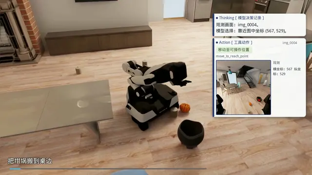](assets/frames/pot-astra-01.webp) | [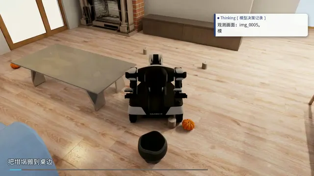](assets/frames/pot-astra-02.webp) | [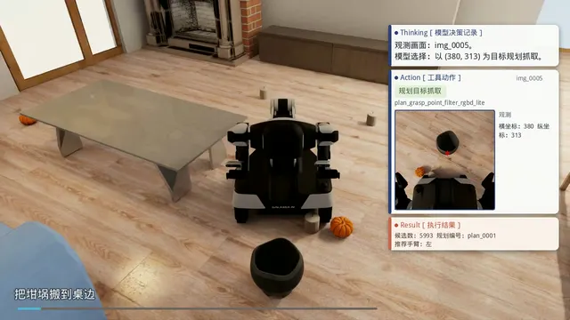](assets/frames/pot-astra-03.webp) |
| --- | --- | --- |
| 1 秒 | 5 秒 | 10 秒 |

| [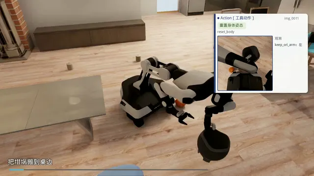](assets/frames/pot-astra-04.webp) | [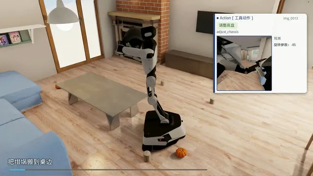](assets/frames/pot-astra-05.webp) | [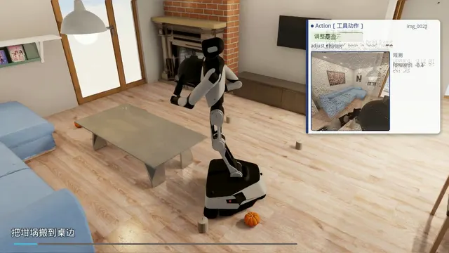](assets/frames/pot-astra-06.webp) |
| --- | --- | --- |
| 16 秒 | 22 秒 | 27 秒 |


### 移走锅具 · G0.5 无原生思维链

[播放录像](assets/clips/pot-purple.mp4)

| [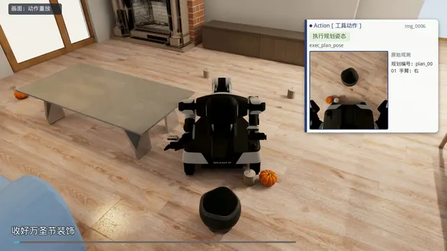](assets/frames/pot-purple-01.webp) | [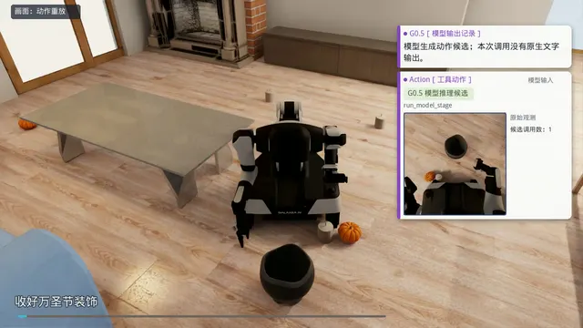](assets/frames/pot-purple-02.webp) | [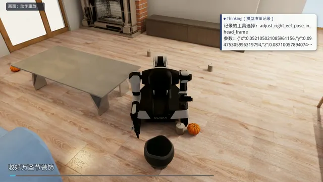](assets/frames/pot-purple-03.webp) |
| --- | --- | --- |
| 1 秒 | 5 秒 | 10 秒 |

| [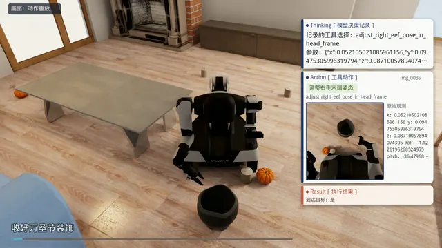](assets/frames/pot-purple-04.webp) | [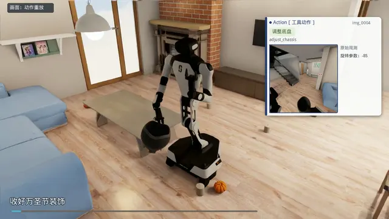](assets/frames/pot-purple-05.webp) | [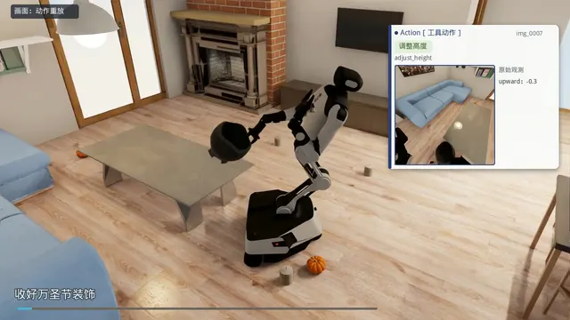](assets/frames/pot-purple-06.webp) |
| --- | --- | --- |
| 16 秒 | 22 秒 | 27 秒 |


### 移走锅具 · G0.5 有原生思维链

[播放录像](assets/clips/pot-pink.mp4)

| [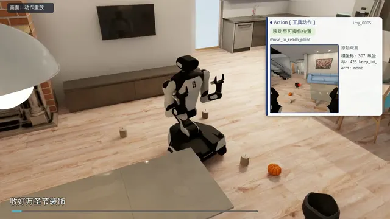](assets/frames/pot-pink-01.webp) | [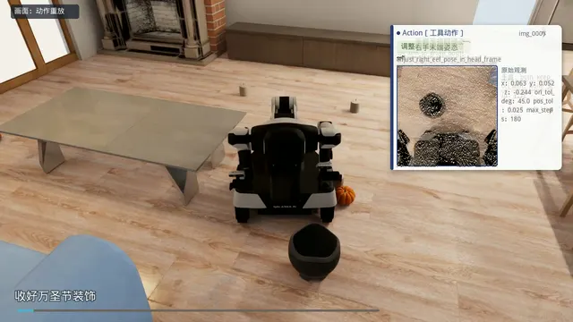](assets/frames/pot-pink-02.webp) | [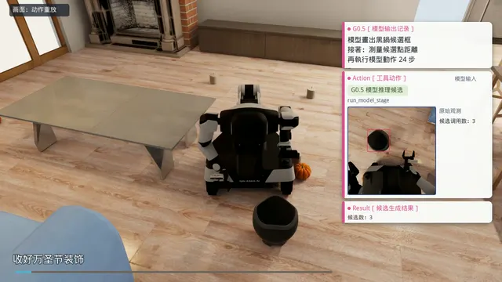](assets/frames/pot-pink-03.webp) |
| --- | --- | --- |
| 1 秒 | 5 秒 | 10 秒 |

| [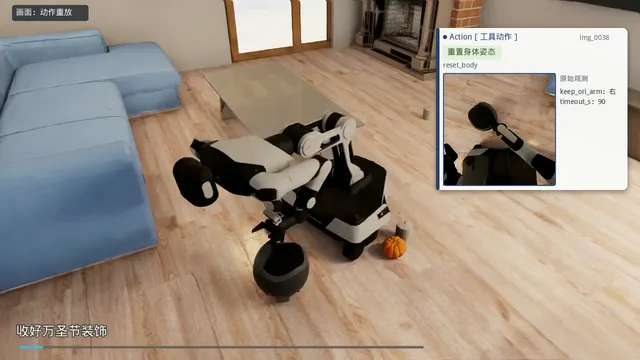](assets/frames/pot-pink-04.webp) | [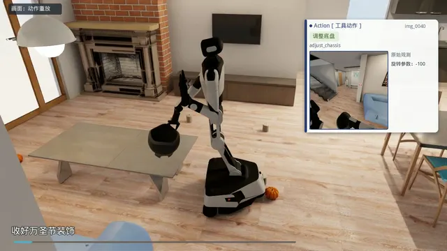](assets/frames/pot-pink-05.webp) | [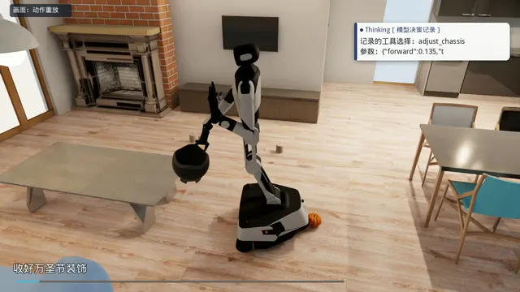](assets/frames/pot-pink-06.webp) |
| --- | --- | --- |
| 16 秒 | 22 秒 | 27 秒 |


### 蜡烛入抽屉 · 纯上层推理

[播放录像](assets/clips/candle-astra.mp4)

| [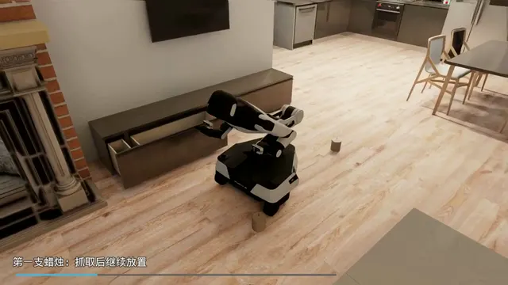](assets/frames/candle-astra-01.webp) | [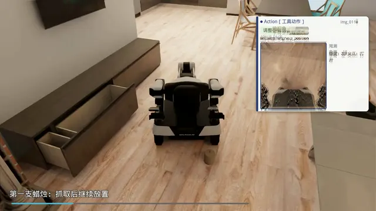](assets/frames/candle-astra-02.webp) | [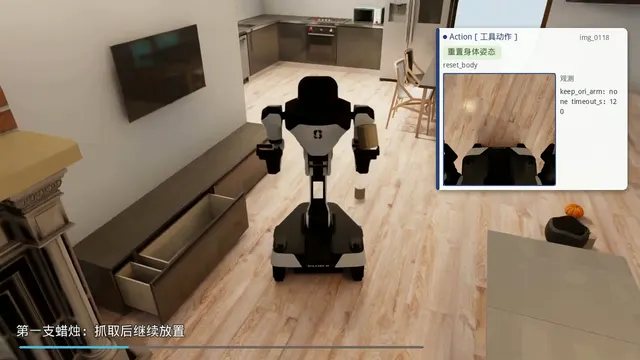](assets/frames/candle-astra-03.webp) |
| --- | --- | --- |
| 1 秒 | 7 秒 | 14 秒 |

| [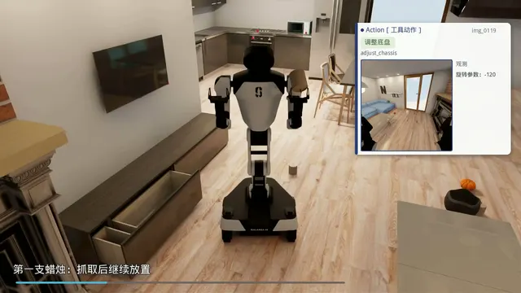](assets/frames/candle-astra-04.webp) | [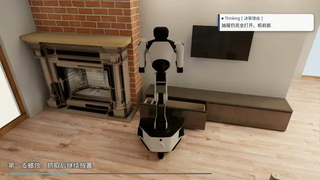](assets/frames/candle-astra-05.webp) | [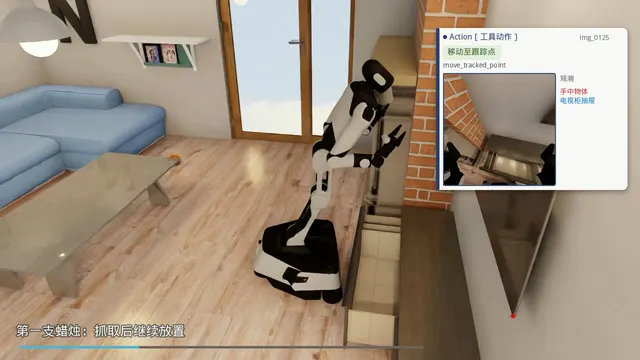](assets/frames/candle-astra-06.webp) |
| --- | --- | --- |
| 21 秒 | 30 秒 | 38 秒 |


### 蜡烛入抽屉 · G0.5 无原生思维链

[播放录像](assets/clips/candle-purple.mp4)

| [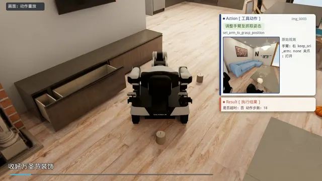](assets/frames/candle-purple-01.webp) | [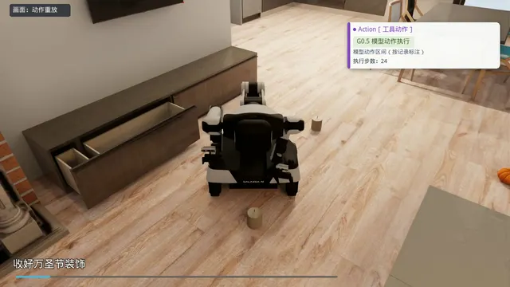](assets/frames/candle-purple-02.webp) | [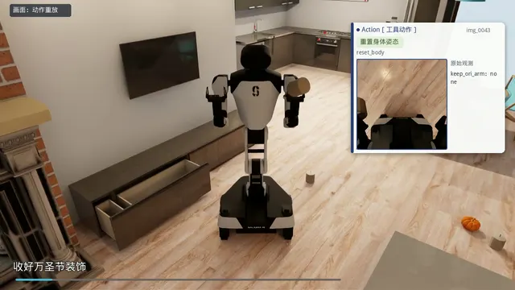](assets/frames/candle-purple-03.webp) |
| --- | --- | --- |
| 1 秒 | 7 秒 | 14 秒 |

| [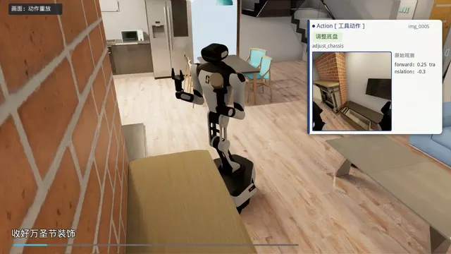](assets/frames/candle-purple-04.webp) | [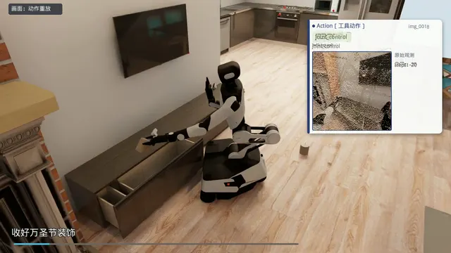](assets/frames/candle-purple-05.webp) | [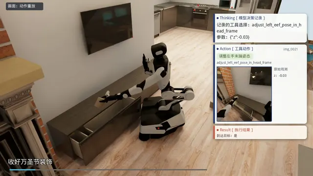](assets/frames/candle-purple-06.webp) |
| --- | --- | --- |
| 21 秒 | 30 秒 | 38 秒 |


### 蜡烛入抽屉 · G0.5 有原生思维链

[播放录像](assets/clips/candle-pink.mp4)

| [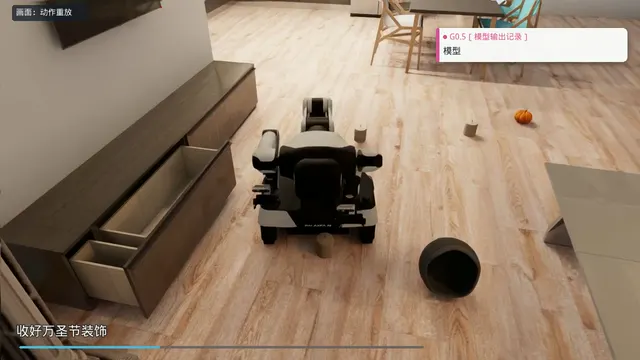](assets/frames/candle-pink-01.webp) | [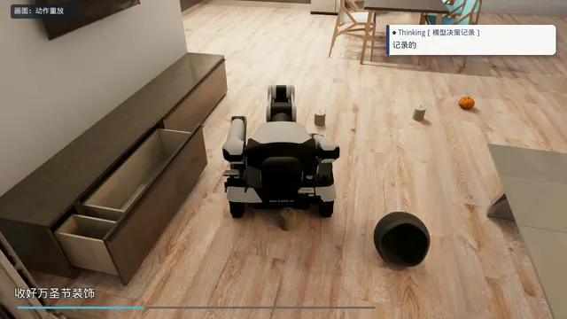](assets/frames/candle-pink-02.webp) | [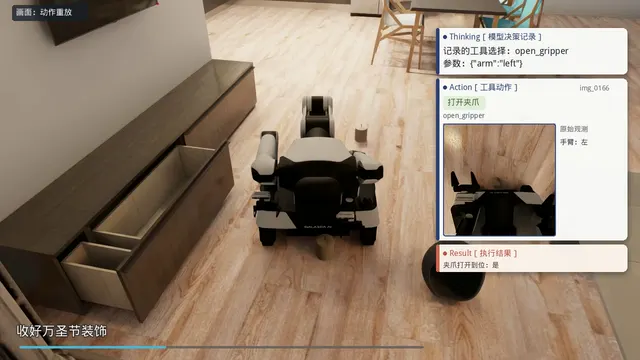](assets/frames/candle-pink-03.webp) |
| --- | --- | --- |
| 1 秒 | 7 秒 | 14 秒 |

| [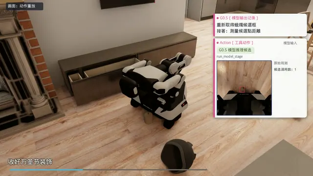](assets/frames/candle-pink-04.webp) | [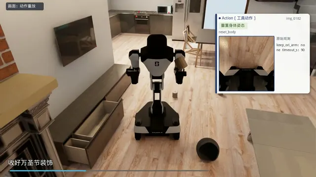](assets/frames/candle-pink-05.webp) | [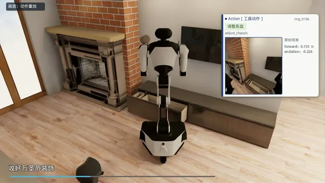](assets/frames/candle-pink-06.webp) |
| --- | --- | --- |
| 21 秒 | 30 秒 | 38 秒 |


### 收尾过程 · 纯上层推理

[播放录像](assets/clips/ending-astra.mp4)

| [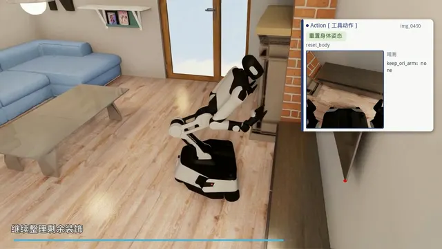](assets/frames/ending-astra-01.webp) | [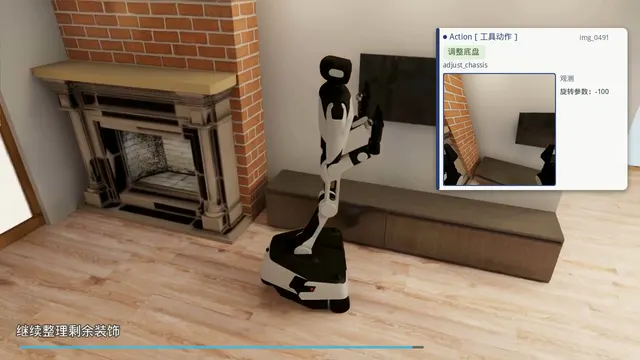](assets/frames/ending-astra-02.webp) | [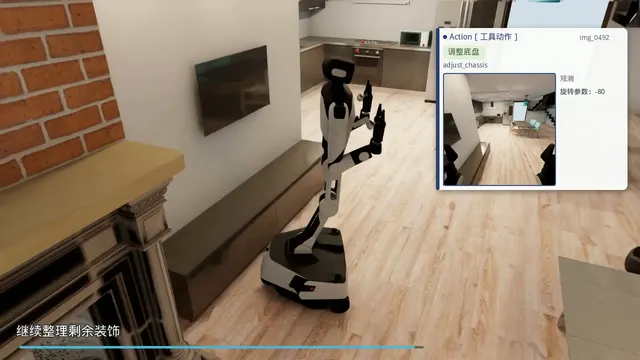](assets/frames/ending-astra-03.webp) |
| --- | --- | --- |
| 1 秒 | 6 秒 | 11 秒 |

| [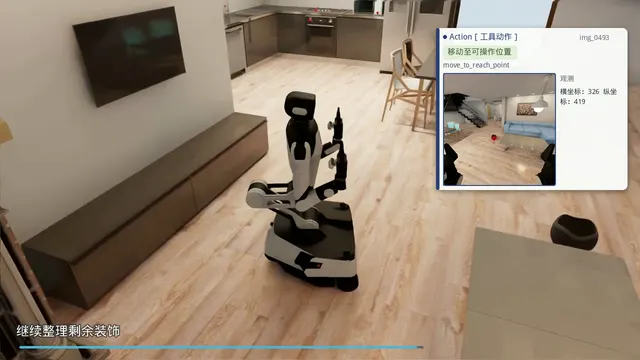](assets/frames/ending-astra-04.webp) | [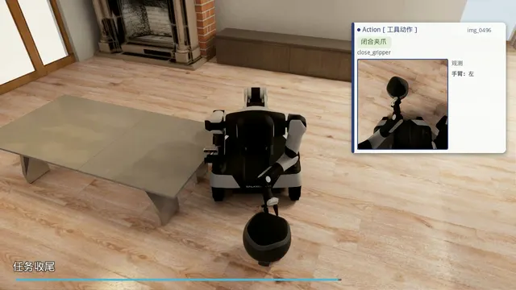](assets/frames/ending-astra-05.webp) | [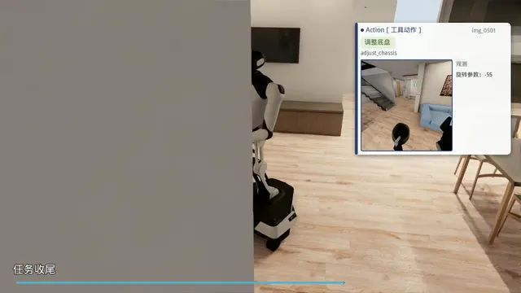](assets/frames/ending-astra-06.webp) |
| --- | --- | --- |
| 16 秒 | 22 秒 | 28 秒 |


### 收尾过程 · G0.5 无原生思维链

[播放录像](assets/clips/ending-purple.mp4)

| [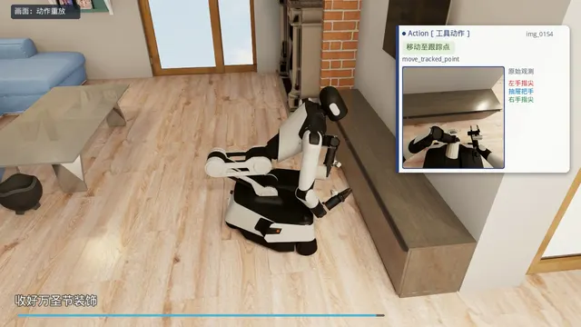](assets/frames/ending-purple-01.webp) | [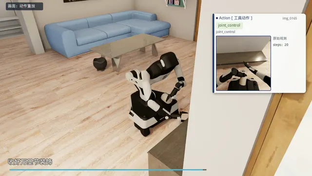](assets/frames/ending-purple-02.webp) | [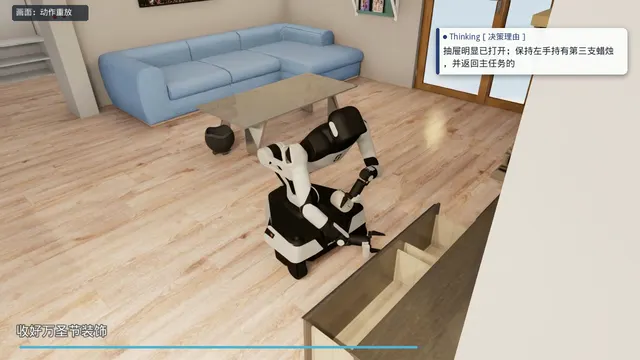](assets/frames/ending-purple-03.webp) |
| --- | --- | --- |
| 1 秒 | 6 秒 | 11 秒 |

| [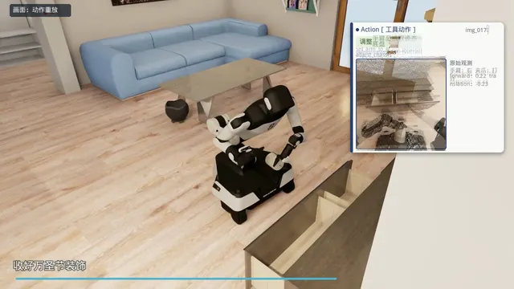](assets/frames/ending-purple-04.webp) | [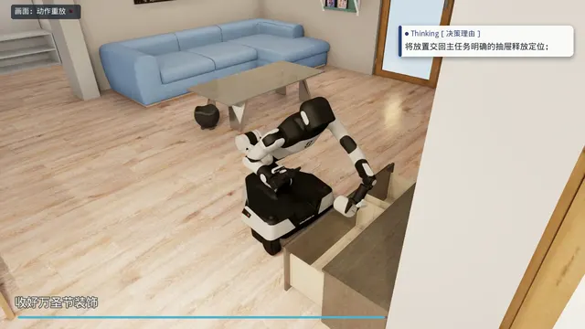](assets/frames/ending-purple-05.webp) | [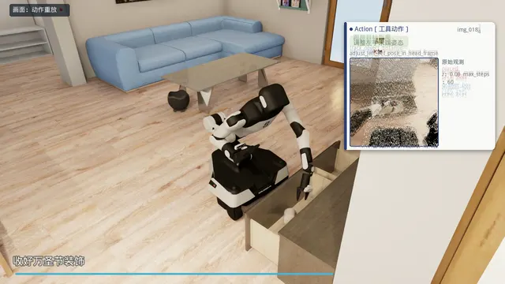](assets/frames/ending-purple-06.webp) |
| --- | --- | --- |
| 16 秒 | 22 秒 | 28 秒 |


### 收尾过程 · G0.5 有原生思维链

[播放录像](assets/clips/ending-pink.mp4)

| [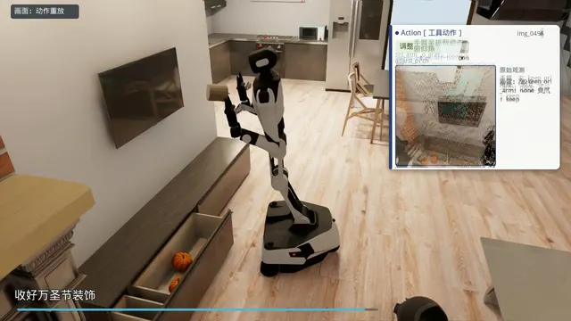](assets/frames/ending-pink-01.webp) | [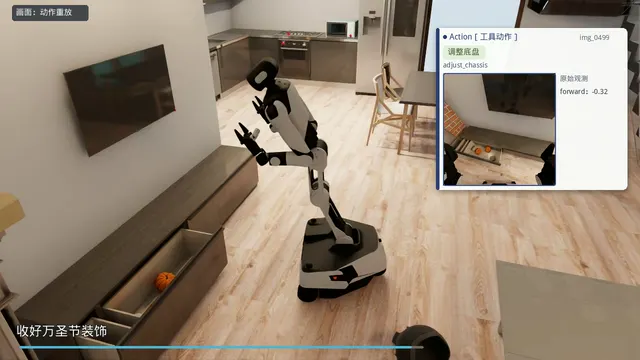](assets/frames/ending-pink-02.webp) | [](assets/frames/ending-pink-03.webp) |
| --- | --- | --- |
| 1 秒 | 6 秒 | 11 秒 |

| [](assets/frames/ending-pink-04.webp) | [](assets/frames/ending-pink-05.webp) | [](assets/frames/ending-pink-06.webp) |
| --- | --- | --- |
| 16 秒 | 22 秒 | 28 秒 |
