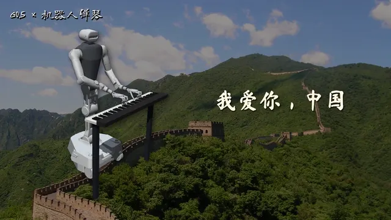
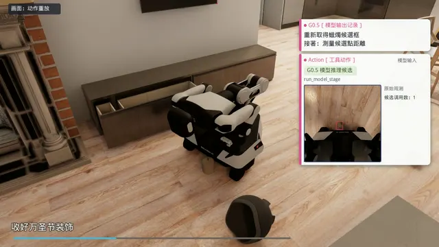

# 星海图 G0.5 仿真复现专题

本专题从双手弹琴、叠衣服与桌面整理、万圣节收纳三个案例出发，学习怎样把星海图 G0.5 接入不同的仿真控制流程，并用原生评测、关节动作和视频逐步排查问题。

| 章节 | 实践 | 完整视频 |
| --- | --- | --- |
| [01 · 双手弹琴](01-双手弹琴.md) | 运行 MuJoCo［物理仿真引擎］回放，读出琴键触发，理解移动琴键后的重新对准 | [B 站](https://www.bilibili.com/video/BV1FhHW6dERA/) |
| [02 · 叠衣服与桌面整理](02-叠衣服与桌面整理.md) | 在 RoboDojo 对齐固定场景，比较 G0.5 动作、上层控制与两者协作 | [B 站](https://www.bilibili.com/video/BV1HMJY61ENP/) |
| [03 · 万圣节收纳](03-万圣节收纳.md) | 在 RoboHarness 拆解长程任务，比较同一实例的三条完整动作流 | [B 站](https://www.bilibili.com/video/BV1huyezgEAH/) |

[](01-双手弹琴.md)
[](02-叠衣服与桌面整理.md)
[](03-万圣节收纳.md)

## 一键复核和观看

从本专题目录运行。Python［脚本运行环境］3.9 或以上即可，无需下载权重或启动仿真服务。

```bash
python3 reproduce.py
```

打开 `reproduction-output/index.html`。页面可播放 15 段示范录像、放大 95 张带时间的画面，并查看分数。脚本重算 30 个正式 RoboDojo 回合的配对结果，检查一条原始叠衣动作轨迹，并逐条核对万圣节三条完整动作流的序号、维度和散列。机器可读结果在 `reproduction-output/report.json`。可用 `--output` 指定另一个输出目录。

## 三次共学练习

1. 在弹琴片段中定位抬手、移琴、恢复和落手的时刻，沿原教程理解执行器目标如何产生琴键触发。
2. 对照同一随机布局的三段叠衣录像，找到开始出现结果差异的时刻，并用正式回合表核对分数。
3. 对照万圣节的九段录像，追踪一次动作候选、观测更新和阶段交接，再用程序核对完整动作序列。

## 复现路线

| 路线 | 你会运行什么 | 环境 |
| --- | --- | --- |
| 录像与数据复核 | `python3 reproduce.py` | 只需 Python［脚本运行环境］ |
| 琴键物理接触回放 | `python reproduce.py --piano` | MuJoCo 3.1.6 和 NumPy 1.26.4 |
| 叠衣服与万圣节动作回放 | 配置第 02、03 章的环境后，运行 `simulation_replay.py` 发送已保存的动作 | 原始仿真资产、版本和机器配置 |
| 发起新推理 | 按章节启动策略服务或上层控制器 | 对应仿真环境、模型检查点和推理权限 |

录像来自原始仿真回合或已发布演示。[素材索引](data/media.json)记录每张画面在片段中的时间、对应方法和场景。权重与第三方仿真资产从其维护者发布渠道获取。星海图模型及动作接口的上游资料见[技术报告](https://opengalaxea.github.io/G05/)和[GalaxeaVLA 仓库](https://github.com/OpenGalaxea/GalaxeaVLA)。

详见 [代码和素材来源](SOURCES.md)。
