# 🤖 AI ハードウェアとロボティクスのチュートリアル 🛠️

[中文](./README.md) | [English](./README.en.md) | 日本語

  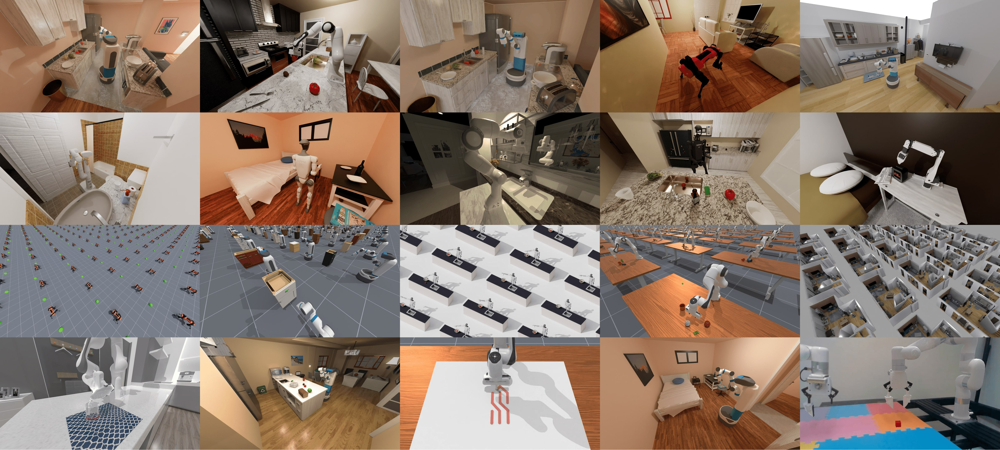

    <strong>ロボティクスの技術を学ぶための、ワンストップのオープンソースのチュートリアル集</strong>
  

    <a href="#-プロジェクトの紹介">紹介</a> •
    <a href="#-table-of-contents">目次</a> •
    <a href="#-学習パスの提案">学習パス</a> •
    <a href="#-動作環境">動作環境</a> •
    <a href="#-update-log">更新履歴</a>
  

   

   

   

## 📖 プロジェクトの紹介

このリポジトリは、AI ハードウェアとロボティクスの技術に関するチュートリアルの資料を集めて整理したもので、ロボットのシミュレーション環境の構築、制御アルゴリズムの実装、ハードウェアの開発、ハンドアイコーディネーションなど、さまざまな分野をカバーしています。ロボティクスの技術を学ぶ初心者や研究者が、学習や参考に使えます。

💡 **このチュートリアルを選ぶ理由**

- 📚 充実した内容：基礎から応用までの体系的な学習パス
- 🔧 実践重視：実践的なコード例と応用事例を数多く収録
- 🌐 継続的な更新：最新の技術の進展と応用の動向を追跡
- 👨‍👩‍👧‍👦 コミュニティのサポート：交流と問題解決のための場を提供

## ✨ 最新のハイライト

- **[2026-10-25]** [HIL-SERL と MuJoCo による挿入（中国語のガイド）](./05-具身场景的深度和强化学习/08-HIL-SERL人机协同强化学习与MuJoCo插孔/README.md)：図解による介入データの流れ、2 つのリプレイバッファー、挿入の成功基準、公式の Panda のシミュレーションと学習の入口。

- **[2026-10-23]** [Agnes Harness のデバイスのデモ（中国語のガイド）](./06-策略抓取或抓取VLA/大模型控制、VLA、VLM/11Agnes-Harness多设备Demo/README.md)：固定したソース、Ubuntu のセットアップ、実際の仮想デバイスでの確認、プラグインのテスト、要点を絞ったスクリーンショット。手動のルートとシミュレーションのモデルのルートでは、API キーは不要です。

### 🍳 スマートホームアシスタント

新しい家庭用ロボットのモジュールは、次のような複数のキッチンの作業をこなせます。

- 物体の認識と把持（野菜、果物、キッチン用品など）
- 環境の清掃と整理（詳しいチュートリアルは今後追加予定）

### 🧠 強化学習フレームワーク

新しい強化学習のモジュールは、次に対応しています。

- 複数のアルゴリズムの実装（PPO、SAC、TD3 など）
- 模倣学習から強化学習へのハイブリッドな学習
- 性能の評価と可視化のツール

  <table>
    <tr>
      <td>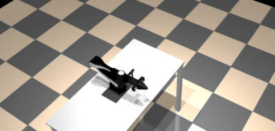</td>
      <td>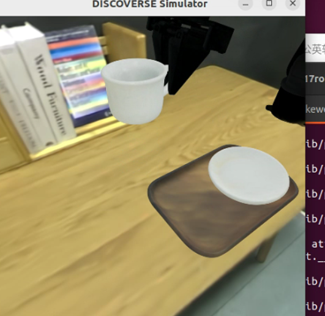</td>
      <td>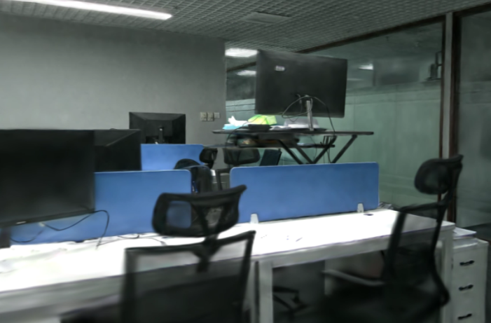</td>
    </tr>
    <tr>
      <td>ロボットアームの光と影のレンダリング</td>
      <td>コーヒーを取ってくる</td>
      <td>屋内の Gaussian Splatting</td>
    </tr>
    <tr>
      <td>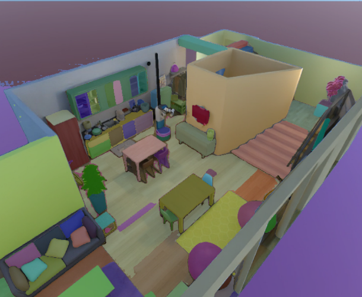</td>
      <td>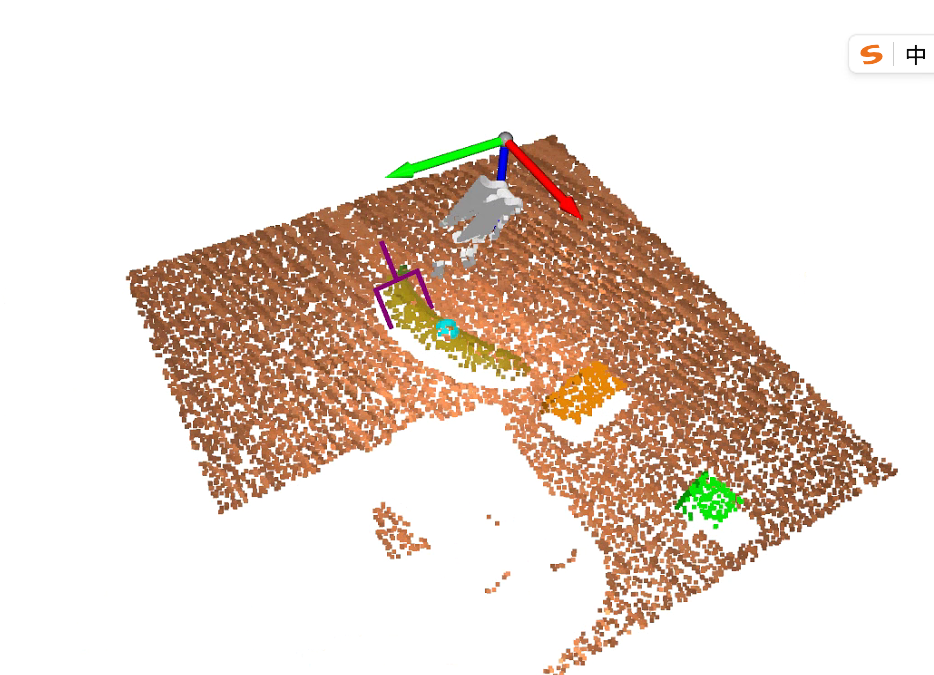</td>
      <td>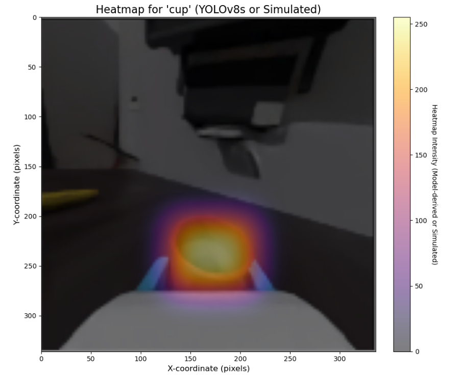</td>
    </tr>
    <tr>
      <td>屋内シーンのセグメンテーション</td>
      <td>ロボットアームによるバナナの把持</td>
      <td>把持のアテンションの可視化</td>
    </tr>
        <tr>
      <td>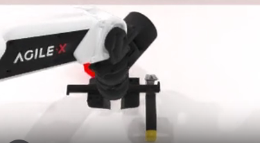</td>
      <td>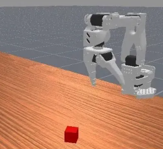</td>
      <td>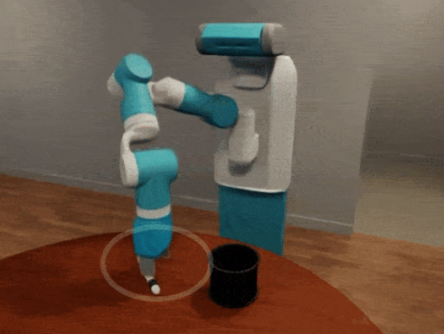</td>
    </tr>
    <tr>
      <td>Robotwin 1.0 の再現</td>
      <td>Lerobot のシミュレーション対応</td>
      <td>OmniGibson</td>
    </tr>
    </tr>
        <tr>
      <td>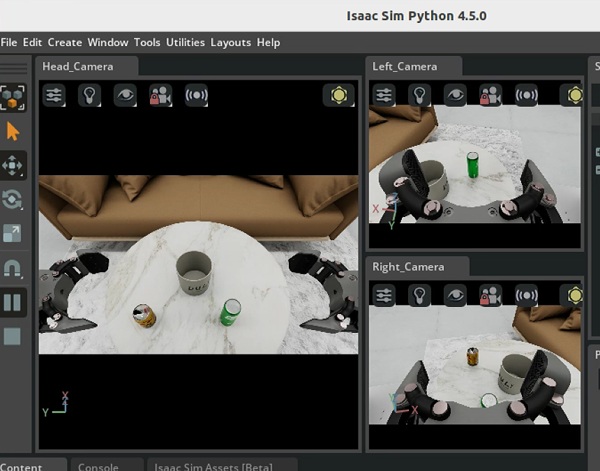</td>
      <td>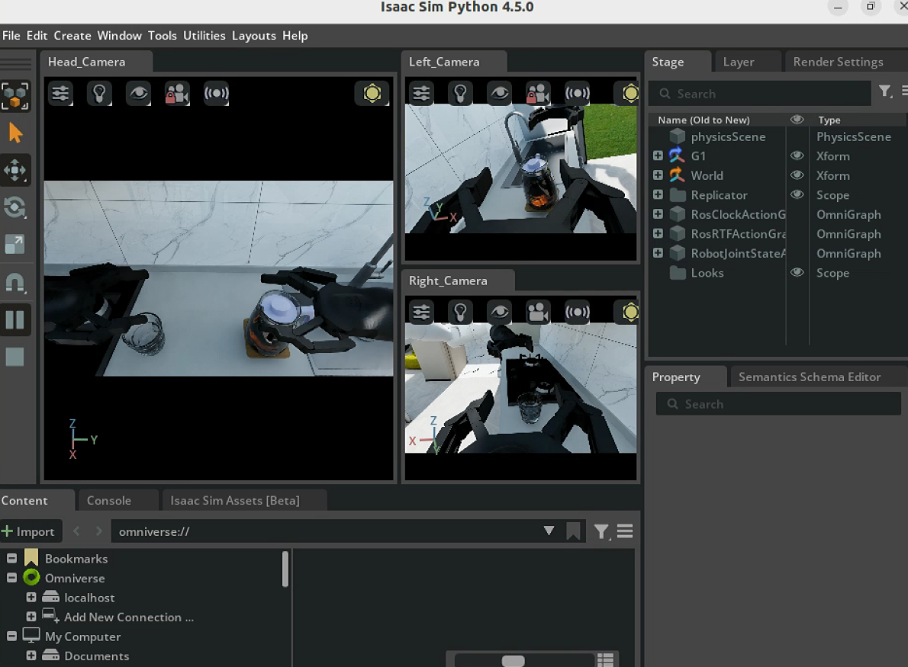</td>
      <td>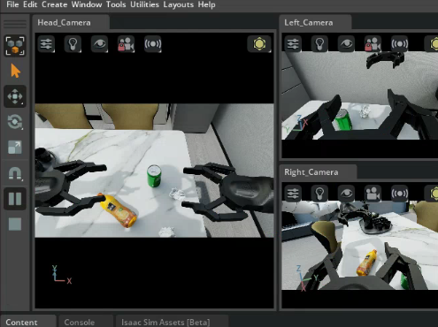</td>
    </tr>
    <tr>
      <td>Zhiyuan のロボットのマルチタスク 1</td>
      <td>Zhiyuan のロボットのマルチタスク 2</td>
      <td>Zhiyuan のロボットのマルチタスク 3</td>
    </tr>
        </tr>
        <tr>
      <td>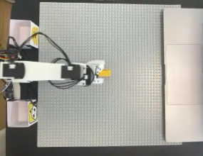</td>
      <td></td>
      <td></td>
    </tr>
    <tr>
      <td>DiGua RDK-X5 を lerobot-so101 に接続して遠隔操作</td>
      <td>Zhiyuan のロボットのキーボード操作</td>
      <td>Zhiyuan のロボットの軌道の記録</td>
    </tr>
  </table>
  

## 軽量なワールドアクションモデル

- [SmolWAM（中国語のガイド）](./06-策略抓取或抓取VLA/大模型控制、VLA、VLM/12SmolWAM轻量世界动作模型/README.md)：Cosmos Policy から抽出した 5 つのインターフェースの変更と、3 つの公式の図、LIBERO での結果、推論と学習の入口。

## 🚀 学習パスの提案

### 身体性 AI ロボット

1.  **身体性知能の概要**
    *   定義と背景
    *   発展の歴史
    *   応用分野

2.  **ロボットの基礎**
    *   ロボティクスの基本概念
    *   運動学と動力学
    *   センサーとアクチュエーター
    *   ロボットのハードウェアの選定
    *   DiGua Robot RDK の使い方と LeRobot SO101 への接続
    *   Ajiaxi 開発ボードのチュートリアル
    *   回路設計（todo）
    *   AutoCAD と Solidworks（todo）
    *   通信プロトコル（todo）
    *   ROS の基礎（todo）

3.  **コンピュータービジョン**
    *   画像処理の基礎
    *   物体の検出と認識
    *   画像のセグメンテーション
    *   姿勢推定

4.  **ロボットの制御**
    *   動作計画
    *   経路計画
    *   制御アルゴリズム

5.  **身体性のシーンにおける深層学習と強化学習**
    *   強化学習

6.  **ハンドアイコーディネーション**
    *   ハンドアイキャリブレーション
    *   把持と操作

7.  **シミュレーション環境の学習**
    *   Issac Sim/Issac Gym
    *   Pybullet
    *   Gazebo（todo）
    *   Genie-Sim

8.  **身体性知能の最先端プロジェクト（再現）**
    *   Google の身体性プロジェクト：RT-RT1、RT2、RTX（todo）
    *   OmniGibson
    *   BitVLA
    *   RoboBrain2.0（todo）
    *   Aloha-ACT（todo）
    *   OpenVLA（todo）
    *   Octo（todo）
    *   AngGrasp（todo）
    *   そのほかの論文の再現とコード

## 🔧 動作環境

- Python 3.8+
- CUDA のサポート（3D シミュレーションのレンダリング用。一部の実験は CPU でも実行できます）
- ROS/ROS2（任意。実際のロボットの制御用）
- MuJoCo（物理エンジン）
- Isaac Sim（NVIDIA の高度なシミュレーションプラットフォーム）

参加と貢献をしてくださった、次の仲間に感謝します。

howe, Miles, Maimang, HAO

翻訳に貢献してくださった、次の仲間に感謝します。

-   第 1～3 章 Lune
-   第 4～5 章 Liu Yuanyang
-   第 6～7 章 Su Jiayu
-   第 8～9 章 Liang Jianbin leoliang023

## 🌟 学習コミュニティ

-   [ディスカッショングループに参加する](#)：ほかの学習者と経験を交換できます
-   [FAQ](#)：よくある質問と解決策を確認できます
-   [技術共有会](#)：定期的にオンラインで技術共有会を開催しています

## 👨‍💻 コントリビューションガイド

チュートリアルやサンプルコードを増やすための Pull Request を歓迎します！👏

1.  このリポジトリをフォークします
2.  Pull Request を作成します

投稿する内容は、リポジトリのテーマに関連し、既存のファイル構成に従ったものにしてください。

## 📬 連絡先

質問や提案があれば、次の方法でご連絡ください。

-   💬 WeChat 公式アカウント：datawhale
-   🌐 Web サイト：[https://datawhale.club/home]
