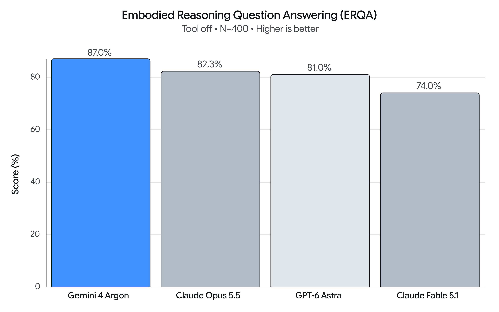

<!-- Generated by the offline translation workflow.
Source: 06-策略抓取或抓取VLA/具身上下文工程/01-Gemini-Argon机器人上下文工程案例.md
Source SHA-256: 8832d9b31ace90188b5eb9c4ab76afecce8fab90ffecf39297b8e0649b37ebe4
Model: tencent/Hy-MT2-1.8B-GGUF:Q4_K_M
Review machine-translated technical claims before relying on them.
-->
# Gemini 4 Argon Robot Case: From Prompt to Verifiable Execution Closed Loop

> Source: [ Google Developers Blog, Gemini 4 Argon for Robotics](https://developers.googleblog.com/gemini-4-argon-for-robotics/), Kanishka Rao, 2026-10-13. This article is a Chinese compilation and teaching analysis. The cases, performance, and data are from the original report, not actual measurements in this tutorial. The videos and images in the article are from the original source and have been authorized for inclusion.

Google describes Argon as a general-purpose model for physical reasoning and code generation, with applications in robot control, Real2Sim, physical understanding, and self-improvement. The common structure of its examples is: **provide the model with tasks and observable states, define tools and actions, then use real or simulation feedback to evaluate results and update the next step**. In addition to the model capabilities, the camera, calibration, action interface, simulator, and validation method collectively determine whether the experiment can proceed.

*Image source: Google Developers Blog; included with permission.*

## 1. Robot Control

### 1.1 Spot manipulation operation: simulate first, then press the pedal

[▶ Watch the original demo video ](../../../06-策略抓取或抓取VLA/具身上下文工程/assets/Spot-can-long-voiceover-preview.mp4) (Source: Google Developers Blog)

The task is for Spot to locate beverage cans, step on the pedal of the trash can, and deposit them. The description indicates that the system first builds a jointed MuJoCo trash can model for practice in simulation; before execution, check whether the front right foot is aligned with the pedal, and verify the positions of the stepping and robotic hand inside the can respectively.

**Key points**: Identify the status of the moving chassis, robotic arm, and foot pedal; provide front view and wrist view; perform a clear visual inspection before releasing the object. Dual verification is a design feature in the system process, not indicating that two verifiers are naturally independent and reliable.

### 1.2 Zero-sample robotic arm: Image scale and action primitives

[▶ Watch the original demo video ](../../../06-策略抓取或抓取VLA/具身上下文工程/assets/yam_control.mp4) (Source: Google Developers Blog)

The task is to correct the position of the fallen cup, and then place a paper towel inside the cup. The model receives wrist camera images and status files: a world coordinate grid, gripper center, opening and closing direction, and object orientation are overlayed on the image; the status includes end position, whether an object is held, execution status, and workspace.

Available actions include observation, pixel back projection, grasping, placement, movement, and contact stopping. The original text requires observing the updated image after each execution, and re-observing if grasping fails. It also offers three call frequencies: coarse-grained, pre-grasping hover inspection, and fine-grained visual servo.

**Key points**: The annotations must explain the coordinate axes, units, height plane, and gripper orientation; the status must be up-to-date; the action return value and image together determine the next round. The original interface and parameters belong to this demonstration environment and cannot be used as a general robot API.

### 1.3 Closed Loop Guidance for the World Model

[▶ Watch the original demo video ](../../../06-策略抓取或抓取VLA/具身上下文工程/assets/omni_control_final_2.mp4) (Source: Google Developers Blog)

The model generates frames in sequence, and writes action descriptions with timestamps for each round, so that the hands in the video arrange letters. The original text requires describing an action in a simple direction at a time, keeping the inactive hand out of sight, and indicating which areas become empty after the object is moved away.

The action instructions here control the **world model generation**; the intermediate frames are used for the next round of revision and cannot be considered as the real robot completing the same task directly.

## 2. Real2Sim: Converting Real Observations into Verifiable Simulation

### 2.1 Robot Perspective Reconstruction

[▶ Watch the original demo video ](../../../06-策略抓取或抓取VLA/具身上下文工程/assets/real2sim_final.mp4) (Source: Google Developers Blog)

Input consists of real teleoperation trajectories and synchronized camera and tactile data. The goal is to construct a MuJoCo scene, replay each frame, and compare it with multi-camera images and the time, magnitude, and direction of fingertip contact forces. The geometry, mass, friction, and initial position of the object can be adjusted, as well as local control commands within the range specified in the original text. External force manipulation, instantaneous movement of objects, or replication of real tactile values is prohibited to simulate contact.

**Key points of context**: Define visual matching, physical matching, allowable variables, and prohibited shortcuts simultaneously; merely looking at visual similarity is not sufficient to prove consistent contact dynamics.

### 2.2 Simulation from First-Person Human Videos

[▶ Watch the original demo video ](../../../06-策略抓取或抓取VLA/具身上下文工程/assets/human_real2sim_2.mp4) (Source: Google Developers Blog)

Enter the first-person manipulation video, candidate viewpoints, and three-dimensional hand key points. The original task requires identifying objects related to the task, handling concave collision geometry of the container, redirecting the hand trajectory to the dexterous hand with two arms, and checking clamping, lifting, and final placement in a 500 Hz simulation.

**Key points of context**: Images, camera parameters, key points, and robot joint definitions are different information sources; "seemingly captured" is a different verification goal from physical contact stability.

### 2.3 From Sketch to Simulation

[▶ Watch the original demo video ](../../../06-策略抓取或抓取VLA/具身上下文工程/assets/sketch_to_sim_final.mp4) (Source: Google Developers Blog)

Enter a hand-drawn sketch of a humanoid robot throwing a ball to knock over a box; the example requires constructing a scenario, generating a full-body throwing trajectory, and checking balance and the target falling status in physical simulation. The sketch provides the task intent and relative layout, while the robot size, dynamics parameters, control frequency, and success criteria need to be specified separately.

## 3. Physical Understanding: Extracting Available Information from Trajectory

### 3.1 Post-hoc Annotation and Quality Judgment

[▶ Watch the original demo video ](../../../06-策略抓取或抓取VLA/具身上下文工程/assets/aloha2_origami_hindsight_1.mp4) (Source: Google Developers Blog)

For the two-armed origami videos, the original text generates time-stamped annotations at four levels: task objectives, consecutive sub-tasks, contact-level actions, and quality control. For segments that do not advance tasks, such as sliding and retries, the progress remains unchanged, and the weight of behavior cloning samples is reduced. These annotations can be used to construct data, but it is necessary to verify whether the boundaries, contact events, and weights are reasonable.

### 3.2 Balance Scale for Finding Abnormal Balls

[▶ Watch the original demo video ](../../../06-策略抓取或抓取VLA/具身上下文工程/assets/weight_puzzle_2.mp4) (Source: Google Developers Blog)

In the example, a dual robotic arm and twelve balls with identical appearances are constructed. The system locates them using stereo images and reads the balance tilt, identifying the heavier or lighter ball within three weighings. The context requires maintaining the set of candidates for each weighing and the results; the original text separates the environment construction from the solver that only uses visual and robotic state information, avoiding the reading of hidden answers.

### 3.3 Task Progress and Value Estimation

[▶ Watch the original demo video ](../../../06-策略抓取或抓取VLA/具身上下文工程/assets/umi_progress_labeling_final_1.mp4) (Source: Google Developers Blog)

The model views synchronized videos of the head and the left and right grippers, marking changes in contact, task segments and progress improvements, as well as pauses or declines. The progress curve is an estimate derived from the video and must be compared with the annotation rules and actual task results. It cannot be used alone to prove that the model has learned transferable value functions.

## 4. Research and Self-Improvement

### 4.1 Improving Simulation Data for VLA

[▶ Watch the original demo video ](../../../06-策略抓取或抓取VLA/具身上下文工程/assets/action_improvement_final.mp4) (Source: Google Developers Blog)

The original description describes constructing a simulation environment from real desktop images, designing tasks and randomization data, and generating over 4,500 trajectories for VLA fine-tuning. Google reported in the experiment that the success rate of the real robot increased from **56% to 75%**, and the completion time decreased from **35 seconds to 24 seconds**. These are the reported values for this case; the article does not provide all the training and evaluation details necessary to fully reproduce the experiment here.

### 4.2 Multiple Improvements in Grabbing the Real Robot

[▶ Watch the original demo video ](../../../06-策略抓取或抓取VLA/具身上下文工程/assets/so101_final.mp4) (Source: Google Developers Blog)

The example first locates the object and generates a trial plan for non-moving hardware, then hovers to observe, and finally executes grasping and releasing, using logs and videos to diagnose failures, adjust, and retry. The original text shows that the three rounds took 58.9, 22.9, and 17.4 seconds respectively, with the second round touching the box edge. This demonstrates task execution and iterative improvement of parameters; it does not indicate that the system has achieved recursive self-improvement (RSI).

### 4.3 Reproduction of Robot Paper Browser

[▶ Watch the original demo video ](../../../06-策略抓取或抓取VLA/具身上下文工程/assets/recreating_robotics_papers_1.mp4) (Source: Google Developers Blog)

Enter the paper and optional weights or robot assets, and request the construction of the MuJoCo WebAssembly environment, the execution of the controller, and a browser check. The original text presents several motion control studies. No errors and non-zero progress only verify that the example runs basicly; whether the conclusions of the paper can be reproduced still requires alignment of models, control frequency, task protocol, and metrics.

*ERQA test diagram in the Google original text; the test results and conditions are based on the original text.*

## 5. Design methods derived from cases

| Module | Required to provide or record | Example |
| --- | --- | --- |
| Goal and Phase | Final goal, current sub-task, completion criteria | Placing the cup upright before putting a paper towel on it |
| Real-time Observation | Camera, status, timestamp, failure indicator | Wrist image, end position, gripper status |
| Spatial约定 | Coordinate system, unit, calibration and error | World coordinate grid, pixel back-projection |
| Tools and Constraints | Actions allowed, parameter range, stop conditions | Grabbing, moving, stopping after contact |
| Verification and Memory | Execution results, historical attempts, reasons for failure | Re-examining after failure in each image verification round |
| Data and Evaluation | Data source, segmentation, metrics and resources | Comparing success rate and time consumption under the same task setting |

These cases show that the context is not limited to a single piece of natural language prompt: visual scales, structured states, history records, tool outputs, and task criteria are all decision inputs. Next, you can use the [ practice template ](02-robot-context-design-and-practice-template.md) to fill in the information for your system.

## Original Text Viewing Entry and Citation

[ original page, 12 demonstration videos, and charts ](https://developers.googleblog.com/gemini-4-argon-for-robotics/). The original text also reports an ERQA score of 87%; this is a report from Google on the specified testing settings, and it cannot be directly used to determine the success rate of tasks on real robots.
